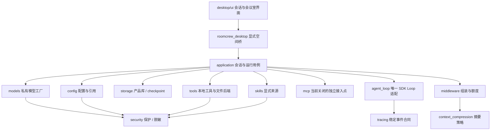
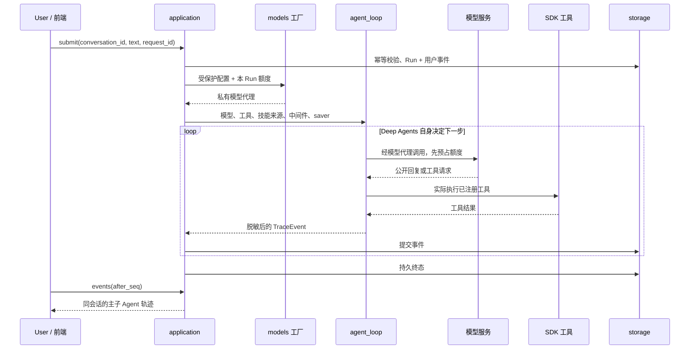
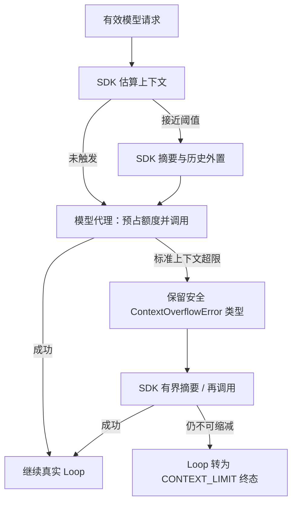

# ADR-0003：按职责拆分后端执行底座

状态：已接受，依据用户明确要求。此次目标是保留 V1 会话应用，建立可以扩展的代码边界；不启用安全 VM、MCP、Shell 或浏览器。

2026-10-27 更新：最新实现由 [ADR-0009](0009-agent-foundation.md) 覆盖。MCP 与隔离 Python 已接入；assets、presentation、StudioService 和旁白已迁至 desktop，后端不包含动作协议。下文保留初始分层背景，不能用旧目录指导新增表现代码。

新增人物仓库、单向表现协议、空间与真实人工恢复的分层扩展见 [ADR-0004](0004-studio-interaction.md)。执行器仍不依赖表现服务，实际依赖白名单由自动检查维护。

## 从外到内理解代码



界面提交普通命令，应用层管理会话和 Run，执行器组装模型、文件后端、工具、技能和中间件，再交给 Deep Agents。Loop 返回普通 `TraceEvent`，应用层提交 SQLite，界面按游标读取。图框架不直接管理产品表，动画和页面状态不能决定实际执行成功。

## 源码目录与职责

```text
backend/src/roomcrew/
├── application/
│   ├── workspaces.py                 多空间 Runtime 装配与明确身份路由
│   ├── runtime.py                    单空间应用门面、生命周期
│   ├── execution.py                  Run 幂等、组件装配、停止与终态
│   ├── artifacts.py                  真实产物列表与预览
│   └── options.py                    本 Run 的不可变组装参数
├── agent_loop/
│   ├── engine.py                     create_deep_agent 与公开事件流
│   ├── event_adapter.py              SDK 事件转产品轨迹
│   ├── messages.py                   公开文本投影
│   └── prompts.py                    通用提示，不含业务专用答案
├── config/
│   ├── schema.py                     模型配置结构、安全回读
│   ├── validation.py                 端点、凭据沿用、代理、数值纯校验
│   └── store.py                      加密文件存取和损坏恢复入口
├── models/
│   ├── factory.py                    可信 SDK 创建，唯一读取真实参数处
│   ├── private_chat.py               代理、工具绑定、输出过滤、额度
│   ├── connection.py                 用户连接探测
│   └── errors.py                     SDK 错误分类与安全异常类型
├── context_compression/
│   ├── policy.py                     摘要输入预算和可选提示
│   └── deepagents_adapter.py         公共工厂创建默认摘要槽位替代项
├── middleware/
│   ├── stack.py                      每次构图组装独立中间件实例
│   └── limits.py                     每 Run 共享模型调用额度
├── security/
│   ├── windows_dpapi.py              Windows 用户级保护
│   ├── redaction.py                  秘密回显递归过滤
│   ├── paths.py                      统一任务虚拟路径校验
│   └── capabilities.py               拒绝误开启尚未实现的能力
├── tools/
│   ├── clock.py                      真实本机时间工具
│   └── registry.py                   注册本地工具与文件后端
├── mcp/
│   └── provider.py                   当前关闭入口；不是已实现客户端
├── skills/
│   └── registry.py                   显式来源校验，交给 SDK 渐进加载
├── storage/
│   ├── sessions.py                   产品会话 / Run / 轨迹 SQLite
│   └── checkpoints.py                框架 saver 生命周期
├── tracing/events.py                 不包含 SDK 类型的轨迹合同
├── contracts/
│   ├── errors.py                     稳定错误码及公开含义
│   └── limits.py                     有界执行参数
└── platform/paths.py                  安装资源与本机数据定位
```

桌面已按 [ADR-0007](0007-workspace-rooms.md) 提取到根 `desktop/`：界面在 `desktop/ui/`，窗口、桥、线程宿主和入口在 `desktop/src/roomcrew_desktop/`。根 `frontend/` 只预留管理员 Web 界面。

包的 `__init__.py` 只说明职责，不把所有实现重新导出成一个大命名空间。原平铺 `runtime.py`、`configuration.py`、`models.py`、`desktop.py`、`storage.py`、`paths.py` 已移除，不保留一套旧实现或转发兼容壳。

## 依赖规则与框架边界

- `agent_loop/` 可以使用 Deep Agents / LangChain，但不能依赖 config、models 工厂、application、desktop 或产品数据库；组件和脱敏能力由外层注入。
- `models/` 是真实 SDK 与配置的可信结合处。配置参数不进入 Loop 的输入参数，Loop 只拿已构建的模型接口。
- `context_compression/` 根据公开模型能力建立压缩器，不读取配置文件、不存取产品 SQLite。
- `middleware/` 组装跨调用策略。`ModelCallBudget` 位于模型调用边界，先预占再进入 SDK。
- `security/` 不反向依赖配置或用例。DPAPI 只处理字节；配置仓库负责 JSON 与用户错误。
- 根 `desktop/src/roomcrew_desktop/` 不导入 SDK。前后端之间仍是普通字典和产品 ID，不传图、模型或 checkpoint 对象。
- `application/` 是组合层，允许连接各模块；它不解析 SDK 事件或重复实现工具、路径、压缩和密码保护。
- `storage/` 把产品表和框架 saver 分开；跨库不具备同一原子事务，不宣称工具恰好执行一次。

`backend/tests/test_layers.py` 解析实际导入，包括方法内延迟导入；防止依赖反向。新增包应先说明职责和依赖变化，再修改规则。

## 一次运行怎么流动



每 Run 新建模型、图、事件适配器和中间件实例；主子 Agent 刻意共享本轮 `ModelCallBudget`，避免通过委派或压缩重置额度。不同 Run 不共享可变上下文。首版调度仍同时只执行一个会话，不把本次拆分描述成已实现通用并行调度器。

主 Agent 与通用 worker 都交给同一 Deep Agents 底座创建；显式 worker 配置使主子两边有独立中间件实例。后续增加中间件应通过 `middleware/stack.py`，而非散落在各角色构图代码中。

## 压缩和错误恢复



`build_compression()` 使用公开 `create_summarization_middleware()`，返回默认槽位的同名替代项。因此仍只有一个摘要机制，不改 SDK 源码、不读取其私有摘要字段。

`trim_tokens_to_summarize` 限制送给摘要模型的旧历史输入，不是触发阈值，也不是输出长度。触发与保留阈值继续根据模型公开能力由 SDK 决定。SDK 按消息裁剪时，单条超大消息可能无法装入较小的摘要输入预算；原始历史外置和产品轨迹仍保留，不能把“发生过压缩”当作摘要一定保留全部事实的证明。

模型代理对普通错误返回稳定错误码；对标准上下文超限保留已去掉正文的异常类型，让 SDK 识别恢复。若把它提前统一变成一般 400 错误，压缩恢复会失效。认证、限流和普通请求错误不会因这一机制自动重试。

调用额度包含主 Agent、worker 和摘要的真实 SDK 入口预占。上限在网络调用前检查；它不代表精确账单，网络失败也占用一次尝试。SDK 普通自动重试仍关闭，框架压缩修复有界且同样消耗额度。

## Skills 与 MCP 的实际状态

| 模块 | 当前已经具备 | 当前没有声称具备 |
| --- | --- | --- |
| skills | `SkillPolicy` 显式来源；限制在会话 `/skills/`；来源存在性验证；SDK 元信息先注入、正文经工具按需读取；主子 Agent 接入 | 用户技能管理界面、跨会话只读库、完整版本冻结、任意脚本执行 |
| mcp | 独立注册入口、默认关闭、不启动连接或进程；误启用明确失败 | 实际 MCP 会话、远程连接、凭据注入、工具客户端 |
| security | Windows DPAPI、脱敏、路径校验、能力约束 | 安全 VM、任意代码 OS 隔离、审批票据服务 |

技能文件是普通不可信内容，不赋予新权限。当前技能来源在会话文件树内，尚未承诺只读或版本不可变。MCP 关闭入口不是空装饰类：应用真实经过该入口，启用未实现路径会失败，防止静默装出一个假工具集合。

## 后续如何扩展

1. **增加本地工具**：在 tools 中实现具名、带中文背景及步骤的工具，注册到 registry；检查实际执行范围。Loop 和桌面 API 不需要知道具体工具内部逻辑。
2. **接入 MCP**：在 mcp 中实现经过验收的连接和工具加载生命周期，在应用装配点接入异步资源管理。不能只改 enabled 就开放；凭据与执行约束继续由可信服务负责。
3. **增加 Skills 管理**：用户配置先验证来源；只读、版本与跨会话分发在 skills 中扩展。SDK 继续负责渐进展示，不一次把全部正文塞入提示。
4. **修改压缩策略**：只调整 context_compression 的参数和适配，stack 仍替换一个槽位；验证摘要输入、恢复、不可缩减情况及主子计数。
5. **新增模型协议**：在 models 实现适配，在 config 增加明确字段和能力验证。不能把厂商签名或私有续接字段混进普通轨迹。
6. **接入安全 VM**：在 security 与具体执行适配器实现真实边界，再逐项开放能力；不把 StateBackend、虚拟路径或独立协程说成 OS 隔离。
7. **扩展调度**：在 application/execution 演进队列、并发和任务恢复，Loop 保持 SDK 适配职责；产品状态和授权仍由应用掌握。

## 数据和验证

本次不改变默认数据根、加密配置 JSON 字段、SQLite 表结构、会话 thread ID 或前端命令字段。已验证原有功能回归，并以重构前已暂存实现实际生成的加密配置、产品数据和 checkpoint 测试新版继续原会话；暂存区只读使用，未修改。

检查不只看目录：依赖约束、SDK 边界、共享额度、Skills 真实工具读取、SDK 实际压缩、超限恢复和原生窗口都需要验证。测试中的模型响应服务不进入发行包，真实模型效果仍等待用户在应用中填入 Key。
