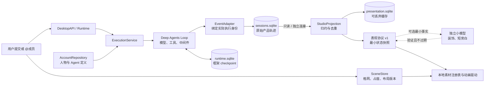
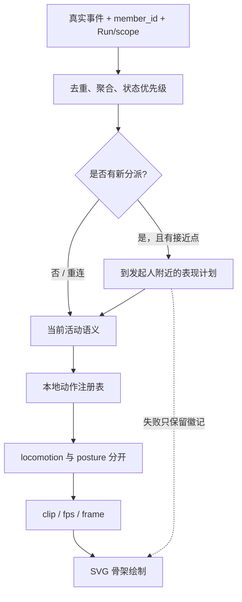
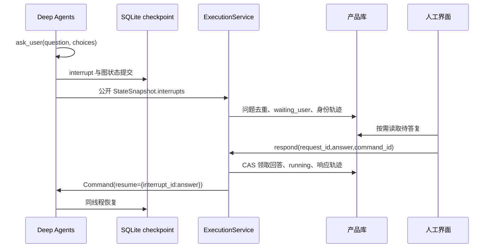

# ADR-0004：事务所交互、人物持久化与单向表现协议

状态：已实现本地原型；2026-10-26。基于用户最新授权，在 `codex/studio-interaction` 分支扩展 V1，不改用另一套 Agent Loop。本文覆盖旧文档中「房间与员工尚未实现」的范围描述；安全 VM、任意代码、MCP 和浏览器仍未开放。

## 1. 先区分四个对象

| 对象 | 身份与职责 | 本次实现 |
| --- | --- | --- |
| User / 老板 | 真实用户，提交、答复、取消任务 | 固定 `boss` 身份，可改名字和外观、坐沙发或换座 |
| Member / 人物 | 场景形象与显示属性 | 独立 `member_id`、名称、服装/肤色/发色、眼镜、外观引用和版本 |
| AgentDefinition | 可复用的职责与提示 | 独立 `agent_id`、版本、description、prompt、无秘密模型绑定引用 |
| Run / 执行上下文 | 一次受理及其执行证据 | 同一配置可以被不同人物使用；每个 Run 固定定义快照，主子 scope 分开 |

助手是普通 Agent 配置的系统人物。监管员只展示安全基础设施，**不是 Agent**，本次标明「安全 VM 未接入」。不能删除或停用老板、助手和监管员；普通员工可以停用，归档能力仅有后端入口。模型底层配置继续位于本机 DPAPI 文件，不进入账号元数据库。

同一会话可看到不同成员的连续轨迹，但人物的主线程上下文不混用：默认助手保留历史 `thread_id=conversation_id`，其他人物使用 `conversation_id::member_id`。Deep Agents 子任务由框架建立独立分支；同一个人物的多个分支由 `run_id + scope` 聚合展示，不能用 `agent_id` 保存可变任务上下文。当前仍限制全局一个活动执行；SDK 内部可以并行委派。

## 2. 最重要的依赖方向



执行器不知道前端、人物坐姿、帧号、模型旁白或动画确认。原始轨迹先落盘，表现服务在查询时异步消费，缓存写入不加入执行事务。投影和布局错误只降级画面，不更改任务。关闭页面、停止动画、旁白超时均不表示任务失败或成功。

人工答复是另一条有意改变执行的业务路径：`User → respond → 产品问题校验 → Command(resume=...) → 原图继续`。不得把它与动画回调、生活动作或旁白混在一起。

## 3. 前后端合同

保留原会话配置、事件和产物接口。新增接口只传普通 JSON，不传 LangChain / LangGraph 私有类型。

| 入口 | 输入 | 输出 / 保证 |
| --- | --- | --- |
| `studio_feed(after)` | 全局日志游标 | 协议版本、当前快照、游标、catching_up、degraded、人物显示属性、布局、偏好；无消息、工具参数或问题正文 |
| `member(id)` | 稳定人物 ID | 人工编辑所需完整定义；不注册为 Agent 工具 |
| `save_member(values, expected_revision)` | 白名单属性及版本 | CAS 保存；忙碌或待人工时拒绝更改定义；核心身份不可更改 |
| `submit(conversation,text,request_id,member_id)` | 人工任务与接单人物 | 固定主子定义，受理即返回；幂等标识绑定任务内容与接单人 |
| `member_events(member,conversation,after)` | 用户明确选中的人物及会话 | 每批最多 100 条，包含该人物所有真实 scope；空间默认不调用 |
| `questions(conversation?)` | 用户主动打开待答复 | 可恢复 Run 的未答复事项；不根据自然语言问号生成 |
| `respond(request,answer,command_id)` | 明确人工答复 | 校验未回答/未取消、原模型绑定、全局执行槽；同命令重试不再次执行 |
| `scene_move(member,anchor,revision)` | 人物、注册锚点、布局版本 | 占座、可达性和版本校验；返回表现移动计划，不改变 Run |
| `scene_edit(values,revision)` | 家具注册类型、整数格位置、版本 | 禁止越界、重叠、堵塞接近点或移动被占家具；支持移除未占家具的后端能力 |
| `configuration/save_configuration/test_connection` | `target=execution / presentation` | 两个独立加密文件，未知域拒绝；已存 Key 永不回显 |
| `preferences` | `narration_enabled: bool` | 必须单独配置表现模型后人工开启；默认关闭 |

### 表现状态示例

```json
{
  "protocol_version": 1,
  "member_id": "assistant",
  "source_seq": 148,
  "activity": "executing",
  "action_id": "work",
  "summary": "执行工具",
  "question_count": 1,
  "warning_count": 0,
  "active_contexts": 2,
  "active_runs": ["run-reference"],
  "requires_input": true,
  "assignment_seq": 139,
  "interaction_target": "boss",
  "origin": "rules"
}
```

`source_seq` 是源事件序号，`activity` 是事实语义，`action_id` 是注册素材动作；**不是任意帧号、脚本、路径或权限指令**。同一 source_seq 可追加兼容旁白，不能改变 activity。`reset` 表示需要应用当前快照；本版本传完整当前状态，512 条以内事件归约后批量合并，历史多批可用 catching_up 逐步追平。

### 确定性转换

| 真实事件或聚合事实 | 活动 | 默认动作 | 注意 |
| --- | --- | --- | --- |
| `run.started / task.assigned` | thinking / receiving | think / listen | 绑定真实人物，保存本次分派序号 |
| `model.started` | thinking | think | 不暴露隐藏思考 |
| 普通 `tool.started` | executing | work | 仅认结构化工具事件，正文「正在执行」无效 |
| `task` 工具在途 | delegating | talk | 接单人与被委派成员分别显示 |
| `tool.completed / tool.failed` | 回到剩余活动；错误加提醒 | 对应剩余活动 | 错误返回不是任务完成 |
| `human.requested` | question，或其他分支仍执行 | ask / 当前动作 + 问题徽记 | 基于已提交 interrupt；GraphInterrupt 不算工具失败 |
| `run.waiting_user` | question / waiting | ask / idle | 整个图暂停，问题持久化 |
| `human.responded / run.resumed` | 恢复剩余上下文 | 当前动作 | 不创建新的 Run 或重新提交原任务 |
| `task.completed / task.failed` | 清理该 scope | report / alert | 不能清掉相同人物的其他工作 |
| `run.completed` | reporting | report | 只表示本轮结束，仍需核对回复和产物 |
| `run.failed / interrupted` | warning | alert | 保留错误证据，不猜测已撤销副作用 |
| `run.cancelled` | stopped | idle | 已发生文件操作仍保留 |

优先级由上下文聚合决定：仍有可执行分支时保持工作动作，同时保留 question/warning 徽记；所有分支等待时才显示 question / waiting。终态只清除对应 Run。未知事件不新建或删除工作上下文，自然语言「成功」「授权」「完成」不能改变事实。

## 4. 从活动到素材动作



人物运动使用世界格网，素材使用统一 2:1 等距投影 `(x-y)*24, (x+y)*12`。地面 pivot、接近点和座点分开。更换素材不能改变导航或权限。

1. 换座计划从原家具接近点开始，先站立，再沿 A* 路线走，最后切到目标座点和坐姿。走路与坐姿互斥。
2. `generation` 是人物动作代次，`scene_revision` 是布局版本。拒绝旧代次、旧布局和重复计划；快照先于计划抵达时允许同代次计划播放一次。
3. 每帧步长限制 50ms，绘制上限约 30fps，动作片段 4–10fps。隐藏窗口直接落到稳定目标，不补播历史；系统减少动态效果时跳过行走插值。
4. 人物选中后可去沙发、工位、会议座位或地面锚点。老板坐沙发不会停止其他任务。新分派可异步赴发起人接近点，短暂停留后回原位；缺席、被占、不可达或手动换座时安全退回徽记/人工安排。
5. 所有赴约、坐姿和回位均是表现；后台任务受理后立即运行，**不等待人物到达**。当前稳定位置保存的是显示目标，前端没有决定任务状态的动画 ACK。

### 素材与布局约束

- 固定 24×19 格画布，最多 64 件家具、16 位人物；可以添加家具和修改整数位置，后端保留移除未占家具入口。当前界面用坐标表单布置，尚未实现拖拽编辑。
- 内置 desk、sofa、meeting、plant、fridge、screen、cabinet；占地固定，投影、地面尺度和座点规则统一。会议桌有四个独立座位锚点。
- 路径使用四邻域 A*，不穿家具；编辑后检查所有接近点可达。座位只由一人占用，归档人物释放空间占位。
- 目前用可改配色、头发、肤色和眼镜的矢量骨架验证协议。注册动作包括 idle、think、read、work、talk、ask、report、alert、listen、walk；缺失动作回退 idle。
- 外部 spritesheet、骨骼动画、自制家具导入尚未开放。后续素材清单必须描述 avatar_id/version、投影尺度、footprint、ground pivot、seat attach、姿态兼容、clip fps/frame count 和缺失动作回退；运行时只接收注册 ID。
- 当前是显示目标与插值原型：尚无多角色道路避让、完整 stand/sit 分阶段 ACK 仲裁或逼真的美术。这些不能被表述为已经达到正式游戏品质。

## 5. 小模型在什么位置

规则是默认方案和故障兜底。可选表现模型只接收 activity、活动上下文数量、问题数、提醒数，不接收消息、工具返回、成员名字、问题正文或执行配置。

- 必须用户单独填写 `presentation-model.dpapi` 并开启开关；不借用 `model-config.dpapi` 的 Key。
- 独立后台任务，最多 4 个等待任务、1 个在途请求；每人至少间隔 10 秒，同一版本已有结果不重复生成。
- 请求最长 2 秒、输出上限 160 token，过期排队项不请求模型，超过 1000 字符或合同不符直接丢弃；三次失败冷却 60 秒。
- 只接收与实际活动兼容的 action_id 和最多 60 字旁白。采用前后再次比较 source_seq；旧结果不覆盖新事实。界面保留规则状态并单独标明「辅助旁白」。
- 旁白可能语义不准确，校验不是对自然语言的真实性证明；它不能改变 activity、批准操作、答复人工问题、执行代码或推断任务成功。
- 实际调用仍使用同一受保护模型工厂，但有独立客户端、队列、故障预算和配置域；关闭或禁用立即取消辅助任务。

## 6. 人工中断、恢复与失败



`ask_user` 是真实工具，使用公开 ToolRuntime 与 interrupt；中断前不做副作用。等待时没有活动执行协程，可关闭应用后继续。多问题可以逐项回答；未答完时保持等待。回答命令幂等且绑定内容，取消后旧按钮不能恢复。

跨暂停保存模型累计调用数与活动秒数，恢复不能重置额度；人工离线等待不计入十分钟活动时间。运行定义被冻结，等待期间禁止编辑模型绑定或人物定义。停止等待保留记录并废弃旧问题。聊天正文中的问号不暂停任务。

产品库与框架 checkpoint 是两个 SQLite 文件，**没有跨库原子事务 / exactly-once 保证**。在框架提交后、产品问题落盘前，或领取回答后、恢复完成前发生进程崩溃，运行可能被标为 interrupted，需要人工检查后新建任务；不自动重放未知副作用。本次验证正常关闭后的等待恢复，不声称已完成任意时刻断电恢复或分布式事务。

## 7. 持久化与未来云端

| 位置 | 内容 | 迁移原则 |
| --- | --- | --- |
| `data/account.sqlite` | members、agent_definitions、preferences | 账号元数据仓库可替换为云端实现；稳定 ID、人物版本和定义版本分别 CAS |
| `data/sessions.sqlite` | conversations、runs、events、run_bindings、human_requests | 本地执行证据；不因为配置迁云就自动上传日志或产物 |
| `data/runtime.sqlite` | 框架 checkpoint | 继续本机持有，与产品事实分开 |
| `data/studio.sqlite` | 布局、人物显示目标和代次 | 当前本机空间；未来是否同步需独立决定 |
| `data/presentation.sqlite` | 归约缓存和游标 | 非权威，可删除重建；不能用它恢复工具执行 |
| `private/*.dpapi` | 两个域的模型原始配置 | 不进入云端普通元数据，不放工作目录、轨迹、checkpoint 或 Skills |
| 会话文件目录 | 真实工具生成的产物 | 文件和引用分别管理，不将绝对本机路径当云端对象 ID |

`accounts/repository.py` 定义无 SQLite/SDK 类型的仓库接口，SQLite 实现在 storage。AccountService 负责身份和定义规则，ExecutionService 固定快照。后续迁云仍需增加真实 account_id/登录、租户校验、版本冲突策略、缓存/离线编辑、软删除和网络失败处理，不能只替换数据库 URL。当前单用户本地运行，不预埋未验证的同步实现。

当前仓库方法同步访问本地 SQLite，未来不能直接在这些方法内阻塞等待云端 HTTP；应引入异步仓库用例，或保留本地快照读接口并增加异步同步器。云端租户字段由可信登录层决定，不能由 Agent 提交。人物 ID 限制 48 字符，以保证派生的子 Agent 工具名称仍符合模型协议常见长度限制。

历史 events 自动增加 member_id/agent_id 列；旧无身份事件兼容默认助手，原文不改写。默认助手 thread ID 不变。迁移前应备份整个本地数据根；模型配置仍由同一 Windows 用户 DPAPI 解密。

## 8. 模块与扩展位置

```text
backend/src/roomcrew/
  accounts/             人物、定义规则与未来云端仓库接口
  contracts/agents.py   无框架的身份与定义快照
  agent_loop/           Deep Agents 构图、公开事件与身份关联
  application/          执行用例、空间组装、可选旁白调度
  presentation/         确定性归约、独立投影、布局与导航
  storage/              账号、Run 问题与额度、轨迹、checkpoint
  tools/human.py        真实信息确认 interrupt 工具
  config/ models/       独立配置域、受保护模型工厂和探测
  desktop/              具名桥接，不暴露存储或执行器对象
desktop/ui/
  app.js                会话与人工模型配置
  studio/protocol.js    合同验证、动作注册表、独立动画状态机
  studio/renderer.js    格网投影、内置几何素材与帧驱动
  studio/controller.js  人工选择、事项、按需轨迹、布局和属性表单
```

presentation 不导入 application / Loop / 模型 / 凭据；accounts 只依赖自身与普通 contracts。application 负责组合与副作用。层级和中文函数说明由回归检查保护。

## 9. 验收与后续

已接入的自动验证覆盖真实 SDK 文件工具、身份与上下文隔离、共享定义 CAS、布局占座和路径、并行人工问题、跨重启恢复、取消旧答复、恢复额度、投影/布局损坏不阻断执行，以及可选模型独立配置与超时回退。原生 WebView2 验证配置、招募、换座、@指派、人工答复、选中人物展开轨迹、实际文件产物。详细结果见 `doc/development/studio-validation.md`。

下一步先由用户方便时做真实服务商与日记任务验收，再细化正式美术、素材包格式、拖拽布置、通行避让和完整动作阶段协议。账号迁云与安全 VM 分别立项；不得把显示「监管员」当成安全隔离，也不得因表现层异常回退到宿主 Shell。
