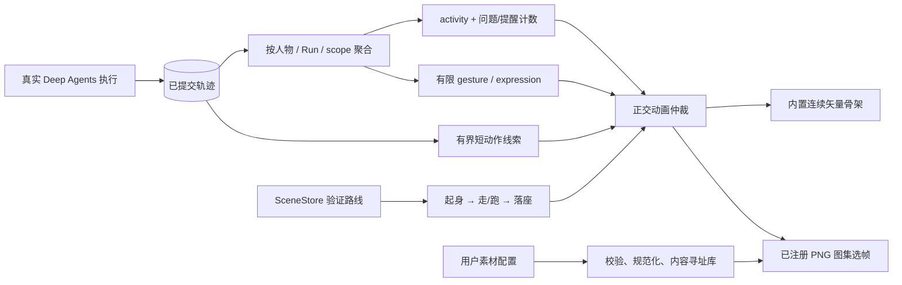
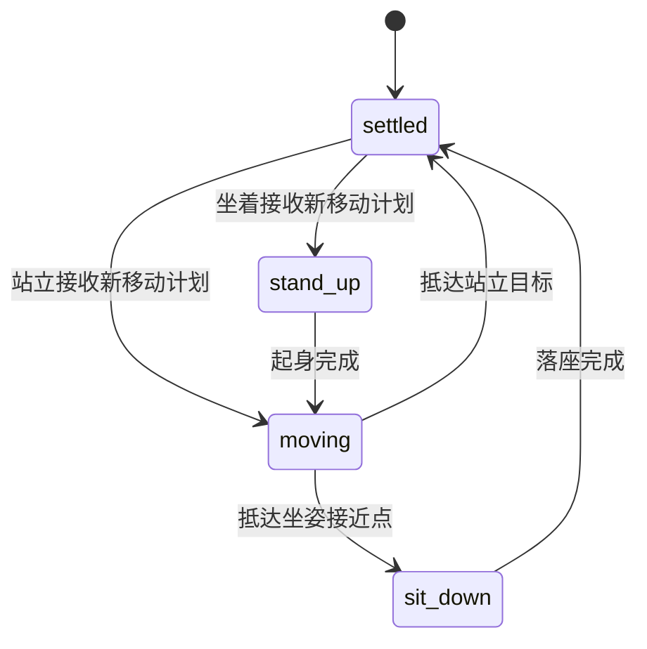
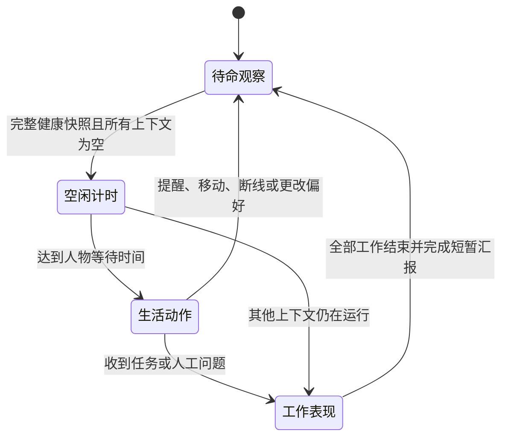
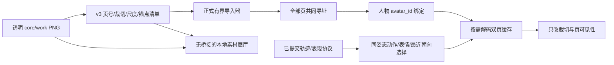

# ADR-0005：2.5D 游戏表现、正交动画与自定义角色素材

当前用户身份、生活活动周期、会议/外援及手绘环境以 [ADR-0006](0006-living-studio.md) 为准；本页保留原有素材与动画通道基线。

状态：已实现；2026-10-26。继续使用原 Deep Agents Loop，本次修改场景、素材资源、动作投影和显示路径，不增加另一套任务执行循环。

## 1. 本次解决的问题

- 办公室铺满整个应用客户区，连续地面覆盖视口外，采用局部取景而非缩小展示完整房间。导航、团队和输入区浮在场景上方；支持空地拖动、滚轮缩放、人物定位。Windows 标题栏仍保留。
- 内置角色使用更精细的矢量骨架，区分走路、小跑、转向、起身、落座、阅读、打字、书写、思考、交谈、举手询问和汇报。四肢按骨段和手部接触目标计算，连续混合；不是把整张人物图片平移或旋转。
- 支持本地 PNG 图集 + JSON 清单导入、动作/表情/朝向/姿态预览、人物绑定和跨重启保存。仍不包含内置像素绘画编辑器；用户可在外部工具制作后导入。
- 提供真实可编辑样例：`doc/assets/crew-avatar-example/`，含 184 帧、37 个动作变体。样例从正式矢量骨架确定性导出，经过正式导入器校验；不是为业务验收预置的 Agent 答案。

## 2. 后端事实与动画保持单向关系



**不存在从动画完成或素材脚本回到 Loop 的边。** 真实任务成功与否、是否需要人工、是否取消，仍按产品日志判断。姿态和道具不会提交工具命令。

## 3. 四条正交通道

| 通道 | 值或来源 | 仲裁原则 |
| --- | --- | --- |
| locomotion | idle / walk / run，由已验证的移动计划产生 | 行走与跑步不能同时发生；起坐过渡时不进入步态 |
| posture / phase | standing / seated，stand_up / moving / sit_down / settled | 先起身，再移动，再落座；脚底点和座位接触点分开 |
| gesture | think / read / type / write / talk / ask / report / alert 等 | 优先来自真实结构化事件；移动与起坐阶段接管身体动作 |
| expression | neutral / focused / curious / concerned / smile | 可以与移动或工作组合；人工问题和异常提醒不被跑步覆盖 |

方向根据投影后的移动向量选择八向，不把人物当一张平面图片旋转。内置骨架有转向、前后面、眨眼、呼吸、摆臂、屈膝及道具切换。图集可按相同通道提供不同变体。

起坐约 0.32 / 0.38 秒，步行和小跑分别约 2.8 / 5.4 格每秒。动画时间步限制 50ms，帧绘制上限约 60fps；低帧率环境允许表现变慢，不用大步跨过家具。减少动态效果或隐藏窗口时直接落到持久化显示目标。

## 4. 轨迹如何映射到动作

| 真实来源 | 身体动作 | 表情 / 提示 |
| --- | --- | --- |
| 新 `run.started / task.assigned` | 前往发起人接近点小跑，短暂停留后返回 | listen；执行器无需等人走到 |
| `model.started` | think，手部思考姿态 | focused；不展示隐藏思考内容 |
| `read_file / ls / glob / grep` | read，翻阅书本 | focused |
| `write_file / write_todos` | write，纸笔书写 | focused |
| `edit_file` | type，键盘动作 | focused |
| `task` 工具 | talk / 委派交流 | focused；接单成员另有独立上下文 |
| 真实 `human.requested` | ask / 举手；需要时前往老板接近点 | curious + 问题徽记，其他分支工作可以继续显示 |
| 工具错误、Run 失败或中断 | concerned；终态短暂 alert 后回到提醒待命 | 错误徽记保留；不伪造回滚 |
| `run.completed` | 短暂 report，随后恢复闲置 | 轻微 smile；仍显示“本轮结束，待核对” |
| `run.cancelled` | 回到待命 | 不把用户取消表现为成功或认证批准 |

根语义仍由 `activity` 表示。表现协议 v1 新增可选 `animation` 和 `cues` 字段，不把帧号或图集坐标写进后端执行状态。

```json
{
  "activity": "executing",
  "source_seq": 241,
  "question_count": 1,
  "animation": {
    "gesture": "write",
    "expression": "curious",
    "source": "trace_rules"
  }
}
```

这里表示同一人物还有工作，同时有问题需要用户答复。若人物正在跑步，身体片段采用 run，疑问表情和徽记仍保留；动画不能代替人工答复。

## 5. 快速事件和过期动作

工具可能在两次轮询之间开始又结束。只读 `StudioProjection` 因此另外读取客户端游标之后、当前投影游标以内最近至多 96 条事件，提取有限 `visual_only` 线索。线索不包含工具参数、输出或问题正文。

前端每人物最多排 4 个线索，相同动作合并，单次停留 0.2～1 秒；超过四秒的历史输入丢弃，已排队线索两秒多即过期。首次恢复、追赶历史、隐藏或离开场景不补播。真实问题和错误立即抢占表情，取消清空线索。

这允许短暂回顾刚发生的读写动作；界面事实标签仍显示最新真实状态，不因回顾动作把已结束任务标成执行中。辅助模型不能覆盖确定性的工具动作和表情，只保留有限装饰或短旁白用途。

## 6. 空间状态与重新规划



每人物仍使用 generation，每布局使用 scene_revision，旧计划和重复计划被拒绝。快速更改目的地时，前端可提交当前已到达的整数地面格；后端再次检查边界、碰撞和 A* 路线，不从上次尚未抵达的逻辑目标瞬移。

持久化保存的是显示目标，不是每帧坐标。这不是多进程物理模拟或完整分阶段 ACK 仲裁。角色间道路避让、拥挤调度和真实物理碰撞仍未实现；占座继续由确定性 SceneStore 管理。

## 7. 自定义素材：数据包与安全边界

完整格式见 [素材制作说明](../assets/crew-avatar-example/README.md)。导入入口只允许用户通过原生文件选择器选择 JSON，或点击固定的示例素材按钮；页面不传任意宿主路径。

1. JSON 最多 128 KiB，图集必须是同目录单帧 PNG，不接受 URL、脚本、任意目录、系统设备名或 APNG。
2. 源 PNG 最多 4 MiB、每边 32～2048 像素；先校验尺寸和完整性，再解码为 RGBA 并重编码，去除元数据。规范化输出最多 8 MiB。
3. 动作仅使用有限词表；帧号、帧率、脚底锚点、姿态、表情及朝向全部校验。单动作最多 120 帧、1～60fps，每包最多 128 变体与 2048 次帧引用。
4. 内容以清单和图片的 SHA-256 寻址，复制到 `data/avatars/<hash>/`。成员只保存 `avatar:<hash>`，不保留源路径或把图片塞进 checkpoint / Agent 提示。
5. 读取图集时再次比较 hash，拒绝被修改的文件；图集通过有限 PNG data URL 按需提供，场景轮询不重复广播图片。
6. 素材库当前最多 32 包，同一空间最多使用 8 种图集，前端缓存最多 8 个活动图集及 1 个预览槽。不能用预留名称声称已经支持无限素材或完整资产管理器。

图片处理采用锁定的 Pillow 13，限制格式、编码大小和解码尺寸；相关约束参考 [Pillow 官方安全说明](https://pillow.readthedocs.io/en/stable/handbook/security.html)。图集读取与导入放在独立工作线程，失败回退外观，不让图片解码进入模型请求或帧回调。

后续手绘样板使用独立的 v2 素材格式：最多 512 个 `frame_rects`，每项只允许源矩形 `rect` 和虚拟帧内 `offset`。源矩形和目标矩形均严格限制在相应边界，数值必须为整数；v1 继续使用等格图集且不得混入新含义。`mirror_west` 仅允许布尔值，用于美术作者明确允许的西向镜像。

## 8. 图集回退与骨架差异

- 先找实际动作 + 同姿态；缺少工作动作回退到同姿态 idle。缺少摸鱼动作或整个姿态则回退到内置骨架，不能拿站立图冒充坐姿或把待命帧当成玩手机。
- 同动作内优先精确表情，再选中性；方向优先最接近已提供朝向。自定义包可逐步补全八向与表情。
- 图集是预绘图像，使用图像自己的颜色；服装/肤色/发色与眼镜修改仅作用于内置骨架和缺失动作回退。
- 角色命名、选择边框、问题/提醒徽记与资源分开，不能因素材缺帧隐藏真实瓶颈。
- 当前不支持任意 Spine / Live2D / 外部 SVG 脚本、材质插件或无限多图集包。v3 有界双页方案见第 12 节。内置骨架的连续插值与图集按素材声明的 FPS 播放是两条真实可用的显示路径。

## 9. 验证与交付

Node 验证覆盖独立表情、事实优先于旁白、走跑差异、坐姿回退、去重、过期线索与移动阶段。后端验证覆盖导入、图片完整性与尺寸、设备/路径拒绝、篡改、绑定持久化以及素材不进入 Agent 上下文。

原生 WebView2 验证使用可见测试窗口，以确保 Chromium 实际执行帧回调：真实导入 PNG、选中 run/e/standing/curious 变体、帧号随时间改变、保存人物、由真实 Agent 中断同时显示跑步和疑问表情、人工答复后真实工具写文件。测试只替代原生文件选择动作与远端模型响应，不替换业务执行器、图集播放器或文件工具。

正式商业美术、素材绘画编辑器、道路避让和云端素材同步仍属于后续工作。本轮不声称达到 DNF 成品美术品质，但素材导入、各动作通道和全窗口场景已经可实际使用。

## 10. 没有工作时的人物生活动作

用户可在人物属性选择保持待命、玩手机 `phone`、打游戏 `game`、浇花 `water` 或自定义休闲 `relax`（默认伸懒腰），并设置 0—120 秒等待时间，默认 5 秒。账号成员 JSON 保存 `leisure_action / leisure_delay`；共享同一 Agent 的形象仍各自独立，不把偏好写入 Agent 定义、执行快照或 checkpoint。旧记录读取时补默认值，不隐式写库或增加版本；老板/助手默认手机，员工默认游戏，监管员保持值守，停用人物不自动摸鱼。



后端 `idle_eligible` 是只读信号：所有 Run / scope 的上下文为空、没有未处理提醒，且 activity 为 idle / reporting / stopped。等待协作、等待人工或模型长时间没有输出都不是空闲。前端复核问题、提醒和上下文数量；没有历史事件的新人物只有在完整健康快照中才开始计时。

优先级为真实工作/人工/异常 → 起坐与移动 → 短线索与汇报 → 生活动作。结束后先保留约 5 秒汇报窗口，再开始用户配置的空闲计时；新工作更新后的下一个绘制帧立即停止摸鱼，不等待片段播完。

等待使用单调时钟而非累计帧数。移动、隐藏窗口、切换视图和偏好变化重置计时；缓存降级、追赶历史、桥接请求失败或超过 4 秒未收到新快照时暂停生活动作。减少动态效果时保持普通待命。生活动画不写任务轨迹、不新增模型请求，也不能修改后端工作状态。

内置手机有轻触姿势，游戏用带动态画面的笔记本和敲键动作，浇花在当前接触点使用小盆栽与水壶；不会真实启动游戏、操作手机或自动寻路到房间植物。自绘 PNG 提供 `phone / game / water / relax` 对应的方向、表情和站坐片段；`relax` 可自由画成喝茶等休闲动作，界面统一称“自定义休闲”。现有 184 帧样例没有新增生活片段，缺帧使用内置骨架；不支持给素材附加可执行脚本。场景以“摸鱼 · 动作名”标明它属于生活表现。

## 11. 手绘角色视觉样板

当前新增“小禾 · 手绘动画样板”，位于 `desktop/ui/studio/assets/atelier-v1/`。原图为 image_gen 生成的透明人物图集，共 64 个姿态、14 个变体；覆盖正背面走跑、站坐待机/手机、起坐和举手。西向以明确授权的镜像复用，不宣称已绘制完整八向与全部工作动作。

播放器按 v2 的源矩形裁切、虚拟帧内偏移与统一脚底锚点绘制；每帧只改变 SVG 裁切与有限变换，图片仍按需解码并缓存一次，不在帧循环读文件或请求模型。PNG 保留原像素，制作工具只登记元数据，减少原始帧间留白和网格误差造成的跳动。

入口为人物属性的“试用手绘角色”。它沿用正式导入、内容 hash、账号绑定与轨迹动作协议；新“连播核心动作”只在素材编辑窗口运行，明确标为原地预览，不接触执行器。正式场景继续由真实轨迹驱动动作。

本轮先验证一个角色的美术方向和播放管线。专用读写/游戏/浇花帧、独立面部/换装图层、专业逐帧修形、桌椅前后景拆层仍待完善，不能把样板说成整套角色已经升级完成。

## 12. 四角色基础素材库与双页合同

第 11 节的单角色阶段现已扩展为老板、小禾助手、小岚员工、守望监管员四套角色，共 496 个登记姿态。每套包含基础页与工作生活页，34 个片段变体覆盖当前 20 种动作语义、5 种闲置表情。读写、思考、汇报、询问、游戏和浇花采用专门画面；工作复用打字，西向显式镜像。不是全方向、全站坐、全表情组合都已经绘制。



`roomcrew.avatar v3` 保留既有动作语义，增加有限 `images`（1—2 页）与每帧 `page / scale`。源文件限制沿用单页合同；scale 只接受 0.25—2 有限数值，用于不同生成页的统一体型校准。所有源矩形必须落在对应页内，缩放后的目标必须落在虚拟帧内。导入过程先完整校验再原子复制；两页共同参与 hash，任一页改变均不能沿用旧身份。v1/v2 单页行为与 hash 路径兼容。

缓存中只解码一至两张图，SVG 节点一次创建，每帧只切换页可见性与裁切参数，不重设 data URL，不读取文件或调用模型。保留场景八套、含预览九套上限；最坏双页 RGBA 约 32 MiB/套，需考虑浏览器纹理与传输副本，后续正式渲染应进一步做实际显存测量和卸载策略。

展厅是独立本地 HTML，加载有限登记表和共享动作选择器，无桌面桥、无账号/模型读取；应用以受限 iframe 按需加载，关闭或 Escape 都卸载。卡片只绘制可见项且限频约 10 FPS，详情可暂停逐帧；真实任务动画仍仅消费表现协议。

环境新增 12 件家具、16 件装饰及 8 组四帧状态特效，登记于同目录 catalog。它们只在展厅预览，场景尚未接入：下一阶段需分别定义占地格、根锚点、交互锚点、渲染高度、前后遮挡层和缩放后可读性。总览中的“核验通过/安全服务”图片不构成任务成功或真实权限。监管员仍没有 Agent 定义。

完整制作约束、覆盖和来源见素材库 README。当前是可检验的基础素材集；部分边缘帧、体型一致性和道具接触仍需精修，不宣称专业游戏级最终美术。
