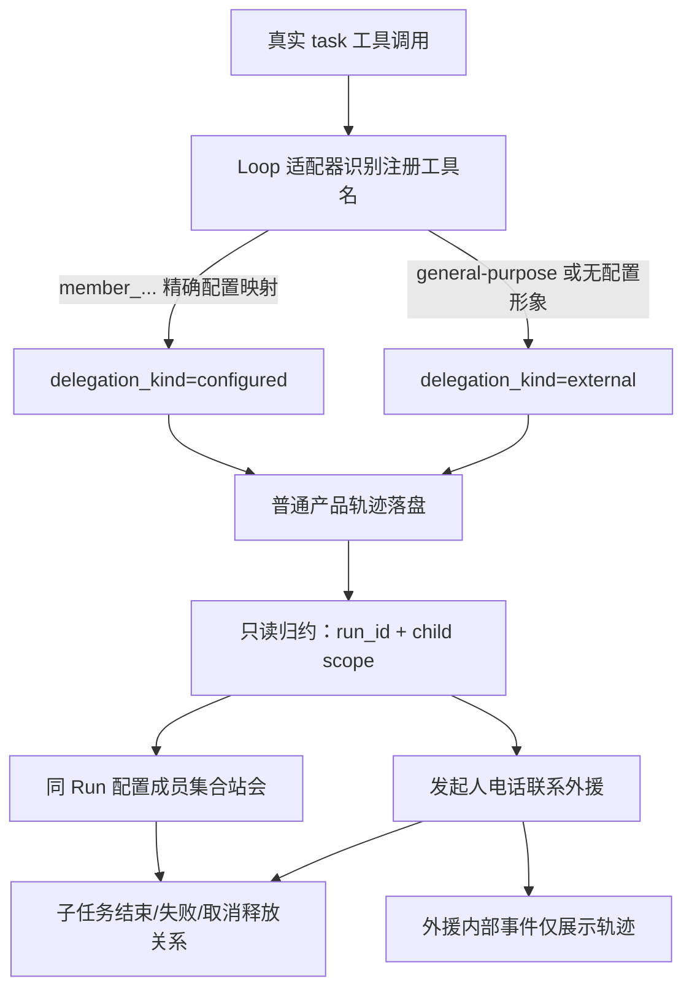

# ADR-0006：用户身份、空闲生活与任务协作表现

日期：2026-10-26。状态：已实现原型。本决定覆盖 ADR-0004/0005 中的老板替身、单一摸鱼动作和赴老板工位的旧表现。

## 1. 用户与成员

用户本人就是老板，场景和团队列表不再创建老板人物。新账号最低成员是助手与监管员；默认接单成员为助手，其他人物按需招募。监管员仍是基础设施展示，不是 Agent，也不自动摸鱼。

旧账号的 `role=user` 记录保留用于历史追溯，但不再通过成员列表/编辑/执行入口暴露为人物；旧老板场景占位释放。原 `boss-desk` 只改名为 `reception-desk`，保留坐标与其他用户布局，增加场景版本。旧助手不会被强制搬家；新账号助手默认在接待台。

## 2. 空闲活动

每个人物的 `leisure_actions` 最多四项，默认手机、游戏、办公室散步、同事闲聊。旧版浇花和自绘休闲可作为替换项；每个人同时启用仍最多四种。空池表示保持待命。配置保存到账号 SQLite，属于人物，不进入 Agent prompt、Run 定义或 checkpoint。

首次空闲等待仍可设置 0—120 秒，默认 5 秒。选定一项活动后，**300—600 秒随机轮换一次**；多个选项时尽量不重复上一项。计时使用单调时钟，和姿态帧率无关。散步活动期间可以分段走动、短暂停步；这不算重新挑选活动。隐藏/降级后丢弃旧生活状态，恢复时从空闲等待重新开始，不补播背景时间。

只有完整健康快照、所有上下文清空、无待答复、无提醒时才可空闲；结束后先展示真实汇报，再进入空闲等待。接单、助手派工、真实提问和报错立即让生活表现让位。真实鼠标/键盘点击人物立即停止摸鱼，进入由轨迹决定的待命或工作表现，并保持五分钟人工接管窗口。点击本身不创建任务；表单保存后的程序选择不会误触发该冷却。

假聊天仅是本地动作：两名允许闲聊且都空闲的人物配对，其中一人避障走到另一人附近。任何一方接单或被点击即解除配对。不会写消息、执行 Agent、请求模型或增加任务轨迹。无可用同事时不虚构一个同事。

## 3. 真实委派的两条表现路径

“已配置成员”来自本轮冻结的 AgentSpec 工具名映射，不按模型文字、角色名字或共享 `agent_id` 猜测。任务委派轨迹增加 `delegation_kind / from_member_id / target_member_id`；作用域依旧独立。通用外援事件保留在发起人的会话子作用域中，标记 `presentation_external`，显示为外援轨迹；内部模型和文件动作不转换为额外人物。真实人工提问仍会进入待办并抢占电话表现。

已配置成员按 **Run ID** 合并会议。同任务的多条子任务去重为人物集合；相同 Agent 配置的不同形象依然各自拥有位置和轨迹。多个关系竞争一个人物时优先先建立的真实关系，不能同时把一个形象放在两个地方。用户手动换座会暂时让出该人物的会议空间控制。

会议使用可达且未被其他人物占用的会议锚点，当前采用站会，让现有站姿交谈/倾听美术实际播放。座点不足时使用附近空地；无路可达时保留真实工作状态，每两秒有限重试，不穿家具、不等待动画完成再执行任务。快速委派若已结束，不补演成仍在进行的会议。任一人物有问题或错误时，实际瓶颈优先于讨论。

通用外援不创建可见成员，也不改变人物数量。主 Agent 显示电话图标、手机片段与“电话联系外援”标签，此状态不是摸鱼。若同时参加配置成员会议，可保留讨论并显示外援电话提示。图像不表示真实拨打电话或外部通讯工具已经接入。

## 4. 前后端合同与职责

| 层 | 职责 | 边界 |
| --- | --- | --- |
| EventAdapter | 将真实 SDK 委派映射为产品元数据 | 无界面依赖，不修改生产循环 |
| presentation/collaboration.py | 归约本 Run 的关系并合并会议成员 | 不读取任务正文，不调用 Agent |
| StudioService | 输出可见人物、最小事实、interactions 和场景 | 过滤 User 旧形象，保持原会话日志 |
| SceneStore | 输出带版本的有限障碍网格 | 权威来自家具占地，不含系统权限 |
| navigation.js | 有界四邻域视觉路线 | 网格最大 64×64，未知地图不移动 |
| motion.js | 共用起坐/行走插值，支持临时视觉目标 | 逻辑锚点和 generation 保持不变 |
| leisure.js | 人物独立活动周期、空闲配对 | 无桌面桥、无模型、无文件写入 |
| collaboration.js | 真实会议关系到临时会议站位 | 子任务终态立即释放，不持久化占座 |
| animation.js | 真实事实、人工/错误、移动和表现层仲裁 | 动画不能反向授权或判定成功 |

`studio_feed.interactions` 只含组 ID、成员 ID、序号和 `kind=meeting`。人物事实增加 `external_calls`；消息、工具参数和隐私正文不广播给画布。用户主动打开人物/完整会话轨迹后才加载正文。

新 `scene.navigation` 含版本、布局修订、宽高和障碍格。前端按布局版本缓存；路线只在活动分段或会议目标变化时搜索。会议规划失败限频，不在每帧重新搜索。所有显示移动都可以丢弃；相机、背景、图集加载失败不能影响实际执行。

## 5. 环境与边界感

原有透明家具图集接入默认房间渲染，保持原格网、点击、家具编辑与锚点合同。接待台、会议桌、沙发、绿植、书柜等使用同套手绘美术；增加可编辑的阅读、咖啡和休闲设施。它们参与实际占地检查，不是悬浮在场景上的假按钮。

相机按窗口比例自适应填充，默认更靠近有人物和家具的区域；连续地面延伸到视口之外。屏幕底角采用无点击、无碰撞的窗边植物前景与柔和光照作为背景皮肤，避免露出硬画布边或大片纯色留白。背景前景与可编辑家具分别建模；装饰不能生成工具权限或隐藏真实工作提示。

高墙补充：墙面最低显示高度由原来的 106 提高到 320 个场景单位，并根据镜头最远可见墙脚与上边缘补足高度，让墙顶保持在视口外。原来的墙外地砖不再露出；双面墙采用固定世界坐标渐变、窄墙角阴影与 12 单位踢脚线。墙面只在镜头变化时调整顶点，窗户相应抬高；不改变家具占地、人物路径、布局版本或任务运行。

本轮不新增外部图片依赖；复用已保存的 imagegen 原图，仅按登记裁切显示，不重画像素。外部骨骼、任意素材脚本、安全 VM、浏览器与真实通讯工具仍未接入。

## 6. 验证

- 注入随机源与时钟测试 299999/300000 毫秒边界，不缩短生产的五至十分钟周期；验证点击、真实工作和聊天同事被派工后的解除。
- 后端验证两名最低成员、旧 User 隐藏且保留、四项上限、持久化、同任务合并、人工优先、终态清理、外援仅轨迹及全部默认锚点可达。
- 原生事务所流程通过真实表单导入图集、保存活动池、接单/提问/答复/真实写文件/恢复空闲/再次点击打断。
- 原生协作流程使用回环模型协议响应，真实运行 Deep Agents、task 与文件工具：两名配置成员集合讨论；另一次通用外援只显示发起人电话。两份文件均由真实工具产生，八次实际 HTTP 请求，持久化座位不变。
- 自动测试不代替真实厂商效果验收；生产没有模拟日记、伪造任务或加速闲置计时入口。
