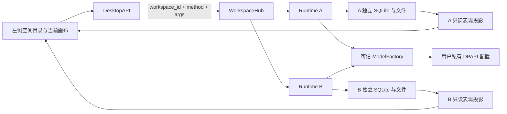
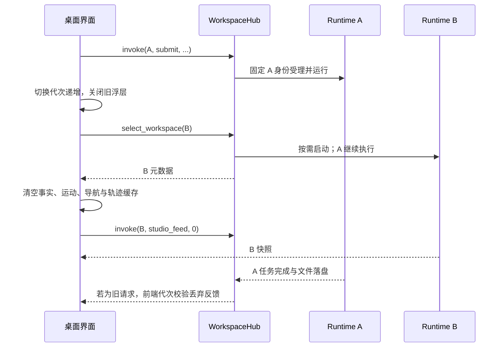

# ADR-0007：桌面目录拆分与一空间一会议室

状态：已实现，2026-10-26。覆盖旧的 frontend 用户界面目录、中文副品牌及全局单会话额度；Agent Loop、文件工具、安全边界不改变。

## 用户看到的行为

品牌统一为 RoomCrew。左侧“我的空间”列出工作空间，显示执行与待答复数量。创建空间同步创建唯一会议室，主画布切换到该房间，右侧团队和会话只属于该空间。重命名保留房间 ID、成员与历史。切换不暂停原任务；返回可看到真实完成结果。User 不生成老板形象，最低人物仍是助手与监管员。

人物点击、表情、换座、空闲生活和会议仍消费当前空间的真实投影；外援只展示轨迹。空间切换清除选择、轨迹游标、事实缓存、导航版本、人工接管冷却、临时会议、生活动作和图集引用。两个空间即使同有 assistant、guardian 和 revision=1，也不能复用旧状态。

未发送输入只按空间保留在内存，退出后不保存。切换时关闭成员、人工事项、家具、文件和模型配置浮层，清空未保存 Key。配置保存已提交到后端的操作仍按原请求完成；前端丢弃迟到反馈。

## 源码边界

```text
RoomCrew/
  desktop/
    ui/                         场景、会话、设置、素材与界面状态
    src/roomcrew_desktop/        WebView2 原生壳、RPC、生命周期
    tests/                      原生窗口流程；web/ 为界面测试
    tools/                      美术导出、登记与预览工具
  backend/src/roomcrew/
    application/workspaces.py   多 Runtime 装配、显式路由与共享额度
    storage/workspaces.py       空间目录与上次选择
    ...                         原有职责分层保持
  frontend/README.md            只预留未来管理员 Web 界面
  packaging/                    仍由根入口冻结两个源码包及 desktop/ui
```

后端不导入 roomcrew_desktop 或 WebView。桌面壳只导入应用用例、产品合同与本机资源定位，不直接读凭据、SQLite 或 SDK。没有保留旧路径 shim 或第二份用户界面。根 pyproject 同时检查 backend/src 与 desktop/src，规范仍只保留根 AGENTS.md。

## 运行结构



WorkspaceHub 只复用既有 Runtime，不实现另一套 Agent Loop。每个实例持有自己的账号仓库、会话日志、checkpoint、执行任务表、场景与表现缓存。空间按需打开；后台已打开实例保持执行，未打开的历史 Run 不自动重放。最多 16 个空间，每空间一个活动会话，最多四个空间同时执行。幂等重发仍由原用例核验并返回旧受理结果，不因新执行额度满而重做任务。

## 持久化与旧数据

```text
%LOCALAPPDATA%/RoomCrew/
  private/                       全部空间共享用户私有模型配置
  data/
    workspaces.sqlite            空间 ID、名称、唯一 room_id、上次选择
    account.sqlite               默认空间原有成员与定义
    sessions.sqlite              默认空间原有会话和轨迹
    runtime.sqlite               默认空间原有框架 checkpoint
    studio.sqlite                默认空间布局
    presentation.sqlite          默认空间表现缓存
    sessions/<conversation>/files/
    avatars/
  workspaces/<32位空间ID>/data/
    account.sqlite
    sessions.sqlite
    runtime.sqlite
    studio.sqlite
    presentation.sqlite
    sessions/<conversation>/files/
    avatars/
```

默认空间 ID 为 default，房间为 room_default，沿用原 data/，不搬迁用户文件。新空间 ID 用随机十六进制字符串，名称不进入路径。目录中 room_id 唯一，一行空间元数据只对应一个房间；房间显示名跟随工作空间。

这是本地单用户的产品隔离，不是 OS 安全沙箱，也不是未来管理员多租户权限模型。同名角色、同名产物、相同布局版本可在不同空间独立存在。未实现空间删除、跨空间搬运成员、跨空间共享任务上下文或云端数据库。

## 请求与前端时序

桥只公开 workspace_state、create_workspace、select_workspace、rename_workspace 与 invoke。invoke 的业务方法在后端固定白名单中；不允许私有属性、close、任意宿主路径或执行器对象。素材文件导入仍需原生人工选择器。



每次业务调用在发出时捕获 workspace_id 和 workspaceEpoch。Hub 不用“当前房间”决定请求归属；旧请求只能读写旧空间。返回时前端检查代次，过时响应不进入画布、会话或素材缓存。轮询有界且串行；空间状态目录只汇总数量，不返回其他空间的工具正文、问题文本或产物。

## 共享模型配置与人工参与

模型配置只在 private/，由 User 本地可信入口维护。Agent 文件根只挂载自己的会话 files/。不同空间使用同一份模型配置引用，原始参数和 Key 不放进 workspace、消息、日志或 checkpoint。前端回显配置仍不包含 Key。

全空间有活动 Run 或待答复事项时，禁止修改共享配置，避免恢复时原绑定失效。未打开的空间以只读查询取得持久待办数量；损坏而无法确认的库也阻止修改。该查询不启动执行器、不自动重放、不读取或公开问题正文。打开后由原 Runtime 恢复人工流程，答复只作用于原问题和 Run。

全空间模型配置保护不改变 V1 能力范围：任意代码、Shell、MCP、浏览器、Computer Use、安全 VM 与云同步仍未开放。

## 当前取舍与下一步

采用每空间独立 Runtime 和 SQLite，优先复用现有成熟执行路径、隔离轨迹与恢复状态。空间数量有界，数据按需打开；目前不做后台实例 LRU 回收，因为需要首先保证人工恢复与任务不中断。未来云端账号可通过既有仓库接口迁移，但不能把云端凭据放入本地任务上下文。

未来增加空间删除/归档时，需要先处理活动任务、人工待办、用户确认、文件备份及不可逆清理；当前没有隐式删除操作。管理员 frontend 是单独应用方向，不能直接复用桌面可信桥暴露用户密钥或宿主文件。

本次验证入口见 development/workspace-validation.md；所有本机模型响应均为模拟协议服务，实际厂商与 Key 仍需用户后续验收。
