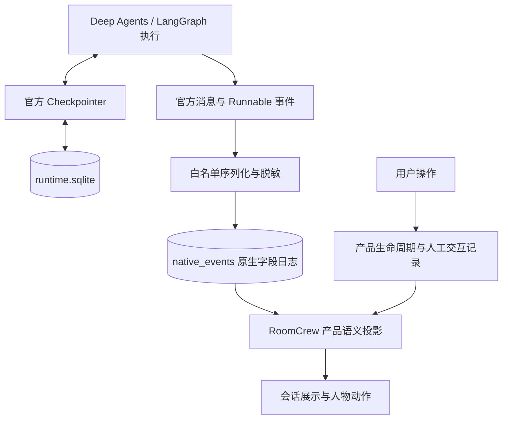
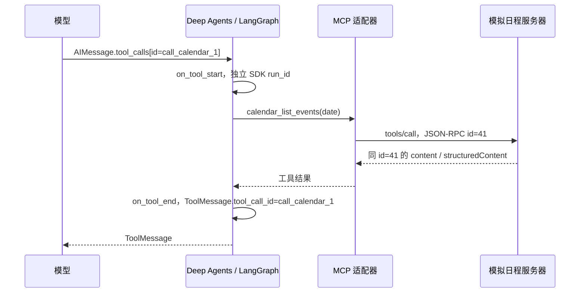

# ADR-0008：采用 Deep Agents 官方执行事件、消息与检查点

状态：已接受并接入，2026-10-27；依据用户明确决定。原生事件存储、模型工具 ID 关联及 HTTP MCP 的实际范围以 [ADR-0009](0009-agent-foundation.md) 为准；本文模拟样例保留用于说明格式。

## 1. 选型与适用范围

RoomCrew 采用 Deep Agents 底层 LangChain / LangGraph 的官方数据结构，作为 Agent 执行记录的事实来源：

- 消息：`HumanMessage`、`AIMessage`、`ToolMessage`，保留真实工具调用 ID。
- 执行事件：当前生产入口 `Runnable.astream_events(version="v2")`，使用官方 `StreamEvent` / `StandardStreamEvent` 字段。
- 恢复状态：官方 `BaseCheckpointSaver` 协议，当前由 `AsyncSqliteSaver` 管理 SQLite 检查点。

这里的“官方轨迹方式”是以上能力的组合，并不存在需要伪造的 `DeepAgentsTrace-v1` 文件规范。`astream_events` 的 v2、`stream` / `astream` 的 v2 输出，以及新版 `stream_events` 的类型化投影，是不同 API，不能把它们的字段混成一个事件对象。当前先沿用已接入并锁定的 `astream_events` v2；后续更换入口需要单独做兼容验证。

ATIF 暂不作为主记录协议；以后有交换、评估或训练需要时再增加导出适配。框架 checkpoint 的保存结构、序列化和迁移继续交给官方实现，不依据 ATIF 或人物动作反推恢复状态。

## 2. 三层数据的职责

框架事件描述模型、工具和图执行；RoomCrew 仍需记录工作空间、人物绑定、用户提交、取消与重启等产品事实。这些属于产品关联记录，不能冒充官方模型或工具事件。前端继续消费 JSON 产品合同，不导入 SDK 类型；动画和旁白不能改变执行结果。

原生事件已经白名单序列化后写入 `sessions.sqlite/native_events`，产品生命周期与兼容查询继续写入业务事件表。两者来自同一次 SDK 执行；后端不包含动画投影，动作转换全部位于桌面。当前不记录 token 重复片段及 chain 完整状态；这是一份有意筛选的原生执行记录，不是无损回调录包。

## 3. 必须保留的原生语义

| 数据 | 原生含义 | RoomCrew 约定 |
| --- | --- | --- |
| `event` | 如 `on_chat_model_start/end`、`on_tool_start/end` | 保留原名，不只保留“执行中”等界面状态 |
| `name` | 产生事件的 Runnable 名称 | 不把工具名前缀当作可信服务器身份 |
| `run_id` | 本次 Runnable 调用身份 | 同一次调用的开始/结束使用相同 ID，不与产品 Run 混用 |
| `parent_ids` | 从根到直接父调用的有序祖先链 | 原样保留；不能为了显示方便删去中间父调用 |
| `data` | 输入、输出、流片段或异常，依事件种类而定 | 使用明确序列化规则，执行脱敏和内容限制 |
| `AIMessage.tool_calls[].id` | 模型提出的某次工具调用身份 | 对应 `ToolMessage.tool_call_id`，不等同于工具事件 `run_id` |
| `metadata` / `tags` | 可选框架信息与应用标记 | 只记录允许字段；真实配置、Key、Header 不进入日志 |

框架事件不是天然的完整 JSON 文件：`data.output` 可能是 `AIMessage` / `ToolMessage` 实例，异常也可能是 Python 对象。落盘需要将允许的消息公开字段编码为 JSON；这一步是安全序列化，不另造模型或工具语义。样例使用消息对象的 `model_dump(mode="json")`，不使用 pickle，也不通过不可信类型名动态导入代码。

原生事件没有逐事件时间戳或唯一事件 ID 的统一必填字段。需要排序、去重、接收时间时，在存储信封中另外记录；`run_id` 标识一次调用，同一调用可以产生很多事件，不能拿它单独去重。消息内容可能包含用户隐私，采用官方结构不等于可以不加限制地存储原始回调或外发 tracing。

## 4. ID 与 checkpoint 关联

| 层次 | 身份 | 关系 |
| --- | --- | --- |
| 产品 | workspace / conversation / product Run / member | RoomCrew 自己维护，按空间隔离 |
| 执行调用树 | SDK 根 `run_id`、子调用 `run_id`、`parent_ids` | 描述模型、工具、图之间的实际调用关系 |
| 消息工具调用 | `tool_calls[].id` / `tool_call_id` | 连接模型请求与工具返回 |
| 检查点 | `thread_id`、`checkpoint_ns`、`checkpoint_id` | 确定恢复哪一个框架执行状态 |
| MCP 传输 | 会话范围内的 JSON-RPC 请求 `id` | 对应 MCP 请求和响应，由客户端维护 |

这些身份不能相互替代。一个产品 Run 可能先后经历多次 invoke（例如人工中断后恢复），因此可以关联多个 SDK 根调用；一个 checkpoint 也不一定对应单条事件。需要保留一次 invoke 与线程/命名空间的映射，再在官方提供的检查点边界登记具体 checkpoint ID，不能给每条事件猜一个 ID。

SQLite saver 的 `checkpoints` 与 `writes` 由 `(thread_id, checkpoint_ns, checkpoint_id)` 关联，中间写入另外按 `task_id / idx` 区分。子图是否持久化、命名空间如何产生，由实际构图和 checkpoint 配置决定，不能仅凭“有子 Agent”就断言每个子任务有可独立恢复的数据库线程。

## 5. 普通工具与 MCP 工具

MCP 工具经过官方适配器变成 LangChain 工具后，仍产生普通工具事件。框架不会为它自动生成一个通用的 `on_mcp_start` 事件。工具来源应从可信工具注册信息解析；不要按字符串中是否带 `mcp` 来判定来源。

当前锁定环境使用 `langchain-mcp-adapters`；本文不照搬在线文档中新版 `langchain.mcp.MCPAdapter` 的 API，也不升级依赖。示例假设注册 `calendar` 服务器的 `list_events` 工具，并显式启用适配器的服务器名前缀，Agent 所见名称为 `calendar_list_events`。服务器原始名称仍为 `list_events`。

MCP JSON-RPC `id=41`、模型的 `call_calendar_1` 和 SDK 工具 `run_id` 属于不同层；若要查看传输层诊断，连接器需额外维护它们的对应。官方 Agent 事件本身不保证包含 JSON-RPC 包。请求 URL、认证 Header 和连接秘密不能放入该对应记录。

错误要按真实结果解释：被适配器处理的 MCP `isError=true` 可能成为 `ToolMessage(status="error")`，同时仍收到 `on_tool_end`；不能看到 end 就当业务成功。未被处理的传输异常可能直接向上抛出；错误回调是否作为流事件暴露需要按锁定 SDK 验证，运行边界仍必须捕获异常和取消，不伪造成功结束事件。

## 6. 模拟样例与验证范围

样例文件：[native-agent-trace.simulated.json](examples/native-agent-trace.simulated.json)。任务为“读取本机时间，通过日程 MCP 查询当天安排，然后汇总”。

- 全部消息、ID、时间和日程是合成数据，未调用真实模型、系统时钟或 MCP 服务。
- `framework_events` 为按官方字段构造的选段，包含根调用、三次模型调用和两次工具调用；省略框架内部 chain 与逐 token 事件，但保留示例祖先 ID。
- `data.output` 中的消息使用官方消息类导出的 JSON 字段。不是直接声明 SDK 的 Python 对象原生就是 JSON。
- `mcp_exchange` 独立列出已建立 MCP 会话中的一次调用；省略 initialize、tools/list、认证和具体传输，不代表完整 MCP 会话录包。
- 顶层 `example_kind`、`contract`、`roomcrew_context`、`framework_events`、`mcp_exchange`、`links` 只是本文件的演示容器，不是官方事件字段或已实现的产品存储协议。
- 样例可以用当前安装的 `StandardStreamEvent`、消息类、MCP JSON-RPC 类和 `CallToolResult` 校验结构；这只能证明样例字段与关联合理，不能代替真实 MCP 接入和故障验证。

## 7. 实现状态与后续验收

1. 已新增受控原生序列化及产品 Run / SDK 调用树存储；入口固定 `astream_events(version="v2")`，具体 SDK 版本以 uv.lock 为准。
2. 已由公开 ToolCallRequest 扩展点传递模型工具 ID，单独保存 SDK run_id；人工中断恢复按模型工具 ID 合并同一界面卡片。
3. checkpoint 继续由官方 saver 管理，桌面兼容查询与显示投影不产生执行事实。以后可新增 ATIF 导出，无需替换生产 Loop。
4. 普通工具、委派、Skills、MCP、人工恢复、超时、隔离执行与隐私已有回归及真实模型验证。模型工具 ID 相同仍不等于外部效果恰好执行一次。
5. MCP 当前只接入 Streamable HTTP；JSON-RPC 录包、认证流程和完整导出仍未提供，不应从 Agent 事件推断传输请求 ID。

## 8. 官方依据

- [Deep Agents Streaming](https://docs.langchain.com/oss/python/deepagents/streaming)：消息、状态和子 Agent 流式输出。
- [LangChain Runnable 事件结构](https://github.com/langchain-ai/langchain/blob/master/libs/core/langchain_core/runnables/schema.py)：`StandardStreamEvent`、`run_id` 与 `parent_ids`。
- [LangGraph Checkpointers](https://docs.langchain.com/oss/python/langgraph/checkpointers)：检查点、状态历史和恢复。
- [LangChain MCP 适配器](https://github.com/langchain-ai/langchain-mcp-adapters/blob/main/langchain_mcp_adapters/tools.py)：MCP 工具转为 LangChain 工具、名称前缀和错误结果。
- [MCP Tools 规范](https://modelcontextprotocol.io/specification/2025-11-25/server/tools)：`tools/call`、内容与错误表示。实际项目实现以锁定依赖为准。
