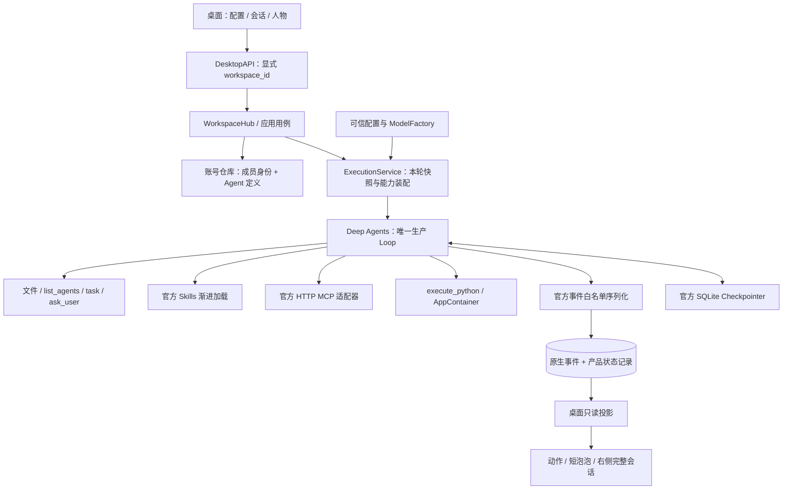
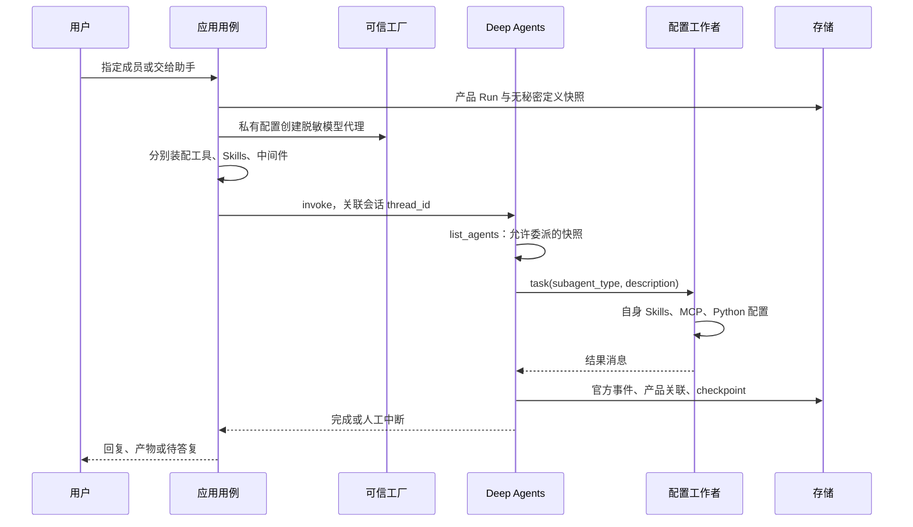
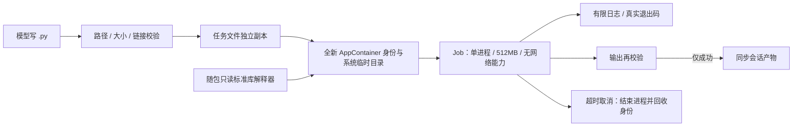

# ADR-0009：可配置 Agent 底座与独立桌面适配

状态：已实现并验证，2026-10-27。依据用户明确授权，覆盖旧文档中 Python/MCP 未开放、后端包含人物动作协议的描述。验收见 [验证记录](../development/agent-foundation-validation.md)。

## 1. 职责与依赖方向

执行底座负责谁执行、使用哪些能力、执行到哪里、是否需要人工参与及实际结果。桌面独立决定人物位置、动作和泡泡；界面关闭不影响执行合同。依赖方向是 desktop → backend，后端不导入桌面包。



`DesktopRuntime` 在通用 Runtime 之外装配账号外观属性、素材库与 StudioService；后端可单独运行无界面集成验证。

| 模块 | 当前职责 |
| --- | --- |
| backend/accounts | 定义校验、执行身份、查询、版本与 Run 快照 |
| backend/application | 生命周期、主子 Agent 能力装配、空间与人工恢复 |
| backend/agent_loop | SDK 构图、官方事件读取及产品关联 |
| backend/config、models | DPAPI 配置、可信工厂、脱敏代理、连接检查 |
| backend/context_compression、middleware | 单份 SDK 摘要、总调用额度、工具调用 ID |
| backend/skills、mcp、tools | 技能、MCP、文件、成员发现、人工工具、隔离 Python |
| backend/security、storage | Windows 边界、路径约束、业务 SQLite 与官方 checkpoint |
| desktop/accounts、assets | 外观、摸鱼偏好、泡泡配置、素材校验 |
| desktop/presentation、studio.py | 只读轨迹归约、动作映射、布局与表现缓存 |
| desktop/ui | 动画播放器、独立气泡层、右侧会话与人工表单 |

旧 ADR-0003 的后端 assets/presentation 目录由此迁移替代。frontend/ 仍仅预留管理员 Web 界面。

## 2. Agent 定义与人物分离

使用已有专用 `agent_definitions` 表，避免再建同义表。每个空间的 `data/account.sqlite` 包含：

| 表 | 身份及版本 | JSON body |
| --- | --- | --- |
| agent_definitions | id、revision | prompt、description、model_binding 引用、skills、mcp_servers、python_enabled |
| members | id、revision | agent_id、角色、启用/归档；桌面扩展外观与 interaction_profile |
| preferences | 单独偏好 | 桌面设置，不注入执行定义 |

保存使用事务和预期版本比较。共用定义变更影响下一轮使用者，不改执行中快照，不虚增其他人物版本。模型真实端点、模型 ID、Key 与认证 Header 不进入定义表；model_binding 只是引用。目前员工共用用户选择的执行模型，尚无逐 Agent 选择不同厂商的表单。

用例提供 `agent_configurations`、`save_agent_configuration`、`members`、`member`、`save_member`。没有形象的独立定义也可登记和委派；桌面由发起人显示外援电话，工作者仅有轨迹。当前 UI 主要通过成员属性编辑其定义。

配置示例（非完整成员请求）：

```json
{
  "description": "资料核对与计算",
  "prompt": "计算结论必须有真实工具证据。",
  "python_enabled": true,
  "skills": [{
    "name": "verify-data",
    "description": "核对数字并输出文件",
    "instructions": "先读取输入，再计算和写入结果。",
    "files": {"examples/check.py": "print(sum(range(1, 101)))"}
  }],
  "mcp_servers": [{
    "name": "local_math",
    "url": "http://127.0.0.1:8000/mcp",
    "enabled": true
  }]
}
```

最多 32 个定义，每个定义最多 16 个 Skills、8 个 MCP 服务、64 个 MCP 工具，配置总计不超过 256KB；完整限制以 accounts/configuration.py 为准。保存与执行装配均校验文本、相对路径及重复名。

## 3. 一轮执行与成员发现



list_agents 仅返回身份、描述、subagent_type、技能名称及 Python 开关，不返回系统提示词、模型秘密或 MCP URL。禁用/归档成员不能通过独立定义绕过禁用。通用外援继承主 Agent 能力，配置工作者使用自己的能力。

主 Agent 可用 SDK task 并行委派；当前 worker 不递归开放 task，其 list_agents 返回空列表。该成员作为主 Agent 时可发现其他成员。以后开放递归需增加深度、预算、并发和循环限制。

各工作者上下文与中间件实例独立，共用同一 Run 模型调用总额度。相同 MCP 配置在一次 invoke 内复用工具发现结果，不跨 Run 缓存可变会话。人工恢复重新装配；同 Run 的 Python 串行，避免隔离副本覆盖共享产物。

## 4. Skills 渐进加载

1. 用户显式保存名称、描述、说明及可选文本文件，不扫描磁盘。
2. 按内容哈希发布到 `skill-bundles/<digest>/`，提供只读虚拟入口 `/skills/configured/<digest>/`。
3. 使用官方 Skills：先提供名称/描述，需要时由 read_file 读取 SKILL.md 正文和附带文本。
4. ReadOnlySkills 拒绝写入和编辑；各 Agent 只收到自己的技能来源。
5. 附带 Python 示例先读取并复制为会话 .py，再 execute_python；不直接在只读技能目录执行，不自动安装依赖。

技能是任务指引，不是权限。技能目录不是相互敌对租户的 OS 边界；同空间配置由同一用户管理。SKILL.md 不能授予网络、系统权限或模型 Key。当前是 JSON 表单，尚无技能市场、安装器或压缩包导入；显式开发来源 /skills/ 与配置只读区分开。

## 5. MCP

使用锁定版本 MultiServerMCPClient，仅支持 Streamable HTTP。服务名前缀避免名称冲突，可信注册 metadata 标明 mcp 类型，不靠工具名猜来源。

URL 只允许 HTTP(S)，拒绝用户信息、查询参数与 fragment。不接收认证 Header，不支持 stdio/OAuth；认证型服务需后续受保护凭据引用，不得把秘密塞进普通配置。端点供适配器连接，不作为模型工具描述。

发现设置连接和总等待限制，失败明确终止装配。ToolMessage 错误和传输异常按实际记录，收到 end 不等于业务成功。不盲目重放未知副作用。服务自身访问范围由服务端管理，此版未提供工具级安全审批。

## 6. Python 不依赖用户安装

宿主 PyInstaller Python 负责应用，另一个随包标准库 CPython 专供脚本。不能直接使用冻结后的 sys.executable：它是 RoomCrew.exe，且可能继承宿主依赖与秘密。



prepare_python_runtime.py 从锁定解释器生成运行时，排除 site-packages，写入隔离 _pth。首次调用复制到应用缓存，仅向专属 SID 授予解释器读取权限；缺失或不可用就失败，不回退 PATH 或宿主。

使用系统创建的低完整性 AppContainer 目录，不更改用户目录完整性。零网络能力、单进程 Job、512MB 上限、GUI 限制、关闭 Job 终止进程；仅继承明确的日志句柄和必要 Windows 环境路径。实际隔离 Token、外部 canary 拒绝、父秘密环境缺失、网络及子进程拒绝已有测试。

脚本最多 256KB；输入/输出最多 256 文件、32MB；默认 30 秒，最高 120 秒；日志增长超过约 1MB 终止，各流返回最多 32KB。失败/超时/取消不同步修改，成功仅复制校验后的文件。实际参数以代码为准。

仅支持标准库计算与文件逻辑，不支持 pip、第三方包、联网、Shell、浏览器或长期进程。AppContainer 仍可读取 Windows 明确公开给应用的资源，不能声称整个 OS 都不可见；也不等于未来凭据安全 VM。

## 7. 原生轨迹与恢复

native_events 保存官方字段的受控 JSON，外加顺序、会话、产品 Run、接收时间及索引。SDK run_id 是调用，parent_ids 是有序祖先链；模型 tool_calls[].id 对应 ToolMessage.tool_call_id。ToolIdentityMiddleware 使用公开 override 扩展点传递模型工具 ID，不改共享工具实例。人工恢复可有新 SDK ID，但右侧按同一模型工具 ID 合并卡片。

只采集脱敏代理 RoomCrewModel 的模型事件，避免内层提供商 response_metadata 泄露模型配置；只编码允许的消息字段与 metadata。chain 保留头部，省略完整状态与重复 token 流。这是经过筛选的原生记录，不是无损回调录包或隐藏思维链。

产品状态记录维护提交、取消、终态、人工请求与兼容查询，是同次 SDK 执行的派生索引。checkpoint 与中间写入继续由 AsyncSqliteSaver 管理，不根据动画恢复。native_events 提供受控应用查询，不开放任意 SQL。

## 8. 人工参与与桌面动作

ask_user 提供 interaction_type=question|choice|approval、choices、allow_other；真实问题持久化，同 Run 恢复。严格选项拒绝自由答案；approval 是任务确认，不签发系统权限。

| 后端事实 | 桌面默认动作 | 显示 |
| --- | --- | --- |
| 普通/Python 工具 | work | 右侧真实调用与结果 |
| 可信 MCP 工具 | phone | 右侧工具卡片 |
| 读取 Skills、list_agents | read | 文件或成员信息 |
| task 指向有形象成员 | 同任务会议 | 同会话各 scope |
| 无形象定义/通用外援 | 发起人 phone | 外援仅轨迹 |
| ask_user 待答复 | 正面 ask、暂停移动 | 自定义泡泡；右侧选项和补充 |
| 完成 | 正面 report | 短泡泡；完整 AIMessage 在右侧 |
| 安全审核 | 预留 security 映射 | 未接入安全 VM，不伪造审核 |

人物可配置 question_bubble、completed_bubble、受限 action_overrides；文本最多 80 字。默认“老板，我有问题想问你。”和“老板，我干完了，你看看。”。泡泡独立置顶、防家具遮挡，限制在顶栏下方和右侧会话左边；点击打开对应会话。完成泡泡本地确认后收起，不修改 Run；待答复不能靠点击消除。

未读汇报保持正面，读过后恢复五至十分钟空闲轮换。动作映射、泡泡、素材和可选旁白都在 desktop，不能影响模型工具选择、成功判定或自动代答。

## 9. 后续

优先做可视化 Skills/MCP 编辑器、受保护认证引用、外部效果授权与幂等、凭据 VM、第三方包白名单、故障评估与新机器发行验证。保持当前模块边界，不把人物动作写进生产 Loop。
