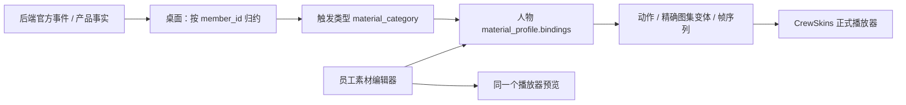

# ADR-0010：人物配置分层、动作帧与默认文件能力

状态：已实现，2026-10-27。延续 ADR-0009 的 backend / desktop 边界，本次不扩展安全 VM 或权限审批。

## 1. 人物属性的两层配置

人物身份（member_id、名称、关联 agent_id）位于属性表单顶部，其下分为两个页签：

| 页签 | 内容 | 存储与影响范围 |
| --- | --- | --- |
| Agent 配置 | 职责、系统提示词、Skills、MCP、Python 开关 | agent_definitions；多个形象共享执行定义 |
| 员工素材配置 | 图集、颜色、空闲活动、人工/完成泡泡、轨迹类型与动作帧绑定 | members；仅影响这个员工形象 |

桌面 `CrewMemberConfiguration` 分别收集两类编辑数据，`CrewActionEditor` 负责触发映射与帧编辑，`CrewMaterialPanel` 与 `CrewSkins` 负责共享预览/正式播放。通用后端不解释素材帧、人物动画或泡泡。

## 2. 动作帧如何配置和使用

在“员工素材配置”导入 PNG+JSON 图集后，选择触发类型：普通工具、Python、MCP、Skills、人工、完成、安全审核预留、成员发现。选择表现动作，默认自动适配方向/姿态；也可指定图集中的精确变体，调整帧序列、fps 与循环。

点“应用并预览”使用正式图集播放器预览；点人物总保存才持久化。没有点预览的当前有效草稿也会在总保存时合并。恢复默认只删除该人物当前触发类型的覆盖。



保存格式示例（帧号必须来自实际图集）：

```json
{
  "version": 1,
  "avatar_id": "avatar:<当前导入素材ID>",
  "bindings": {
    "mcp": {"action": "phone"},
    "completed": {
      "action": "report",
      "clip": "report.s.standing.neutral",
      "frames": [12, 13, 14, 13],
      "fps": 7,
      "loop": false
    }
  }
}
```

自动模式保留方向/姿态适配；精确变体明确覆盖此组合。走动和会议等临时动作仍有优先级，配置帧不改变人物实际位置。更换素材保留动作语义，清除旧图集帧号；内置骨架可选择语义动作，不能编辑不存在的外部图集帧。越界帧、缺失变体、非整数 fps 与不匹配素材由桌面校验拒绝。

旧 interaction_profile.action_overrides 兼容读取，编辑保存后归并为 material_profile，避免两套映射同时编辑。相关字段不进入 Agent Run 快照、系统提示或 checkpoint。

## 3. 泡泡归属与跟随

泡泡和指向线绑定该 Run 入口主人物的 member_id，身份来自 `run.started`，不使用当前选中人物或共享 agent_id。只有 `run.completed` 产生结果泡泡，子任务完成只保留轨迹。子 Agent 的人工请求同样由入口主人物转达，保留真实 request_id、source_member_id、scope 和会话；点击答复仍恢复原子任务。多个独立任务可各自保留提示。该规则覆盖前期“各执行人物单独提示”的设计。

泡泡与尾巴合并为稳定人物局部挂点。人物根节点与提示根节点由 `crewSetActorTransform` 同帧写入同一份投影变换，两者继承同一个 world 镜头，文字框与人物共同缩放。提示单独绘制在家具上层，避免白板或柜子挡住点击；不以重新选边处理遮挡。内置骨架定义局部头顶挂点，图集根据统一画布、脚底锚点和整套姿态最上沿生成一次站立/坐姿挂点，使用 WeakMap 缓存。起坐按 seatMix 插值，显式固定变体遵循实际选定姿态。行走帧和朝向不会改变挂点，不再读取每帧屏幕裁切框、反算 CTM 或动态选择左右候选。

完成后点击并成功打开对应会话才记录已读，不改变任务状态；人工问题仍需真实答复。未读提示与当前任务状态分开保存，新任务、切换会话或空间、重启不会自动清除。完整内容放在右侧，泡泡只承载人物自定义短提示。

## 4. 所有 Agent 的默认工具

官方 Deep Agents 继续提供 ls、read_file、write_file、edit_file、glob、grep 和 write_todos。文本工具用于 UTF-8 文本、代码、JSON、CSV、Markdown 等；不能把它们描述成 PDF/Word 的语义解析器。

RoomCrew 补充以下默认能力，主 Agent、通用子 Agent、配置工作者使用同一装配入口：

| 工具 | 行为 |
| --- | --- |
| file_info | 查询存在性、文件/目录类型、大小、修改时间 |
| make_directory | 创建目录及父目录 |
| copy_file | 按原始字节复制普通文件，目标存在时拒绝 |
| move_file | 单文件移动/改名，目标存在时拒绝 |
| delete_file | 删除单文件或空目录；缺失返回 deleted=false |
| execute_python | 运行 Agent 已写入任务目录的 Python 脚本，返回真实日志/退出码/产物 |
| list_agents、ask_user、get_local_time | 成员发现、人工介入和本机时间 |

复制和移动支持任意格式的字节，不重新编码二进制。所有路径使用当前会话虚拟路径；本次不提供目录递归删除或覆盖已有目标。将来增加 PDF/Office 内容解析时，采用独立工具，不改变上述字节操作语义。

Python 默认加载，用户可按 Agent 定义关闭；关闭能力不被子任务偷偷重新启用。继续使用已有随包解释器与执行边界，本次重点验证执行能力，不新增安全产品功能。用户无需预装 Python。第三方包、pip 和联网执行尚未提供。

## 5. 首次实现验证结果（历史）

- 107 项 pytest 通过；包括共享 Agent 的两个形象独立保存素材与泡泡、帧有效性、二进制 CRUD，以及主子 Agent 默认工具。
- 子 Agent 实际生成并执行 Python，读取输入计算，产出二进制文件，再复制、改名、查询和删除；逐个实际模型请求检查默认工具均已注册。
- 首次脚本真实报错，模型收到错误后调用 edit_file 修正，同一 Loop 再执行成功；不使用业务专用答案。
- Node 验证精确帧覆盖、原图集不变、人物移动时泡泡同向跟随和按钮避让；既有三组协议回归保持通过。
- 原生 WebView2 表单验证两个页签、真实图集导入、7 fps 自定义帧实际播放、MCP/Python/人工恢复，以及缩放后气泡屏幕尺寸稳定。
- 使用已保存模型配置运行独立真实任务：生产框架完成委派、Skills、MCP、Python、文件归档和人工恢复，86.46 秒，随机计算、归档一致性和临时文件移除全部通过。机器记录为 [agent-files-live-validation.json](../development/agent-files-live-validation.json)。

Windows ZIP 已重新构建；414 个条目 CRC 全部通过，新配置页、帧编辑器、气泡布局与发行 UI 逐字节一致，不包含用户 SQLite 或私有配置。SHA256：`7ae70946d318e15c2a14b31a79c488b9eaa20959f87c27e2c0a61833195a91b0`。

新发行 exe 另经独立窗口验证：9 次合成模型请求、1 次真实本机 MCP 调用，包内 Python 计算 5050，随后真实调用五个新增文件工具；全部通过。该验证不使用用户 Key，与上面的真实模型验收分别记录。

## 6. 未读状态修正与上一版定位尝试（历史）

2026-10-27 修正了固定头部偏移和屏幕夹紧导致的素材脱节，以及显示仅依赖 reporting 状态、前端临时序号导致的新任务覆盖与已读丢失。

- `presentation/bubbles.py` 只读消费已提交事件，把稳定通知身份与回执存到每个空间的 `data/bubbles.sqlite`，与场景库和可丢弃的投影缓存分开。
- 完成使用产品 Run + scope，人工问题使用真实 request_id；多个形象使用 member_id，不能因共用 Agent 定义而串用。无形象外援内部结束不单独制造员工泡泡。
- 人工问题优先，旧完成结果保持未读；多个未处理结果显示数量，每次点击处理其对应通知。取消任务或实际答复只解决相应问题，不把旧完成结果标成已读。
- 桌面 `acknowledge_bubble(member_id, notice_id)` 只登记已读，拒绝消除人工问题。控制层先成功读取通知关联会话，再写回执；失败、切空间或只关闭人工表单均保留提示。
- 帧循环读取实际渲染节点，尾线连接本帧素材边界。用户明确换座可在未读期间继续走动，泡泡持续跟随；不再通过冻结完成角色来替代跟随。
- 图集缺少当前姿态而回退骨架时清理旧裁切引用，只使用当前可见节点，避免泡泡跟随已移除的图集。
- 异步场景刷新按请求代次丢弃迟到快照，避免已读后又被旧轮询恢复。数据库连接显式关闭，Windows 上重建投影不会遗留文件锁。

修正后完整 pytest **110 passed / 51.25 秒**，Ruff、mypy（89 个源码文件）及五组 Node 验证通过。原生能力验收新增 actualWalking、persistentUntilRead：真实 Agent 中断/恢复、实际走向沙发、图集/骨架头部与 SVG 尾线误差不超过 2 像素、缩放、切换会话、查看原结果后消失均通过。另覆盖新任务、重启、投影重建、错误成员回执和加载失败保留等路径。

上一版完整发行包曾重新构建，414 个条目 CRC 通过，泡泡相关发行 UI 与源码逐字节一致，不含用户数据库或私有配置。历史 ZIP SHA256：`ac6f25196de8b72d36313023888a7941784885169bea0e8f9fdede554fd96ad7`。原有素材导入、换座、人工作业、读后恢复空闲的 studio 原生回归也通过；该次定位验证不足，见下一节。

## 7. 整段行走漂移复现与局部挂点修正

用户再次反馈行走时漂移后，新增逐帧连续验收，在旧实现上先得到失败：369 帧中，泡泡相对人物根节点的局部位置变化约 740.76 单位。旧方案会随视口、工具条与遮挡重新选择位置，也受逐帧素材裁切影响。此前验证尾线端点和少数位置只能证明连线接上，不能证明泡泡本体稳定，因此不能把第 6 节的旧定位方案视为已解决。

先用人物直接子节点验证同空间变换可消除漂移；实际用户布局复查发现前景白板会遮挡，因此最终采用第 3 节的共享人物变换与上层提示。提示层只改变绘制顺序，不建立另一套位置推导。动态候选与屏幕逆变换已删除，固定宽高的文字框与三角尾巴相连；帧循环不额外读取布局，成员移除同步释放其提示根节点。键盘事件保留原生按钮激活且不冒泡到场景。

验收使用真实 WebView2、生产人物换座接口和正式渲染器，按 requestAnimationFrame 连续采样至真实 settled，中途两次切换相机定位；测量 `actorCTM.inverse() × bubbleCTM` 的局部平移，要求至少 40 帧且变化小于 0.5 单位。旧实现确实失败，新图集与内置人物各 369 帧的最大变化均小于 0.000001 单位。另检查实际文字按钮与尾巴相连、共同缩放、问题表单关闭保留、切会话保留、成功打开原结果后回执消失。测试沿用合成本机模型、真实 MCP、随包 Python 和人工中断/恢复，不使用用户 Key，不伪造生产轨迹或移动坐标。

连续移动回归支持 `desktop/tests/capabilities_smoke.py --builtin` 覆盖内置人物；默认覆盖自定义图集。`--keep-open` 在读取回执前保留 20 秒供观察，验收后保留测试窗口。相关 Node 五组回归、Ruff、mypy（89 个源码文件）和中文规范/未读持久化四项 pytest 通过。本次未修改 Agent Loop 或业务回执规则。

最终上层提示方案重新通过两种人物各 369 帧连续回归，并增加实际按钮命中检查。Windows 完整程序与 ZIP 重新构建，414 个条目 CRC 通过，渲染器、挂点、样式与入口在源码、解包目录、ZIP 中逐字节一致，未包含用户数据库或密文。该版历史 ZIP SHA256：`9b7c0c84b373e7cb8e4fb5b0c4d04b5e359ade7999bc3d8ae4ccd7b4fa4f8461`。

## 8. 入口主 Agent 统一汇报与人工转达

2026-10-27 按用户最新决定修正归属：此前 `task.completed` 会让配置子 Agent 单独冒完成泡泡，这与统一入口不符。`BubbleStore` 现在增量保存 `bubble_runs(run_id, member_id)`，按正式主运行启动记录确定人物，忽略全部子任务完成。`run.completed` 的结果仍使用稳定主 scope ID；`human.requested` 则使用原始 request_id，但展示人物改为入口成员。

源轨迹、Checkpointer、人工请求仓库和恢复调用完全保留真实执行身份。StudioService 只在桌面表现中把问题计数、提问动作和短泡泡转交入口人物；子 Agent 显示等待协调。问题 ID 到转达人物的映射仅含普通身份字段；表单显示主 Agent 名称，点击问题泡泡定位原请求，仍以原 request_id 调用 respond。主 Agent 不需要额外模型调用来改写问题或恢复另一个任务。

旧 `bubbles.sqlite` 使用事务内一次性策略迁移：将旧 pending 标为 retired，重放正式主启动、整轮完成和人工请求事件，只重新激活有效主任务提示并更新其归属。已读结果与已解决问题的状态不重置；子完成记录保持 retired，不伪装成用户已读。读取游标与策略版本一起提交，失败后可重试；不删除用户业务数据或回写源轨迹。

验证包含非默认入口、主子人物共用定义、子完成不提前宣布完成、人工问题转达、错误人物无法代读、旧子泡泡退役与已读保留。真实 Deep Agents task → 子 Agent ask_user → 人工恢复 → 子返回 → 主总结链路保持身份与会话一致。原生 WebView2 流程经过 10 次合成模型请求、1 次真实本机 MCP、隔离 Python、真实委派和人工表单，确认只有入口人物冒泡；整段行走 881 帧的相对偏移小于 0.000001 局部单位。

最终全量 pytest **111 passed / 51.47 秒**；Ruff、mypy（89 个源码文件）与五组 Node 回归通过。只读核对当前用户数据的 6 条 pending 提示，来源全部为 `run.completed` 且归属与各自入口一致，因此不将这些独立任务的合法未读结果清除。

当前完整 ZIP 共 414 个条目，CRC 全部通过，控制器、渲染器、挂点、样式及入口与源码逐字节一致，未打入用户数据库或密文。SHA256：`814c7863f29a719da7a89b35118d8631d6f3465d72edae77393ad45feb0318de`。
