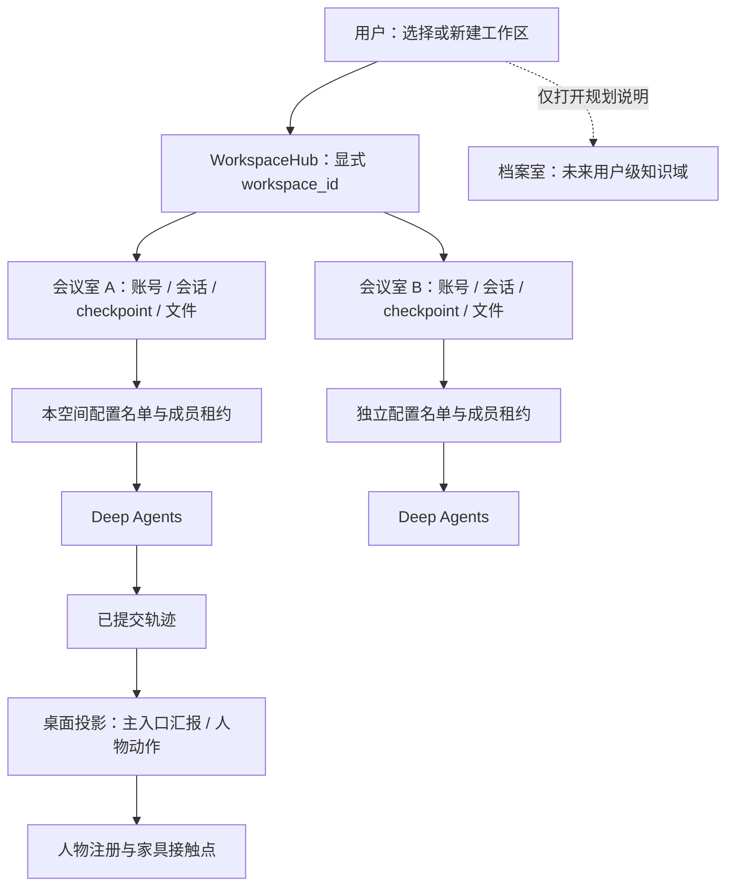

# ADR-0011：统一视觉注册、独立工作区与配置名单

状态：2026-10-27。界面、工作区入口与名单约束已实现；档案室仅有设施入口，归档与长期记忆未实现。

## 1. 总体边界

执行继续使用唯一 Deep Agents Loop。桌面单向消费轨迹，不能决定任务成功、权限或人工恢复。工作区原来已有独立目录和 Runtime，本次强化入口与约束，不另建一套工作区架构。

## 2. 人物与家具

旧清单只按整页人物高度缩放；动作包围框包含弯腿、举手和道具，整体高度不是稳定体型指标。缺帧时回退到另一画风的骨架，也会突然改变身体比例。

assets/registration.py 在素材工作线程读取已校验 PNG 的透明度，估计每帧上部连续轮廓头宽，生成独立 registration.version=1 元数据。目标头宽为 38 世界单位，等比校准，保留原脚底与小跑腾空；坐姿不会拉成站姿高度。不重绘图片、不修改原清单、hash 或帧号，旧导入素材同样受益。每页只解码一次，结果有界缓存，逐帧仅读几何。

低置信度、不透明矩形和 v1 素材保持原注册；用户可关闭校准。这是显示启发式，不是美术重绘，特殊头饰、遮挡或非人形素材可能需要人工精修。预览和正式场景共用播放器；缺动作保留同一图集的兼容 idle，缺姿态保留该人物站姿，不宣称具备未制作动作。加载期间不闪出另一画风。

新工作区准备统一手绘助手和监管员，新成员默认员工套装；旧工作区已选形象不被覆盖。统一地面投影仍是 (x-y)*24、(x+y)*12，接近点、脚底和姿态仍由 SceneStore 锚点维护。

| 对象 | 接触依据 | 处理 |
| --- | --- | --- |
| 人物 | 脚底、头宽 | 等比校准，保留站坐差异 |
| 工位 | 手部约 46 世界单位 | 图片接触位置对齐正式座点 |
| 椅子 | 座面约 26–28 单位 | 同套手绘素材、独立深度排序，位于人物身后 |
| 沙发 | 图中座垫、臀部约 28 单位 | 按座面定位，不仅按外框居中 |
| 书柜、白板 | 统一尺寸目录 | 避免视觉跨度异常巨大 |

原图透视和动作细节仍可能需要美术精修，本次不宣称已实现完整骨骼动画或任意外部家具自动适配。泡泡仍共用人物变换，在家具上层绘制，仅成功查看或实际答复后解除。

## 3. 白底阅读

theme.css 集中维护界面配色：白色面板与会话、深灰正文、蓝灰强调和浅灰边框。会话正文 14px、1.9 行高，用户消息、工具记录与表单分层；墙面和地板改为接近白色的中性色。布局文件继续管理定位，主题不参与业务。

## 4. 独立工作区

顶部常驻“新建工作区”，侧栏入口保留。WorkspaceRepository 创建稳定 ID，WorkspaceHub 初始化独立 Runtime 后进入唯一会议室，不复制其他空间的成员或上下文。默认空间继续使用原 data/，新空间为 workspaces/<id>/data/；账号、人物、会话、轨迹、checkpoint、文件与场景分别保存。

模型连接由本机用户统一维护，秘密不复制到工作区。业务桥显式携带空间 ID，切换不停止其他会议室执行。当前仍为一空间一活跃会话、最多四空间并行、最多十六空间；新空间初始化期间旧任务自然完成不等于被取消。

## 5. 配置人数约束

可执行身份只来自本空间已启用成员，以及用户显式登记、没有形象的独立定义。监管员和档案室不计入 Agent 人数；不同形象即便复用定义，也按独立 member_id 运行。list_agents 只返回本轮固定名单。

取消隐式 general-purpose 外援，通过 SDK 公共 HarnessProfile 注册与 GeneralPurposeSubagentProfile(enabled=False) 关闭默认注入。模型只公开固定 roomcrew:private 标识，没有可委派成员时不暴露 task，入口 Agent 自己处理或请用户配置。

ConfiguredDelegationMiddleware 在应用组装点接入，真正 task 执行前检查目标与成员租约。同一成员同时至多一个子任务；重复并发返回可处理错误，可顺序安排或选择其他成员。异常、取消和人工中断均释放租约，锁不跨 await，不使用无界等待。

N 个执行身份同时至多 N 个活跃实例（包含入口），不能反复 task 克隆同一成员。不同身份可并行，租约和上下文不跨工作区共享。模型请求数和轨迹条数不是人数。真实执行者留在轨迹里，完成与人工问题仍由入口主 Agent 提示。

## 6. 档案室当前状态

档案室是基础设施：侧栏入口和可摆放家具。新布局直接包含；旧布局仅在空闲墙边补充，不移动原家具，满房间保留侧栏入口。点击只展示说明，不调用模型、不读取或总结资料、不增加执行 Agent。

未实现归档数据库、习惯提取、跨空间检索、长期记忆自动注入或工作区删除。入口不会让 Agent 自动感知其他会议室内容。

## 7. 后续记忆与删除设计（未实现）

档案室作为用户级独立域，原始封存包、提取任务与检索记忆分开。记忆应包含来源空间/会话、时间、访问范围、版本、置信度和确认状态。用户习惯先作为待确认候选，不把推测直接当永久事实。

默认不检索、不自动注入所有资料。仅在明确需求与授权下限定来源、时间和结果量，摘要继承访问限制；支持纠正、撤回、过期和追溯，检索失败不阻止普通任务。

未来删除会议室前冻结写入，由用户选择保留范围，生成带哈希的原始封存包（数据库、文件、来源清单，排除秘密），确认成功后移出列表。提取可异步重试，失败仍保留原始副本，不能让模型摘要成为唯一存档。彻底删除时明确处理派生摘要。删除、封存、提取和物理清理分别建模，后续专门评审后实现。

## 8. 验证

使用真实 SDK、本机合成模型/MCP、隔离 Python 和原生 WebView2，不使用用户真实 Key。验证名单、重复并发与取消释放、四套真实图集体型与原图不变，以及顶部新建、档案说明、后台任务、文件和草稿隔离。通过数量与发行校验完成时补充。

最终全量 pytest：113 passed / 72.72 秒；Ruff、mypy（91 个源码文件）与五组 Node 验证通过。原生能力流程经过 10 次合成模型请求、真实委派、MCP、Python 和人工恢复，主 Agent 泡泡归属保持正确；连续移动 888 帧的相对偏移接近零。原生工作区验收完成两会议室创建/切换、独立成员与两个实际文件，后台执行与未发送草稿保持正确，并验证了顶部新建按钮和档案说明入口。

Windows 完整包已重建，415 个条目 CRC 通过，主题、入口、工作区控制和相关人物/家具渲染文件与源码逐字节一致，不含用户数据库或密文。最后的监管员站位与选择框调整另通过 14 项相关回归；原骨架改用 display 隔离，避免子节点 visibility 显式可见形成悬空表情，该修正已通过末次原生委派/人工恢复与 872 帧移动回归。ZIP SHA256：f84b6d5a2b43fc6198a91b766c6a9a531ec878f8ec6b698d814aef313ea8a310。
