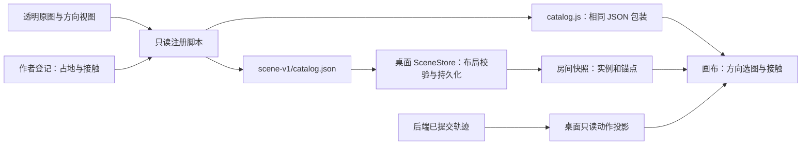
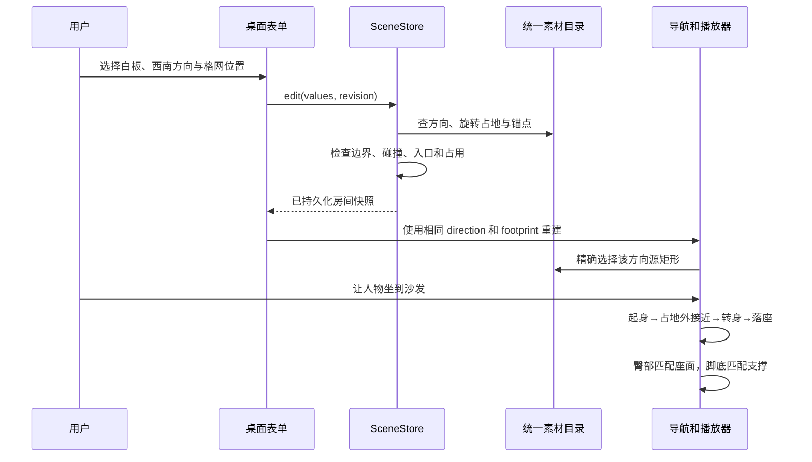

# ADR-0017：可配置场景素材与八方向接触合同

状态：2026-10-27，已实现内置素材合同、方向编辑、接触求解和默认布景；外部家具导入与完整动画编辑器仍未开放。

本决定覆盖 ADR-0014—0016 中固定桌型、固定坐姿抬升、旧 24×19 布景及 office-v1 默认资源的描述。Agent Loop、实际工具权限、官方轨迹和任务结果不因此改变。

## 1. 先分清五种对象

| 对象 | 负责什么 | 不负责什么 |
| --- | --- | --- |
| Agent 定义 / Run | 能力、上下文、真实执行与轨迹 | 原画、座高、朝向 |
| 员工素材 | 动作语义、方向、姿态、帧序列、接触标记 | 工具权限 |
| 设备素材定义 | 八方向图片、世界尺度、占地、操作面和座位类型 | 某间房的摆放位置 |
| 家具实例 | 稳定 ID、类型、位置、方向、座面高度 | 把图片旋转当成新的视角 |
| 场景播放器 | 导航、转身、入座、图层、脚踏、动作与泡泡展示 | 判断真实任务成功 |

用户以后更换一张椅子的画法，不应改 Agent；旋转白板也不应重新定义一种工具。当前先将这些职责独立，避免继续在每个家具分支里加偏移值。

## 2. 同一份素材事实，两端读取



源目录为 `desktop/ui/studio/assets/scene-v1/`。`packaging/register_scene_assets.py` 仅读 PNG 透明轮廓，登记源矩形与元数据，不编辑图片。运行不依赖 Pillow 或该脚本。

`desktop/src/roomcrew_desktop/assets/scene_catalog.py` 读取随包 JSON；`scene-assets.js`、`furniture.js`、`skins.js` 读取同内容的浏览器包装。Python / JavaScript 合同逐内容比对，避免碰撞与显示各维护一张尺寸表。

当前登记 14 个设备类别。其中 12 个类别有八向槽的原绘图，监管台共用电脑桌原图；实际新增 11 张设备图集。绿植、圆形落地灯显式声明旋转对称复用，不能把同图复用统计成八张原画。另有四张人物坐姿图集，每张八个方向。

生成来源与完整提示词在 `prompts.json`，不包含本机绝对用户名路径。历史 office-v1 留在源码供追溯，运行及发行均排除该目录。

## 3. 方向和占地

方向名使用屏幕方位 `e / se / s / sw / w / nw / n / ne`。当前代码世界格网投影为 `screenX=(x-y)×24`、`screenY=(x+y)×12`（2026-10-28 校正此前文档中误写的 32/16）。例如世界 +x 指向屏幕东南，+y 指向西南。不能把屏幕东误当成世界 +x。制作视角与八向轴线以后续 [统一素材制作规范](../assets/asset-production-standard/README.md) 为准。

| 屏幕朝向 | 格网方向向量 |
| --- | --- |
| e | [1,-1] |
| se | [1,0] |
| s | [1,1] |
| sw | [0,1] |
| w | [-1,1] |
| nw | [-1,0] |
| n | [-1,-1] |
| ne | [0,-1] |

设备 `direction` 表示正面 / 操作侧朝向。电脑桌使用者朝其反方向面对显示器；沙发使用者朝沙发正面；会议桌的两侧坐席相向。

每个定义提供基准方向和基准占地。旋转 90° 时交换长宽，45° 时使用旋转矩形的保守外包格。这样斜放家具可能占更多格，也可能因碰撞、边界或阻断入口而被拒绝。这是有意的稳定性取舍；当前不是精确多边形物理引擎。

**占地包含设备及其预留座椅空间。**步行 `approach` 必须在占地外；落座后的 `position` 可以进入专属座位区。普通路径不得穿越桌体或其他椅子。旧文档的“所有入座点都在占地外”由此修正，不能再据此把人物推离座面。

示例家具实例：

```json
{
  "id": "my-sofa",
  "type": "sofa",
  "x": 19,
  "y": 12,
  "direction": "sw",
  "seat_height": 22
}
```

“布置会议室”已可选择设备、格网位置、八方向、12—32 世界单位座面高度。活动中的家具不可直接移动；并发编辑按房间 revision 检查。当前是表单布置，尚无鼠标拖拽家具。

## 4. 图片视角不等于平面旋转

每个 `materials.<type>.views.<direction>` 包含：

| 字段 | 含义 |
| --- | --- |
| rect | 源 PNG 裁切矩形 [x,y,width,height] |
| coverage | drawn 原绘；symmetric 对称复用 |
| ground | 相对裁切框的落地挂点 |
| operator_ground | 电脑桌逐向登记的操作侧脚点，可位于原图外 |
| seat | 椅子 / 沙发的归一化座面挂点 |
| keyboard | 预留桌面接触提示；当前不做手部 IK |

所有图片等比缩放。八方向用独立裁切选图，不用 SVG rotate、斜切、水平拉伸或一张图的左右翻转冒充不同设备视角。AI 生成的图集顺序不一定遵守提示词，因此按实际原图登记；储物设备与桌椅图集的行列方向顺序不同。

椅子的八向图片预先创建，坐姿朝向改变时切换可见性；椅背有有限前景遮挡。不会每帧重新解码图片，也不会为一次转身无界增加精灵节点。

## 5. 人物到底需要哪些动作

“允许导入草稿”与“完整办公素材”分开：历史人物导入仍允许最小站姿素材；完整交互素材应满足下表。不能升级后拒绝用户原有图集，也不能把缺失动作说成已经完成。

| 动作 | 建议覆盖 | 接触 / 转换要求 |
| --- | --- | --- |
| idle | 八向站姿、八向坐姿 | 站姿脚底；坐姿臀部和脚底 |
| walk / run | 八向循环；run 可后补 | 连续脚点，方向与速度匹配 |
| sit_down / stand_up | 八向过渡 | 站立→接近→转身→落座，反向离座 |
| work / type | 八向坐姿循环 | 面对操作面，手部接近键盘 |
| ask / report / alert | 对用户方向和工作方向 | 与原任务入口人物及泡泡一致 |
| phone / read / talk | 常用正侧面，可扩八向 | 与道具一致；无对应帧时明确回退 |
| game / water / relax | 个人可选生活动作 | 电脑游戏须在工位，浇花须有合适位置 |

本轮四套内置人物各新增八方向**坐姿关键帧**，作为身形、方向和接触的共同基准；原有站立、行走等图集保留。新增坐姿还不是每种动作的八方向完整动画，未制作的手部动作会复用兼容坐姿。素材总览对此明确提示。

已知内置素材按内容 ID 在显示内存附加一页，不修改原图、原帧号或用户两页 v3 导入合同。陌生自制素材不会套上内置人物补图。显式坐姿绑定若没有接触标记，不能强行覆盖已经登记接触的内置坐姿。

## 6. 坐得住，也踩得到

人物姿态登记臀部 `hip`、脚底 `soles`；可补 `hands`、`bubble`。自制图集使用虚拟帧坐标，原点左上、向右向下为正：

```json
{
  "page": 0,
  "rect": [0, 0, 100, 150],
  "offset": [50, 40],
  "scale": 1,
  "contact": {
    "hip": [100, 160],
    "soles": [100, 196],
    "hands": [118, 142],
    "bubble": [100, 54]
  }
}
```

这是 `frame_size=[200,200]` 的字段示例，实际接触点应由作者对自己的原图标注，不能原样套用。校验要求二维有限数值、位于虚拟帧内、臀部高于脚底，拒绝 NaN、布尔值、脚本和未知键。

自动体型注册会同步换算这些接触标记；未归一化的素材在显示时换算为世界单位。内置补帧登记的是世界局部坐标，且同一角色八向共用头部尺度，不逐帧按裁切框高度重新缩放。

设姿态臀部距脚底高度为 P，家具座高为 H：

- H≥P：身体上移 H−P，同时显示该高度的脚踏，让脚底有明确支撑。
- H<P：脚底保持地面，显示 P−H 的坐垫支撑臀部。
- 起坐过程中乘以连续 seatMix；人物身体和泡泡同帧使用结果，地面阴影保持地面。

脚踏中心使用实际登记的鞋底 X 偏移，不能放在另一处人物根坐标下方。没有接触标记则返回“未验证”，不假设已适配；该情况保留兼容显示，不能宣称物理接触正确。

这里是确定性的接触注册与支撑求解，**不是骨骼 IK、自动解剖识别或精确双脚物理**。内置髋部是作者比例标记，鞋底来自透明轮廓测量；更复杂体型仍需要作者逐帧精修。手部和泡泡可保存标记，当前不据此自动驱动手部 IK；泡泡仍使用既有稳定头部挂点。

## 7. 四张沙发和中央茶几

默认房间为 32×25 格。保留四工位、安全服务台、档案柜和会议区；休闲区用四个相向沙发围住中央茶几，咖啡、冰箱、落地灯及植物在外围，保留主通道。四沙发分别朝 se / sw / ne / nw。

原 `sofa` 和 `lounge-sofa` ID 保留，避免已有成员丢座位。沙发当前各提供一个稳定主坐席，即四张沙发最多四个人物落座；双人多座位扩展需要增加独立 seat ID，不能复制成员身份。

布局升级只接受完整匹配的已知 24×19 旧默认模板。移动过家具、额外自建家具或不符合已知模板的布置不会被重置；这些自定义房间可继续编辑，新增空间直接采用新版布局。迁移本身也不修改 Agent 配置、会话或任务文件。

## 8. 从编辑到播放



动作来自桌面已有轨迹归约：MCP / 工具 / Skills / 人工 / 完成仍可选择员工素材动作。此次不在后端增加动作字段，不改变实际人工恢复或委派对象。动画缺帧、走路或入座不能阻塞真实模型执行。

## 9. 验证与限制

127 项 Python 回归通过，覆盖统一目录、原图边界、六种设备各八方向的几何和持久化、接近点可达性、非法接触标记、四沙发布局和自定义房间保护。Node 检查四人物的 32 个方向姿态、臀部 / 脚底方程、原清单不变、方向选择与借座。

原生 WebView 验收使用本机合成模型服务，但实际运行 Deep Agents、隔离 Python 和 ask_user 恢复：四次模型请求，产物生成成功，完整经过起身、移动、转向、落座；连续行走脚点侵入为零，同时精灵最多两个；真实表单依次保存白板八方向，再打开受限素材总览。已目检工作、休闲、旋转与总览截图。

这些验证不代表所有自制图集或所有旋转布局都已经人工验收，更不代表全动作动画或正式游戏物理已完成。下一步按合同补齐手部动作、不同体型的逐帧注册和外部家具导入；届时应先提供作者预览与覆盖检查，再允许发布为完整素材包。
