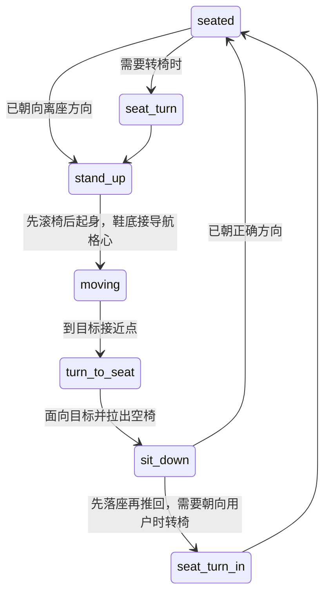

# ADR-0019：标准椅子的配套交互与脚点交接

状态：2026-10-28。用户提供的暖色手绘办公室继续作为美术目标；本决定聚焦人物与桌椅的真实关联，不增加后端动作协议。

后续补充：用户指出家具原画与地轴投影不一致。本文的已实现交互不代表当前原图通过美术验收；后续制作按 [统一素材规范](../assets/asset-production-standard/README.md) 重建相机、尺寸、根点和逐帧接触。现有 PNG 尚未据此重制。

## 为什么不能继续只调人物高度

独立生成的坐姿和椅子没有共同的骨点。仅按头宽统一大小，再推测臀部位置，即使数值接触通过，仍会出现脚插进抽屉、椅背压肩、起身整张图缩放和椅子跳位。此前静态画面检查不足以证明交互合格。

新的标准椅预设将人物和同款椅子作为一个配套交互片段绘制。桌子、显示器、键盘与鼠标仍是独立物件；空椅也仍是独立物件。人物使用配套片段时隐藏对应空椅，离开后在真实拉出位置恢复空椅。不能同时绘制两张椅子，不能拿完整背景图伪装可交互办公室。

## 素材和坐标合同

- `paired-chair-v1.png`：四行对应四套内置人物，每行四帧，包含背向待命、两帧伸手工作和正向待命。东北/西南明确镜像复用交互片段，不声称新增独立原绘方向。
- `chair-rise-v2.png`：六列四行，依次待命、前倾、准备起身、半起身、站直、离椅站立。反向播放用于落座。每个角色使用同一头宽尺度，不随动作裁切框重新缩放。
- `workstation-v3.png`：八向桌子和四向独立键盘/鼠标。行高并不相等，注册脚本使用明确行边界；不能套均匀网格切到相邻图片。
- 每帧登记中央椅脚轮的原点；最后一帧另登记鞋底相对椅脚的局部位移。测量透明通道，不根据预览底色判断 PNG 是否透明。
- `furniture_position` 是桌子的固定作者原点；`position` 是座位原点；`approach` 是外侧整数导航格。三者职责不同，移动椅子不能移动桌子。

世界投影为 `screen.x = (x-y)*24`、`screen.y = (x+y)*12`。局部投影偏移 `(dx,dy)` 对应世界偏移 `(dx/48+dy/24, -dx/48+dy/24)`。站立帧鞋底与导航格心用这组逆变换对齐。臀部到鞋底的屏幕纵向距离含地面深度，不等于物理座高，不再据此自动塞脚踏。

## 运动状态机

离座用 `sourceSeat`，目标用 `target`。`crewAttachedSeat` 统一提供当前接触对象，禁止在刚点击新目标时就转动、隐藏或移动远处椅子。到达新目标清理上一张椅子的退出点与片段进度。离座期间再次点击只替换后续路线，保留当前姿势与原椅，不重播起身。

六帧片段按进度选帧，不能给每帧叠一张透明旧椅。跨配套/独立图像边界也禁用整张图透明交叉，以免出现双椅重影。原有站立、行走与表情图集保留，普通动作切换仍使用有界混合，最多两个精灵节点。

空椅位置由 `CrewMotion.chairs` 维护，只是可丢弃的桌面状态。切换空间/布局重建时清空；不写用户家具布局，不写 Agent 状态。默认第四工位旁的盆栽上移两格以留出拉椅空间，升级仅匹配完整旧默认清单，任何自定义布局保留。

## 预设边界和扩展

当前配套预设限四套已知内容 ID、标准鼠尾草绿办公椅、座高 22，以及已制作的方向。自定义人物、沙发或改高椅子继续原独立接触路径，不使用配套片段的椅脚运动。将来开放更多家具时应增加预设 ID、方向、接触标记与片段，而非再加一组全局人物偏移。

运行显示在用户两页之外附加三张白名单补页：八向坐姿、配套办公椅、六帧起坐。总共五个内部显示页。用户 PNG/JSON 导入仍为两页，源数组和原帧号不变。模型文字、素材清单和用户技能均不能下发任意图像地址或执行代码。

当前没有骨骼 IK、连续物理求解、任意家具自动贴合或所有动作的八向完整动画。会议、沙发等不同接触仍需继续逐类精修；不能把标准椅样板宣称为完整游戏动画系统。

## 验证要求

1. Node 检查来源座、目标座、再次点击、逆投影、鞋底连续、自制形象回退和真实五页加载，原清单不可改变。
2. Python 核对四角色各六帧的透明度、边界、配套椅标记、站立鞋底；旋转与布局迁移保护继续回归。
3. 独立原生窗口使用合成模型运行真实 Deep Agents、隔离 Python、人工恢复与产物核验；没有使用用户密钥。
4. 原生播放器实际导出每张离座、入座帧及工作近景、全景、行走、沙发休闲；截图不能通过改位置或强制选帧生成。
5. 打包后核对资源与 ZIP 一致，再用发行目录的实际 UI 文件运行同一原生验收，并正常启动独立 exe。

人物动作不批准工具、不改变任务完成、不延迟生产 Agent，也不成为框架执行的前置条件。
