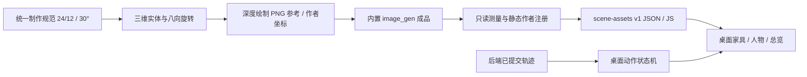

# ADR-0020：统一投影的第一批素材重制

日期：2026-10-28。状态：已实现兼容预览，严格完整美术包继续按制作规范验收。

## 问题与结果

此前多次只移动二维贴图和调整身高，家具原画与地板仍使用不同相机。人物在动作切换时椅子款式、手的位置及落地线也不一致。新一轮先给家具建立固定三维底稿，再绘制八类设备和四角色椅子交互素材；生产 Agent Loop、轨迹和授权不参与这些修正。

## 数据流

## 运行合同

- `crewSceneMaterial` 支持每向 `image`、`atlas_size`、`display_height`，不再假设一个设备的所有方向一定在同一图片。统一目录仍是同一 JSON 的浏览器包装，不把 Deep Agents 类型引入桌面。
- `world_origin_at_center` 区分新家具的真正实体原点与历史视觉偏移。椅子和沙发的座面、地面由同一作者原点推导，不独立猜框内比例。
- 新桌子的操作侧与键盘挂点由三维坐标计算，先旋转再投影。默认方向另用高密度单图。其余方向保留实际生成图；不对 PNG 施加屏幕斜切或非等比伸缩。
- 会议桌保守占地用于阻挡和外围接近点，实体桌边用于最后落座点。四席采用中心两侧各 1.65 格、沿桌边各 1 格，避免新桌子变小后椅子还停在外围通道。
- 四角色三张内部补页仍共五页显示。更新配套工作、六帧起坐的白名单路径，不改用户原清单、原帧号及两页导入合同；离座与落座继续分清原椅/目标椅。
- 总览能切换新版配套姿态与六帧起坐。关键帧不宣称完整连续骨骼动画，镜像覆盖不计新原绘。

## 规范兼容边界

新图集生成后没有严格保留参考图的固定像素密度，现阶段做静态作者校准并记录偏差，不使用逐帧自适应归一化。运行显示更协调不意味着原画刚性漂移、双手双脚接触或全部投影方向已达到最终阈值。

当前采用旧角色的座高 22 兼容规格；尚未制作规范要求的 0.44 米新骨架。配套图的椅脚根点、角色脚点交接按 ADR-0019 显式转换，不能冒充完整新 profile。详见 `desktop/ui/studio/assets/scene-v2/README.md`。

## 验证

单元检查增加默认桌子真实 PNG 边缘拟合、座面与根点恒定高度、会议桌实体座点。原生检查包含真实 Deep Agents / 隔离 Python / ask_user 恢复，工作近景、全景、六张起身与六张落座、八向白板编辑。

新增素材总览原生检查实际等待家具与四角色 Canvas 绘制，覆盖配套工作和起坐帧，不能仅以 iframe 打开判断成功。独立宿主需以应用 UI 根目录启动再进入素材页，避免把子目录误设成静态服务根而拒绝上层资源。

发行包验证和当前截图位置记录于 `doc/development/scene-assets-validation.md`；源码底稿排除出运行包。未测指标继续标为未测，不以功能测试数代替视觉验收。
