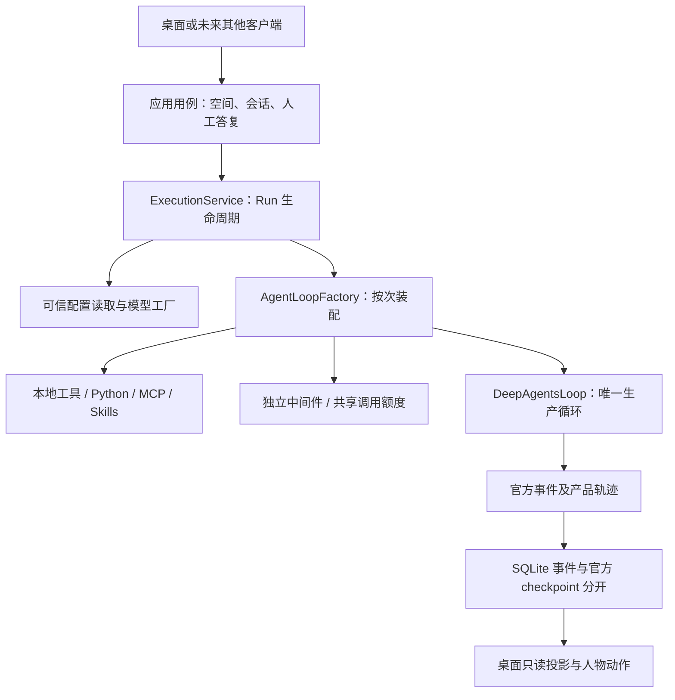

# ADR-0021：执行底座整理与后续升级边界

状态：已接受并实现，2026-10-28。目标是精简现有实现并保留行为，为下一步通用编码与日常工作 Runtime 留下清楚的接入点；本次不增加新执行能力、不升级 SDK。

## 1. 当前执行链

`application/components.py` 中的 `AgentLoopFactory` 是能力装配点；`agent_loop/engine.py` 是 SDK 构图适配点。前者按产品配置选择能力，后者调用官方接口建立图。应用层不直接导入 LangChain / LangGraph / Deep Agents 类型，也不转换桌面动作。

每次新执行、续聊或人工恢复都重新创建工厂。主子 Agent 使用相同装配路径，但本地工具闭包和中间件独立；只有主 Agent 可以委派当前名单。脚本锁、相同 MCP 配置的发现缓存仅属于本次工厂，不升级为进程全局单例，不跨空间或 Run 共享可变上下文。MCP 工具名称冲突仍直接拒绝。

## 2. 资源与数据所有权

| 对象 | 所有者与寿命 | 职责限制 |
| --- | --- | --- |
| Run / 取消 / 人工恢复 / 终态 | `ExecutionService` | 不逐项创建角色专属工具，不包含动画 |
| Agent 定义及成员绑定 | `AccountService` + 产品仓库；每次受理读取快照 | 不作为执行中的共享消息容器 |
| 能力、中间件、脚本锁、MCP 发现缓存 | `AgentLoopFactory`，一次调用 | 不持有真实密钥，不读写产品终态 |
| 主执行模型及 HTTP 连接 | 执行服务创建并在结束时关闭 | 工厂借用模型，不能提前关闭 |
| 探测 / 辅助模型连接 | `model_session` 上下文，退出即关闭 | 不缓存为全局模型或增加环境密钥兜底 |
| checkpoint saver | 工作空间 Runtime 生命周期 | 不把框架表改为产品状态表 |
| 人物 / 家具 / 泡泡 | `desktop` | 不决定权限、工具执行及任务成功 |

模型连接释放路径统一后，探测、辅助生成在成功、异常和取消时采用同一规则；同步连接关闭失败也尝试关闭异步连接。原有超时、调用额度、厂商协议和重试策略均保留。

成员列表改为批量读取定义后合并，绑定在同一份读取结果上完成，避免每个成员单独查询定义。本地工具注册返回独立副本，避免修改工具元数据污染全局模板。没有为 SQLite 与未来云数据库提前增加无行为的空仓库层。

## 3. 本次清理范围

- 删除未被运行目录或场景引用的 `office-v1`、12 张旧场景图片和旧登记脚本，共 21 个文件、20,856,287 字节。历史原图和来源可从 Git 提交 `50e3718` 追溯；当前使用的坐姿、键盘附件、窗景及原绘来源保留。
- 素材登记直接选择当前几何图集，不再先构造整套旧设备再覆盖；移除没有消费者的旧工作帧字段。重新生成目录前后，112 个方向槽、当前人物帧、设备定义与键盘附件保持一致。
- 删除只验证已弃用元数据的重复测试，增加工具实例隔离、模型资源释放、工厂缓存边界和批量查询验证；保留迁移、隔离执行和失败路径测试。
- 开发指导改为按主题查阅，历史 ADR 保留变更依据；根 `main.py`、用户数据、模型配置、旧发行快照和现有存储迁移不删除。

不以源文件行数作为架构指标。当前桌面场景/控制器仍较大，拆分它们需围绕导航、接触求解、渲染和输入分别建立行为验证；本次保持已有交互和美术不变，不进行同时重写。

## 4. 下一步升级顺序

1. **先确定 Runtime 合同**：编码和日常任务共用会话、Run、取消、人工恢复、产物和错误语义；列出行为验收，保留官方消息、事件和 checkpoint，不能另起一套循环。
2. **工具与执行边界**：沿现有注册点补充工具；代码执行继续通过适配器，明确目录、超时、输出、失败和产物。现有 Python 只含标准库、无网络，不等于完整编码环境。Shell、依赖安装、浏览器和安全 VM 需要单独设计和授权开发。
3. **上下文与恢复**：沿现有压缩中间件、Skills 渐进加载、Agent 快照和 checkpoint 扩展。先覆盖长任务、错误重试、压缩后工具配对和重启恢复，再引入长期记忆；不把所有 Agent 消息塞入公共可变列表。
4. **多 Agent 协作**：保持工作空间名单、成员租约和独立上下文；由主 Agent 管理委派和结果汇总。先验证正确性、取消和失败传播，再按测量结果优化并行度。
5. **客户端与性能**：客户端消费稳定事件，不绑定内部 SDK 对象；人物映射仍在桌面侧。用代表任务记录延迟、调用次数、事件体积和内存，再决定是否需要缓存、批量写入或任务队列。

以上为后续顺序，本次没有把计划项标成已实现，也没有预建空插件、重复接口或第二套配置。

## 5. 验证记录

- 完整 pytest：136 项通过；Ruff 通过；mypy 检查 92 个源码文件通过。
- 八组 JavaScript 行为检查通过，覆盖协议、空间、配置表单、素材绑定、泡泡已读、相机指针、办公行为和 Markdown。
- 使用重构前进程创建的 SQLite 与真实 checkpoint，在重构后进程恢复待答复任务并续聊已完成会话；原 Run ID、旧事件前缀及文件产物保留。
- 原生 WebView 验证通过：Python、人工恢复、四角色及起身/行走/转向/落座；素材总览三组加载通过。清理前后的 112 个方向槽和现有角色帧一致，没有在本次修改美术效果。
- 实际发行 exe 完成 9 次合成模型请求、1 次 MCP 调用及随包 Python / 文件增删改查，生成 `sum=5050` 的真实产物。验收输入和窗口关闭的等待预算已可显式配置，避免观察耗时导致测试误报。
- 源码与发行 88 个 UI 文件逐字节一致，ZIP CRC 检查通过；发行不含废弃图集或制作底稿。统一入口为根 `start.ps1`，保留 `.cache/asset-v2-showcase` 数据。
- 本次模型验证使用本机合成协议服务，不读取用户真实 Key，不代表已经验证所有外部厂商。AppContainer、既有能力限制及数据格式保留；没有做全新机器、所有 DPI 或长期负载验收。
