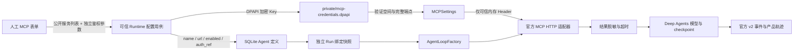

# ADR-0022：Agent MCP 配置与受保护 Bearer 鉴权

2026-10-28，已实现。更新 ADR-0009 中“无认证 HTTP MCP”的边界；不改变唯一 Deep Agents Loop 或桌面单向表现原则。

## 1. 用户入口

右上角 `⋯ → 我的团队 → 选中成员 → 属性 → Agent 配置 → MCP 工具服务`。

- 添加自定义服务，或选择“百炼联网搜索”。每位 Agent 最多八个服务；名称、Streamable HTTP 地址、启用开关可编辑。
- 鉴权方式为无认证或 Bearer API Key。测试直接使用当前表单，不必先保存；它执行初始化和工具发现，不调用搜索等业务工具，不创建会话。
- 显示发现的真实工具名称；失败仅显示稳定错误。修改字段使旧结论失效；移除卡片、关闭窗口或切换空间后旧请求不能覆盖新表单。
- 点击“保存到本地”才提交配置。已有 Key 不回显，同一地址留空保留；改地址必须重填。关闭或取消编辑会清除密码草稿。
- 复用 Agent 定义的新增形象不能编辑原定义；监管员不能配置 Agent 能力。已存在的共享定义修改仍影响其引用者，并保留版本检查。

## 2. 凭据流与存储



公开服务示例：

```json
{
  "name": "bailian_search",
  "url": "https://dashscope.aliyuncs.com/api/v1/mcps/EnhancedSearch/mcp",
  "enabled": true,
  "auth_ref": "<程序生成的32位十六进制引用>"
}
```

`auth_ref` 是定位符，不是服务的 API Key；无认证时省略。原始 Key 不进入账号 SQLite、任务文件、Skills、Run 绑定、框架 checkpoint、工具描述或普通轨迹。公开配置继续拒绝 headers、api_key、URL 用户信息、查询参数与 fragment。

保护文件由 Windows 当前用户 DPAPI 加密；临时文件也先加密再写，flush/fsync 后原子替换。每条凭据绑定相对空间数据路径和规范化后的完整 URL，跨空间或更改地址不能沿用旧引用。相对作用域不会因为同用户移动整个应用数据根而改变；DPAPI 仍不保证跨 Windows 用户/机器可解密。

修改 Key 创建新引用，不覆盖旧引用；主子 Agent 使用本次 Run 固定的配置，其他空间和待恢复任务不会被新 Key 偷换。保护文件成功写入后才做 SQLite CAS；业务失败则移除本次新建引用。进程在两个写入之间崩溃最多留下未引用的加密条目，业务定义不会指向尚未写入的 Key。旧引用保留以支持历史 checkpoint，后续应按引用可达性设计清理；当前无自动清理和 UI 凭据删除器。

模型 Key 与 MCP Key 分开，没有环境变量或执行模型 Key 兜底。当前为可信本机代码访问 DPAPI，不是安全 VM，也不是对同用户宿主代码的完整隔离。

## 3. 模块职责与执行

| 模块 | 职责 |
| --- | --- |
| desktop/ui/studio/mcp-settings.js | 卡片、预设、临时密码、测试和迟到响应隔离 |
| accounts/configuration | 纯公开定义校验；可保存 auth_ref，禁止原始认证数据 |
| config/mcp_credentials | DPAPI 原子存取、不可变引用、作用域/端点/Key 校验 |
| application/runtime | 人工保存/测试入口、忙碌保护、业务版本与凭据失败回滚 |
| application/mcp_settings | 组合公开配置与可信凭据，提供连接参数和当前秘密脱敏器 |
| application/components | 每次 Run 独立发现缓存；主子 Agent 各取自己的服务定义 |
| mcp/provider | 官方 HTTP SDK、工具命名前缀、可信来源标签、结果过滤和超时 |

后端依赖方向维持原规则：config 可依赖 security；mcp 不读保护文件、不导入配置仓库。应用装配层把 Key 作为私有连接参数传给适配器。SDK 连接内部持有 Header，但不将它作为模型参数、工具输入 schema 或图状态。

发现总时限 20 秒，单连接超时 15 秒，读超时 45 秒；单次工具调用外层最多 60 秒，无未知外部效果自动重试。一个 Agent 最多 64 个 MCP 工具，保留服务名前缀和工具重名拒绝。鉴权只允许 HTTPS，HTTP 仅支持 localhost/回环 IP 测试。

工具目录名称、描述或输入 schema 回显 Key 时拒绝注册；普通返回和 structuredContent 在转为 ToolMessage **之前**递归过滤 Key，包括字典键。执行事件再组合模型和 MCP 脱敏器。网络异常只暴露稳定错误码。该机制过滤已知秘密的原文回显，不声称识别任意编码/变换后的秘密或清除普通业务内容中的一切敏感信息。

## 4. 百炼搜索预设

预设使用 [Token Plan Harness 工具文档](https://help.aliyun.com/zh/model-studio/token-plan-harness-tool) 中的 EnhancedSearch Streamable HTTP 端点。使用独立的普通百炼 API Key（`sk-…`），不使用 Token Plan 模型 Key（`sk-sp-…`）。需要用户自行开通服务、核对权限和额度；当前实现不假定账号已开通，也不读取 CLI 密钥文件。

当前只实现 Bearer；不支持 stdio、OAuth、任意认证 Header、MCP 代理配置或应用内购买。用户的真实百炼 Key 尚未填写，因此本轮不声明真实搜索服务已验收。

## 5. 验证

- 新增后端验证：保护保存、留空保留、替换地址、跨空间拒绝、HTTPS/Header 校验、版本失败回滚、未保存配置探测、错误 Key 拒绝、目录回显拒绝。
- 真实本地 MCP + 生产 Deep Agents Loop 执行计算工具；合成模型只控制响应，未替换工具、认证、轨迹或存储。返回刻意回显合成 Key，确认模型请求、SQLite/checkpoint、产品/原生事件和任务文件不出现原文。
- `desktop/tests/mcp_settings_smoke.py` 驱动真实 WebView2 表单、保存和重开，检查预设、错误/正确 Key、留空保留、关闭清除、共享定义只读，并通过正式对话完成 MCP 工具调用。截图保存在该次独立 `.cache/mcp-settings-smoke/<id>/`。
- 完整 pytest 139 项通过，现有九组 Node 界面验证通过；Ruff 和 mypy 通过。真实百炼服务待用户补入 Key 后再验收。
- 最终装配调整后相关 31 项再次通过，原生完整流程再次通过；mypy 检查 94 个源码文件。冻结 exe 已在独立空数据目录启动至“准备就绪”；89 个界面文件逐一核对与源码一致，新增凭据/配置模块已进入 PYZ，发行 ZIP CRC 通过且不包含用户数据目录。未将原生源码验证冒充真实百炼调用或冻结版远端鉴权验收。

## 6. 本次发行与重开

本次发行 `20261028-235604` 位于 `dist/releases/20261028-235604/RoomCrew/`，完整 ZIP 仍为 `dist/RoomCrew-0.1.0-windows-x64.zip`。原窗口无法通过系统自动激活并正常关闭，因此采用并排发布，未覆盖或终止运行中的旧窗口。

`packaging/active-release.json` 已原子切换到新版，数据仍为 `.cache/asset-v2-showcase`；没有复制真实模型 Key。关闭旧 RoomCrew 后运行根 `start.ps1`，不能直接双击旧 `dist/RoomCrew/RoomCrew.exe`。单实例锁会阻止相同数据根同时运行两个版本。只用于启动验证的新版空数据进程已经清理，未将其设为默认数据。
