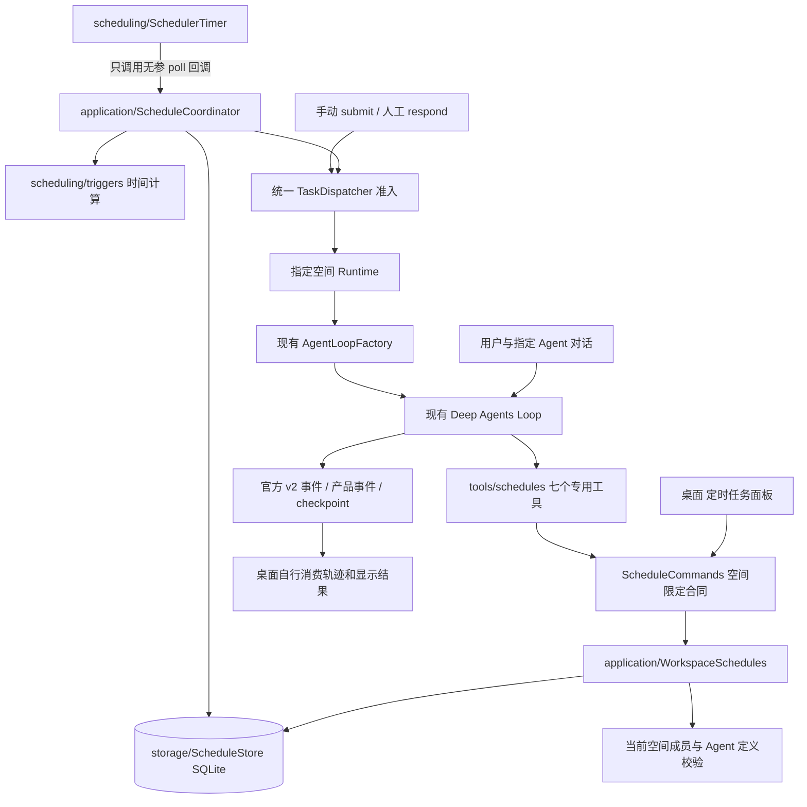
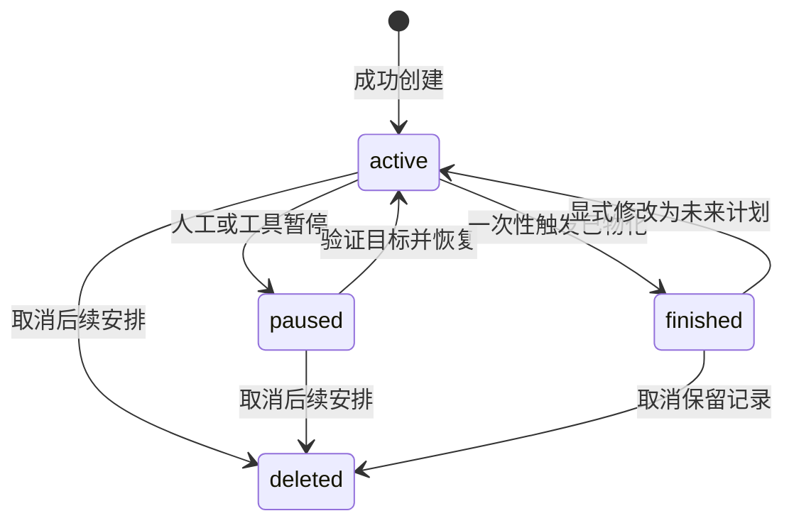
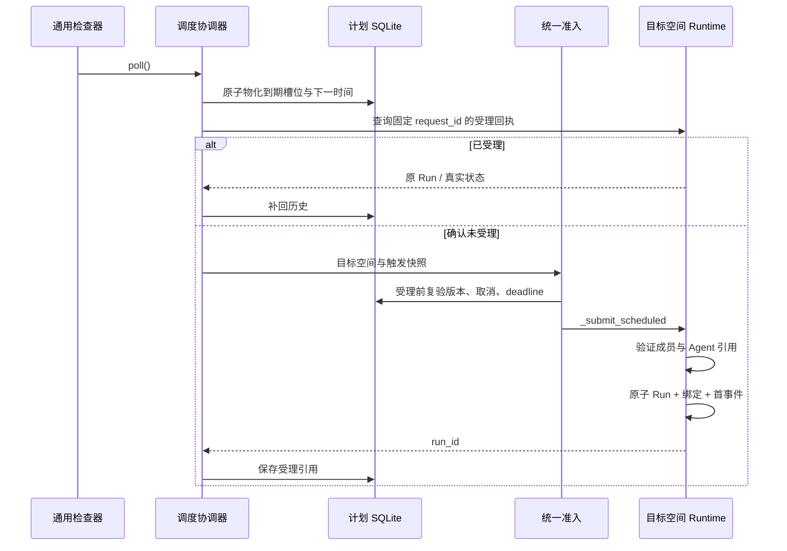

# ADR-0023：绑定工作空间与 Agent 的持久定时任务

2026-10-29，已实现。定时任务是产品用例，复用唯一 Deep Agents Loop；不实现另一套 Agent 循环，不把定时等待放进模型上下文。

## 1. 用户行为与绑定

用户在某个会议室与员工对话，可以要求“每天下午两点半分析黄金走势”“把刚才的任务改成三点”“取消两点半那个计划”。模型必须实际调用专用工具，收到成功回执后才可宣称安排完成；同名计划不明确时先查询或询问用户。

每条计划固定 `workspace_id + target_member_id + target_agent_id`。工作空间由可信装配固定，模型不能通过工具参数指定其他空间。省略接单成员时使用发起工具的实际成员，包括真实子 Agent，而不是一律使用助手。指定其他人时仅接受本空间已配置、启用、未归档且存在 Agent 定义的成员。

计划只保存任务正文、时间规则和身份引用，不复制创建会话、系统提示词、Skills 或 MCP。到期后使用目标成员当时有效的配置构建一次新的正常 Run，并固定本次配置快照。修改系统提示词、Skills、MCP 会影响未来新 Run；已受理的 Run 保持原绑定。如果该成员改绑了另一个 Agent 定义或被停用，则本次触发阻塞，不悄悄交给默认助手。用户需明确修改目标或恢复后续计划。

## 2. 架构与依赖



| 层 | 实际职责 |
| --- | --- |
| scheduling/timer.py | 单实例异步检查器、启停与错误退避；不知道 Agent、空间、数据库和工具 |
| scheduling/triggers.py | 校验四种规则并计算下一时间；通过 APScheduler 3.11 公开触发器计算间隔和日历 |
| contracts/schedules.py | 空间限定的管理端口与短暂繁忙信号；不导入 SDK 或客户端 |
| storage/schedules.py | WAL SQLite、计划 CAS、幂等命令、触发快照、索引、历史 |
| application/schedules.py | 绑定目标、创建、修改、暂停、恢复、取消及可读时间投影 |
| application/scheduled_execution.py | 到期物化、回执对账、延迟窗口、调用统一准入；单项失败不阻断其余项 |
| application/dispatcher.py | 手动、人工恢复、定时触发共用受理锁及四空间并发上限 |
| application/runtime.py | 验证目标引用，用普通执行入口创建指定成员的独立 Run |
| tools/schedules.py | 模型可见的具名工具、注入工具调用 ID、输入与错误适配 |
| desktop/ui/schedules.js | 只调产品 API，展示、直接取消和打开历史会话，不参与调度决策 |

没有 APScheduler 的持久 Python JobStore，也不序列化任意回调。计划和业务状态由产品 SQLite 维护，轻量检查协程与现有后端共用同一事件循环；无需额外常驻服务或线程访问同一 SQLite 连接。框架 checkpoint 不用来表示未来日程。

## 3. 工具与接口

默认主子 Agent 均装配以下工具；未接入宿主调度端口的独立嵌入式 Runtime 不伪装为支持定时任务。

| 工具 | 语义 |
| --- | --- |
| list_schedules | 按标题/正文查询当前空间；默认活动/暂停，可显式包含历史 |
| get_schedule | 精确读取计划、revision、下一次时间和最近二十次触发记录 |
| create_schedule | 新增计划；target_member_id 留空指向当前成员 |
| update_schedule | 按 schedule_id + revision 修改标题、正文、触发规则、目标；历史不变 |
| pause_schedule | 清除下一次时间，撤销尚未受理的排队项 |
| resume_schedule | 重新检查原目标和未来时间，按原间隔起点继续；已取消不可复活 |
| delete_schedule | 逻辑取消未来执行，保留计划、报告与会话引用；不自动终止已受理任务 |

普通桌面接口另提供 `create_schedule / update_schedule / set_schedule_state`，与工具使用同一服务。右上角 `⋯ → 定时任务` 可以直接暂停、恢复、取消和查看记录，不依赖模型或 API Key；新增与修改目前通过对话工具完成，尚无完整编辑表单。查看记录打开真实 occurrence 对应会话，不新增空会话，也不假装用户已经读过其他泡泡。

时间规则示例：

```json
{"type":"interval","seconds":300,"timezone":"Asia/Shanghai"}
{"type":"daily","time":"14:30","timezone":"Asia/Shanghai"}
{"type":"weekly","time":"14:30","weekdays":[0,1,2,3,4],"timezone":"Asia/Shanghai"}
{"type":"once","at":"2026-11-01T14:30:00+08:00","timezone":"Asia/Shanghai"}
```

默认时区 Asia/Shanghai，周一为 0。一次性时间必须有 UTC 偏移且在未来；间隔 60～2678400 秒，首次默认创建后一个间隔。可显式传 `start_at` 固定间隔起点。日历规则使用 IANA 时区库；夏令时不存在的当地时刻跳过，回拨重复时刻只取第一次。Windows 发行包携带 tzdata，不能依赖操作系统恰好提供 Unix 时区文件。不接受任意 Cron、Python 回调、Shell 或未知字段。

每空间最多 64 条未删除计划；查询最多 200 条，活动和暂停优先，避免大量历史遮住待取消任务。正文最多 16000 字、标题最多 120 字。历史长期仍会增长，当前未实现自动压缩或清理。

## 4. 状态、持久化与去重



| 表 | 关键约束 |
| --- | --- |
| schedules | 主键 ID、空间、revision、状态、next_fire 索引、正文；与账号表分离 |
| schedule_occurrences | 唯一(schedule_id, scheduled_for)、原计划版本/任务快照、deadline、状态、run_id |
| schedule_commands | 主键(workspace_id, command_id)、请求指纹和原回执，与修改同事务提交 |

工具的命令标识由真实 `conversation_id + tool_call_id` 派生，模型不能自行选择。恢复重放同一个调用返回原回执；复用命令提交不同请求会失败。修改使用 CAS revision，旧表单或旧模型判断不能覆盖新安排。取消、修改、暂停与撤销旧 pending 在一个 SQLite 事务内完成。

每个到期时间产生确定的 occurrence_id，同一时间只物化一次，推进下一时间与触发快照一起提交。执行使用固定 `schedule:<occurrence_id>` 请求 ID 和 occurrence_id 对应的独立会话，受理时将 Run、首事件、绑定快照一起写入空间会话库。不同周期不复用可变聊天上下文，不把日程模型配置放入 checkpoint。

计划库与各空间会话库不做跨库事务，因此检查器在重发前先查询实际 Run，补回丢失的受理回执。查不到与无法查询必须区分：暂时无法读回执时不发第二次任务。已经受理的任务只对账终态，崩溃中断不自动重做外部效果。这是幂等受理与可追溯恢复，不宣称所有外部工具拥有 exactly-once 语义。



## 5. 繁忙、离线与失败

- 同计划 pending、running、waiting_user 期间不重入，新槽位记 skipped_overlap；人工问题仍走现有人机恢复接口。同一空间正在执行其他工作时暂时排队，不能抢占或启动第二套 Loop。
- 全局最多四个空间执行。准入锁只覆盖初始化和受理，不等待网络模型完成；pending 按空间轮转排序，避免一个空间占满派发批次。
- 默认允许延后 15 分钟，可通过服务参数配置 1～86400 秒。超时记 expired，不创建模型或空会话。长时间退出不会补跑一串历史任务；下一时间跳到当前时刻之后。当前实现检查最早尚未处理槽位：它若过期就跳过，不从离线期间补选另一个较近槽位。
- 目标停用、改绑、配置缺失等记 blocked；普通模型错误沿用现有 Run 失败策略。调度器不自动重放失败的业务 Run，下个周期可按计划正常到期。
- 一条规则损坏或空间暂时不可读不阻断本轮其他记录；检查器报告不健康并退避五秒。全局存储故障不绕过持久化执行。每轮最多一百个到期项和一百个待派发项，按索引分批处理。
- **仅在应用运行且电脑清醒时检查**。退出/休眠时不执行，不承诺 Windows 服务、开机自启、系统唤醒或云端常驻。关闭应用先停检查器，再停止执行和关闭数据库。

## 6. 费用、权限与展示

定时器轮询和任务列表操作不调用模型。到期接单使用现有模型调用次数、总时间与图步数限制；真实业务需要联网时由该 Agent 已配置的 MCP 提供，不因定时任务额外扩张工具或权限。模型 Key 和 MCP Key 仍由可信连接层读取保护文件，不进入日程表或上下文。

自动触发的 Run 只装配日程查询工具，不装配新增、修改、暂停、恢复、删除工具，包含其子 Agent，避免周期任务自己不断生成持久周期任务。用户普通对话仍可管理日程。此限制是当前产品的自动化边界，不是安全 VM 或通用代码沙箱的替代。

轨迹仍是官方 v2 + 稳定产品事件，`run.started.payload.source` 记录 schedule_id、occurrence_id、workspace_id、scheduled_for，`member_id` 保留真实入口接单者；用户消息标记为“定时任务”。人物动作和通知由桌面自行适配，后端不生成“走路/打电话”等协议。

## 7. 验证与后续

验证记录见 [定时任务验收](../development/scheduler-validation.md)。已覆盖 CRUD/CAS/重放、隔离、目标提示词和 MCP、独立会话、取消排队项、超时、重启、回执丢失、四空间容量和异常隔离；另外实际等待五分钟，由真实模型创建、执行和取消时间检查计划。

后续可增加完整时间编辑表单、全局管理视图、持久历史归档、每计划费用预算和 Windows 常驻执行，但不属于当前已实现承诺。部署常驻服务前还必须解决进程所有权、凭据账户、系统唤醒及多实例任务认领；不能直接把当前单实例检查器复制成多个进程。
