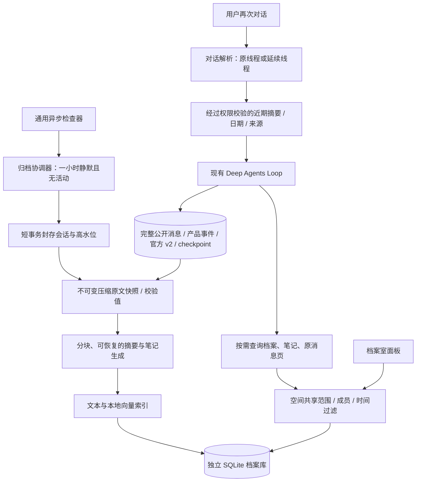
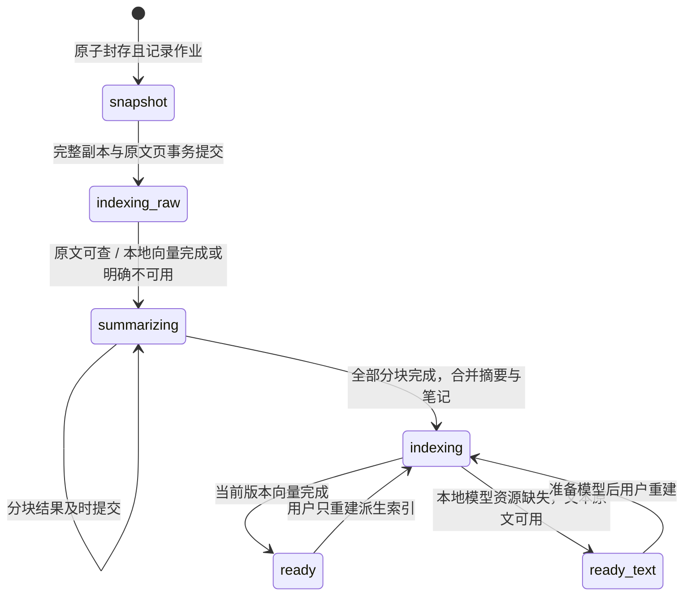
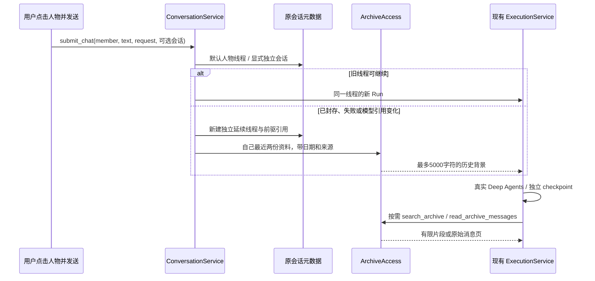

# ADR-0024：独立档案库、异步归档与无感续聊

2026-10-29，已实现并通过原生界面与真实模型验证。验证记录见 [档案验收](../development/archive-validation.md)。

## 1. 产品约定

- 档案库是可追溯知识库。完整公开消息与官方轨迹是原始证据；摘要、笔记与向量都是可重建索引，不能取代或删除原文。
- 一个会话连续一小时没有新数据，且没有运行任务或待答复问题时，才进入后台归档。应用关闭时不工作；重启后继续处理。此处“离线压缩”指脱离交互主链路的异步工作，摘要仍使用用户配置的模型服务，并非保证断网生成摘要。
- 每条档案记录空间、会话、成员、Agent、实际时间、来源事件范围与归档状态。摘要说明何人在何时做了什么、产物、决定、未完成事项与可追溯来源；笔记不把猜测当成用户习惯或授权。
- 点人物默认回到持久的当前对话；发送时若旧会话已经归档，内部创建新线程并装入带日期的少量历史摘要，用户无需手工新建。仍保留显式新建独立会话，用于同一 Agent 同时处理多个任务。
- 不合并并行会话的 checkpoint；不把其他活动任务的可变上下文拼进当前线程。已归档原会话可查看，后续发送创建延续线程。
- 默认检索自己、当前空间，允许显式检索同空间其他 Agent。跨空间默认隔离，由用户在档案室为当前空间选择可读取的来源空间，Agent 工具不能修改共享权限。

## 2. 架构

模块按职责拆分：archive 包维护分块、消息投影和检索模型适配；storage 保存档案及会话状态；application 负责归档、权限、续聊和装配；tools 只暴露受限检索；desktop 自行显示归档和并行会话，不向后端加入动作协议。

## 3. 存储与一致性

1. 原会话 SQLite、文件产物目录与 checkpoint 保留。封存时记录事件和原生轨迹高水位，原文另存压缩 JSONL 与清单校验值；档案库保存完整公开消息列表供分页读取，不丢工具请求/结果和人工答复。产物目录保留原位置，当前不额外复制所有二进制附件。凭据、隐藏推理、厂商私有配置本来就不在公开历史范围内。
2. 会话封存和新请求受理在同一事件循环、短事务中竞争。已经受理或等待人工的会话不能归档；封存之后的新输入转到新线程。归档失败不能让原文丢失，也不能破坏新对话。
3. 后台作业保存源版本、阶段、分块结果和重试时间。外部模型调用不持数据库事务；失败有界退避、可恢复，已成功分块不反复收费。对前台工作让出资源，不用模型自己 sleep 调度。
4. 摘要携带完整日期、来源和未完成项。内容作为不可信历史资料注入，不能成为系统指令、真实权限或任务完成证明。大消息分片处理，压缩不能通过简单截断冒充全量理解。

## 4. 检索与轻量实现

- 使用 SQLite，不引入独立向量数据库服务。文本索引用 FTS5 trigram，短中文关键词使用精确子串路径，避免两个汉字搜不到；参数化查询，不把用户文本当 SQL/FTS 指令。
- 本地 CPU 向量采用 FastEmbed + BGE small 中文模型，模型按需加载，全应用复用，文本不发给远程 embedding 服务；首次提供模型资源，后续使用本地文件。记录模型与维数，避免不同版本向量混算。
- 向量存在 SQLite，元数据先做空间、成员、日期过滤，再进行分批相似度计算；适合个人桌面规模，不加载所有会话原文到内存。混合检索融合文本与向量排序，返回来源而非无出处结论。
- 支持关键词、语义、混合、时间范围、最近对话、成员/Agent 过滤；搜索返回小摘要与原文游标，完整消息按需分页。若向量资源不可用，明确显示降级状态，文本和原文仍可用，不把字符串哈希当语义向量。
- 自动注入限制条数与字符预算，优先同成员最近摘要；更早内容和其他成员由工具按需读取。生成未完成时提供带状态的近期原文摘录，不伪造摘要，也不阻塞用户继续工作。

## 5. 并行与验证计划

将原“一空间一个活动会话”准入细化为“同会话不并发、每空间最多四个活动会话、全应用最多八个活动会话、最多四个活动工作空间”。同一个配置的两次 Run 使用独立图、上下文、文件根与 checkpoint；现有 Run 限额、人工恢复、定时任务与配置变更保护继续生效。桌面停止/输入状态跟随选中会话，而非被其他任务错误禁用。

验证包含：一小时阈值及新写入重置、活动/人工等待不归档、封存/发送竞争、失败恢复和重启、原文逐条核对、中文短词、真实本地语义向量、日期和自身优先、跨空间默认拒绝/手动授权/撤销、无感续聊与显式并行、真实 Deep Agents 读取历史。最后在原生界面检查档案查询、共享、历史分页和同时对话，并交付独立 Windows 包。

参考官方资料：[SQLite FTS5](https://www.sqlite.org/fts5.html)、[FastEmbed 模型与本地运行](https://qdrant.tech/documentation/embeddings/fastembed/)。检索与归档不改变 Deep Agents 唯一生产 Loop。

## 6. 实际模块、状态与数据库

| 模块 | 已实现职责 |
| --- | --- |
| storage/conversation_memory.py | 最后真实写入时间、静默候选、原子封存、持久人物聊天指针、旧数据迁移 |
| application/conversations.py | 当前人物默认对话、失败/归档/配置变化后的延续选择 |
| application/archive_worker.py | 独立后台作业、封存、原文优先索引、摘要、向量与有界重试 |
| application/archive_snapshot.py | 一致只读高水位、压缩 JSONL、完整性校验及原子目录发布 |
| archive/text.py | 完整公开消息投影、长消息分片、来源位置 |
| archive/summary.py | 摘要提示、大小与 JSON 校验、真实来源引用检查 |
| archive/embeddings.py | FastEmbed 本地 CPU 模型、按需加载、两线程、长文分片池化 |
| storage/archives.py | 档案、原文页、摘要分块、文本索引、向量和用户共享白名单 |
| storage/archive_search.py | 元数据先过滤、FTS5/短词子串、分批向量相似度、最近历史 |
| application/archive_access.py | 工作空间权限、混合排序、近期自身背景、人工重试和重建 |
| tools/archive.py | 所有主子 Agent 的 search_archive / read_archive_messages，只读 |
| desktop/ui/archive.js | 条件检索、完整历史分页、共享、立即归档、重试与索引重建 |

存储位置为应用数据根的 `data/archives.sqlite` 与 `data/archive-blobs/<archive_id>/`；各空间会话与 checkpoint 继续使用原目录。集中档案库中的每条资料都带 workspace_id，集中存储不代表默认跨空间可读。

| 表 | 内容与约束 |
| --- | --- |
| conversation_memory / member_channels | 位于各空间原会话库；生命周期、所有者、最近写入、默认人物对话 |
| archives | 唯一(space, conversation)、身份、日期、事件高水位、摘要、阶段、错误、重试 |
| archive_messages | 唯一(archive, position)、完整公开消息、角色、原始 payload 和事件来源 |
| archive_parts | 完整覆盖原消息的摘要分块及已提交模型结果 |
| archive_documents / archive_fts | 原文片段与笔记、成员/Agent/时间过滤、FTS5 trigram、向量 BLOB 与模型版本 |
| archive_shares | 有方向的 target_space → source_space 用户授权，不自动双向共享 |
| archive_model_usage | 按真实小时持久预扣摘要调用次数；重启不能重置额度 |

失败保留当前阶段、成功分片、稳定错误码与十分钟退避，累计三次后等待人工重试。原文阶段先于远程摘要：无有效 Key、超时或模型 JSON 无效时，已保存原文仍可文字和语义检索。归档扫描只由确定性宿主执行；模型不能操纵一小时阈值或共享范围。

后台每批最多两次摘要调用、一次向量批次最多 32 个索引项，全应用每个真实小时最多十二次摘要请求。预算在请求前写 SQLite，失败也计数。前台忙碌时不开启下一段；已有网络调用有九十秒上限。检查器每三十秒检查一次，所有模型和本地 CPU 推理都不持写事务。单个空间异常会记录健康状态，其他空间继续处理。

摘要、笔记和长消息不通过截断替代全文。摘要分片按模型窗口留出输出预算，成功结果有来源位置；长向量输入先分片后池化。向量记录 `模型名@权重版本:维数`，不同版本不混算。FTS5 trigram 用于长关键词，短中文精确子串作为补充。混合检索用 RRF 排序，融合分数不是事实正确率。

## 7. 续聊与 Agent 使用

首次接单固定近期背景，后续同一成员的 Run 复用这份背景，避免第二轮忽然丢失；不会把并行活动会话自动拼入。最近摘要未就绪时明示为“摘要生成中”，提供少量近期原话作为临时背景，不假称已压缩完成。更多内容通过档案工具获取。

“自己”默认指实际接单成员，而不只看共享 Agent 配置 ID；索引同时保留两种身份。子任务笔记以真实来源位置确定执行者，模型不能自填成员身份；参与他人主任务的 Agent 自动只加载自己的相关笔记/原话。`all_members=true`、`member_id` 或 `agent_id` 可显式查询本空间其他成员；`workspace_id` 还必须通过用户共享白名单。

旧版同一产品会话有多个入口成员的记录继续兼容，SDK 的成员线程隔离不变，首次所有者不被后来的成员覆盖。新无感入口按成员选择聊天，显式“新建会话”仍可并行。正在运行与等待人工的会话不能封存；归档/发送竞态由原会话库短事务和静默版本校验解决。

## 8. 当前边界

- 自动处理仅在应用运行、电脑清醒期间；退出停止自己的归档任务，重启恢复未完成阶段。
- 原文是应用已经记录的完整公开消息与原生轨迹，不能恢复早期版本从未记录的隐藏字段。旧记录用公开事件投影补充，原生 JSONL 仍完整保留。
- 来源位置能证明摘要可追溯，不能证明模型没有语义误读；重要事实应通过工具或人工回到完整原文。
- 共享撤销对后续读取立即生效，已经进入过去会话的资料不会自动从人的认知或旧 checkpoint 中消失。
- 没有空间删除、自动提取长期个人偏好、二进制附件全文解析、云端同步、向量近似索引服务、档案删除或自动保留期策略；当前数据不会因归档被自动清理。
- 本地 BGE 模型约 90 MB，CPU 运行，无需额外 API Key、GPU 或常驻向量数据库。模型由构建步骤下载，运行时只加载随包本地资源；资源不可用时明确退化为文本能力。
