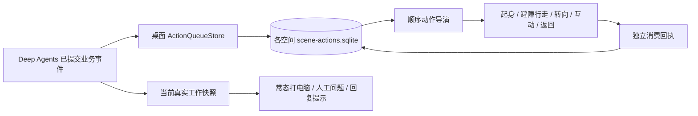

# ADR-0025：统一工作动作与持久顺序演出

2026-10-30，按用户最新行为规范覆盖旧的“同任务自动开会”表现。

后续同日的 [ADR-0026](0026-coalesced-desktop-actions.md) 将 MCP、查档改为首事件起六十秒合并；本篇的逐人委派、单向依赖和独立回执继续适用，历史验收保留当时事实。

## 1. 产品合同

| 真实行为 | 常态与一次性演出 |
| --- | --- |
| 模型思考、普通工具、文件、Python、Skills、列出成员、等待子任务 | 有工作时面向实际显示器操作电脑 |
| MCP 工具开始 | 队列触发短暂电话贴耳通话，随后恢复电脑工作；不同于摸鱼玩手机 |
| 向已配置成员派发子任务 | 主 Agent 起身，走到对应成员旁递交文件，再返回；两个目标分别演出 |
| search_archive / read_archive_messages | 走到当前空间档案库旁翻查，再返回 |
| 未来安全工具请求 | 预留走到安全服务台请求审核；当前没有新增权限或安全 VM |
| 人工问题、错误、最终回复 | 依正式 Run 状态显示；业务成功不由动画或模型一句话判断 |
| 无工作 | 沿用已有待命、五至十分钟轮换的最多四项摸鱼活动 |

演出可以落后于事件，播放结束不代表真实工具成功。任务已经结束时，仍能顺序播放尚未消费的行为。回复泡泡不等待动画完成，默认使用“本轮回复已就绪，请查看”，不冒充业务验收完成。

## 2. 单向架构

代码全部位于 desktop；后端 Loop、工具和 checkpoint 不依赖演出。不把截图、动作回调或消费回执写成 run.completed。

## 3. 队列、不变量和恢复

- 以空间独立日志 seq 唯一入队，同一 Run 给 A、B 派发两次便登记两项，不合并为会议。
- 收件箱逐批扫描最多 512 个候选，返回最早 32 项；超过一批继续追赶，不能跳过尾部。
- 无四秒过期或仅保留最后四项的丢弃策略。首次启用以已有历史为基线，不回放旧版本几天前的操作；之后未确认项跨窗口、空间切换和重启保留。
- 首次基线读取完整原始日志的最大 seq；表现快照正在分批重建时，不能把该批游标误作历史末尾，否则后续批次会误演旧动作。
- 播放器一次处理一个特殊行为：prepare → travel → perform → return → played。未到达不能递文件或查档；MCP 原地通话。
- 人工待答优先，暂停演出而不阻塞执行；缺角色、缺设施、无路、人工接管、布局变化和减少动态效果以明确 skipped 原因消费，不能假装到达或通过审核。
- 顺序回执幂等，仅允许确认队首；控制层轮询提交，帧循环没有 RPC、模型请求或产品数据库访问。
- 临时路线使用现有避障、起坐和椅脚原点，不持久修改成员工位。空闲导演避让当前演出参与者；表演结束后原空闲规则继续工作。
- 表现队列异常只降级画面；原始轨迹、模型执行、人工答复和结果通知保持独立。

## 4. 素材与边界

新“小橘”男性黄色吉祥物提供两页 32 个主姿态、配套椅和脚踏、六帧起坐补图。独立跑步、沙发配套和完整八向仍待补，接触登记为 estimated。

五套内置人物增加独立贴耳通话两关键帧，与休闲手机分开选择。内置人体显示最多四张白名单补页、共六页；用户导入仍最多两页，源文件、hash 和原帧号不改。递文件与翻页使用角色动作加世界道具层，不能声称生成了真实文件或安全审核结论。

生成使用 imagegen 内置工具；主素材与提示词分别保存在 library-v1/characters/hippo/ 和 scene-v2/。先做真实 WebView 目检，再确认发行，不用测试数量代替美术验收。

## 5. 验证入口

- test_action_queue.py：A/B 顺序、重复快照、顺序回执、重启、七百项追赶和空间隔离。
- performance.test.cjs：正式导航与运动、A 后 B、电话短暂触发、档案库往返、人工暂停与缺失目标。
- execution_visuals_smoke.py：真实 MCP HTTP + 真实 Deep Agents + 可控模型协议，验证电话补页、随后打字、人工中断、最终回复与新角色起坐。
- performance_queue_smoke.py：同一模型消息并行派发两位配置成员，核对原始委派顺序、后端先完成而动作继续消费、真实查档工具及持久席位不变。

安全服务演出只是预留分类；当前没有新增安全 VM、授权服务、自动审批或跨空间调用。

## 6. 本次验收记录

2026-10-30，在 Windows / WebView2 验证：

- 全量 Python：171 passed；11 组 Node 界面逻辑检查通过；ruff 与 mypy（117 个源文件）通过。
- 原生通话与人工恢复：`.cache/execution-visuals-smoke/496bed19dcb74e9ca08fefa67135a937/result.json`。真实 MCP 分别收到 17+25、18+24，两次均返回 42；电话之后回到打字，采到小橘四个打字帧。检查人工弹窗、主结果、起身、换座及重新落座截图；修正通话图集不等行高裁切，未重画或改写 PNG。
- 原生顺序演出：`.cache/performance-queue-smoke/6081fb06a8374919809f12e5e4040ad2/result.json`。真实 Deep Agents 同一消息派发两位已配置成员，8 次合成模型协议请求；消费顺序与正式 task.assigned 一致，后台先结束、前台继续演示，持久工位未变，真实 search_archive 触发档案库往返。
- 新独立 exe：首次为 `.cache/frozen-smoke/0f18b3e5c8eb4d28a7411efb582377aa`，补齐首次日志基线后重新构建并复验 `.cache/frozen-smoke/8ed7ce1aa9e44accab3f546439648de9`。通过真实窗口输入与发送，打包程序自身完成 9 次模型请求、1 次 MCP、标准库 Python 和目录/文件增删改查；生成 frozen-result.json 的 sum=5050。候选资源与生产脚本一起重新构建，不使用旧 exe 冒充本次版本。
- 最后修复首次基线时，另跑队列、完成状态、泡泡、交互与桌面集成共 33 项，全部通过；静态检查再次通过。

上述模型协议使用本机可控服务，执行器、工具、MCP、原生桥、导航和图集为实际生产实现；没有读取、复制用户 Key 或借助动画伪造工具完成。该记录验证行为和代表画面，不等于全动作八向、所有 DPI 或专业逐帧美术验收。

最终活动发行 `20261030-024733`，统一入口 `start.ps1`，数据继续使用 `.cache/asset-v2-showcase`；没有迁移用户配置或会话。发行 ZIP 的 SHA256 为 `0F580C4F56E62962B2B7351012FEDCD8E2F3777BE00B1F9A5DC481764A0F2596`。
