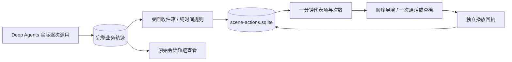

# ADR-0026：桌面同类动作六十秒合并

2026-10-30，按用户新要求覆盖 ADR-0025 中 MCP、查档逐次演出的部分；后台工具和轨迹保持逐次执行、逐次记录。

## 1. 规则

| 情况 | 表现 |
| --- | --- |
| 同工作空间、同 member_id、同类 MCP 或查档动作 | 从首个事件起算 60 秒，仅展示一次，合计调用次数 |
| 第一个事件 | 立即入队，不等待窗口结束 |
| 窗口内继续调用 | 增加次数；不重置播放进度，也不延长窗口 |
| 代表动作已播完 | 仍吸收同窗口内后续调用，避免工具间隔几秒就再次起身或打电话 |
| 恰好第 60 秒或以后 | 开始新窗口，允许一次新演出 |
| 不同人物、不同空间、不同动作类别 | 分别计算；共享 agent_id 不等于同一人物 |
| 派发任务、人工问题、安全审核及其回执 | 不聚合，不丢失目标或问题 |
| 时间无效、没有时区或发生回拨 | 保守保留独立动作，不误归入未来窗口 |

这里按相同的视觉操作类型合并：不同 MCP 方法都表现为通话，因此归在 MCP 类；search_archive 与 read_archive_messages 归在查档类。窗口不是自然分钟桶，12:00:59 与 12:01:00 的同类操作可以合并。也不是等待静默的 debounce，持续高频调用不会无限延后第一项或延长旧窗口。

人物只有一个可见身体，同一人物的不同 Run 可共用这一个短期演出窗口。它们的 Thread、上下文、消息、任务终态和输出仍独立。合并协议的 run_id 仅指首个来源，不代表组内全部事件都属于该 Run。

## 2. 单向架构



实现仅在 desktop：`presentation/coalescing.py` 定义时间与摘要合同，`action_queue.py` 持久聚合，`performance.js` 更新待播/正在播放的次数。后端无动作协议、冷却计时器、模型限流或新增依赖。

## 3. 增量协议

现有 studio_feed 顶层版本保持 1，新增可忽略的 action_policy、actions_coalesced 和代表项 aggregation。旧的单条字段与稳定 ID 保持兼容。

```json
{
  "action_policy": {
    "version": 1,
    "mode": "leading_window",
    "window_ms": 60000,
    "kinds": ["archive", "mcp"],
    "scope": ["workspace", "member_id", "kind"]
  },
  "actions_pending": 1,
  "actions_coalesced": 4,
  "actions": [{
    "id": "104",
    "source_seq": 104,
    "member_id": "assistant",
    "kind": "mcp",
    "run_id": "first-source-run",
    "created_at": "2026-10-30T12:00:59Z",
    "visual_only": true,
    "aggregation": {
      "version": 1,
      "count": 5,
      "first_seq": 104,
      "last_seq": 115,
      "first_at": "2026-10-30T12:00:59Z",
      "last_at": "2026-10-30T12:01:12Z",
      "window_ms": 60000
    }
  }]
}
```

- count 是代表的真实来源次数，包含首条。actions_pending 是待播代表项数；actions_coalesced 是该空间累计合并的来源数，只用于诊断，不能当成本轮任务工具量。
- 每次原始来源仍在收件箱中保留。重复项标为 coalesced，reason 指向代表序号；原始业务日志不修改、不删除。
- action_windows 以 member_id + kind 索引当前窗口；空间由各自数据库隔离。窗口时间取带时区的来源事件，持久保存，因此轮询、切空间、重启不会重置冷却。
- 队列和回执始终按代表项 first_seq 排序。last_seq 仅描述聚合范围，不能拿它推进播放游标，否则会丢掉夹在两次 MCP 之间的委派。
- 新快照更新相同 ID 的次数，不入第二次队，也不重启动画时钟。动作提示显示“60秒内 N 次调用合并”。已经播完时不额外播放统计更新。
- 无有效时间或不适用合并的类型，仍有 count=1、window_ms=0 的有限摘要。未知或无效聚合元数据在界面按单条兼容，不能扩大能力。

## 4. 升级与性能

旧队列在独立事务中流式迁移，已播回执保持已播，旧待播重复项也会合并，避免升级后继续逐条清积压。首次收件箱基线仍读取完整业务日志末尾，不把历史状态重建误当新动作。

每个来源按主键幂等登记，窗口按索引查询；摘要只保存首尾与次数，不创建不断增长的 ID 列表。事件扫描每批 512、前端每批最多 32 个代表项，现有上限保持。归约在桌面工作线程运行，不持有后端写事务；表现库异常时降级画面，执行器继续。

没有新增“任务成功”判断，没有压缩模型上下文，也没有改变权限或工具结果。无工作时的待命活动保持原样。

## 5. 验证

- Python：首条立即可播、自然分钟边界、精确 60 秒边界、等价时区、窗口不延长、已播吸收、重启、不同人物/类别/空间、旧积压迁移、无效/回拨时间、七百项追赶及原始记录保留。
- Node：播放中次数增加不重置时钟，迟到快照不能回退统计；聚合 last_seq 不能跳过中间委派。原 A/B 递文件、查档、人工暂停等继续回归。
- 原生：`desktop/tests/action_coalescing_smoke.py` 使用实际 Deep Agents、本机可控模型协议与真实 HTTP MCP。两轮 10 次 MCP、8 次查档只消费 2 个代表项；第二轮在已播窗口内不重播，完整轨迹仍有 18 条工具开始记录，持久工位不变。
- 源码原生记录：`.cache/action-coalescing-smoke/546b6fbb1cb14bca994a143b51d32443/result.json`；两组分别为 archive=8、mcp=10，状态均 played，累计合并 16 项。截图已目检。

真实模型响应在本验收中由本机合成协议控制，不读取用户 Key，不消费用户真实 Token。时间边界由确定性测试覆盖，不在原生窗口用改时钟或等待一分钟伪造来源。

候选包界面复验记录 `.cache/action-coalescing-smoke/bbeef45ff069456cab2963c95faf9527/result.json`：18 次真实工具事件、10 次实际 MCP HTTP 调用，仍只消费 2 个代表项；已播窗口跨第二个 Run 不重演。候选包的 performance.js、animation.js、renderer.js 与源码 SHA256 一致。

全量 Python 176 项通过，随后增加的交错委派用例与队列/规范检查共 10 项通过；12 组 Node、ruff 和 mypy（118 个源文件）通过。后端生产目录无本次改动。

已发布 `20261030-111743`，按 `start.ps1` 更新并重启，数据仍为 `.cache/asset-v2-showcase`。发行 ZIP SHA256：`49994B402F127A31C18F0599A35023A116B6DD97F72F563C691C630566084736`。

实际发行重启后确认聚合库版本为 1，原已播组保持 played，六条旧重复来源已标记 coalesced，没有重复待播。三个现有空间的原始事件数（233、0、20）与任务状态计数在重启前后一致；人物和未读结果仍保留。
