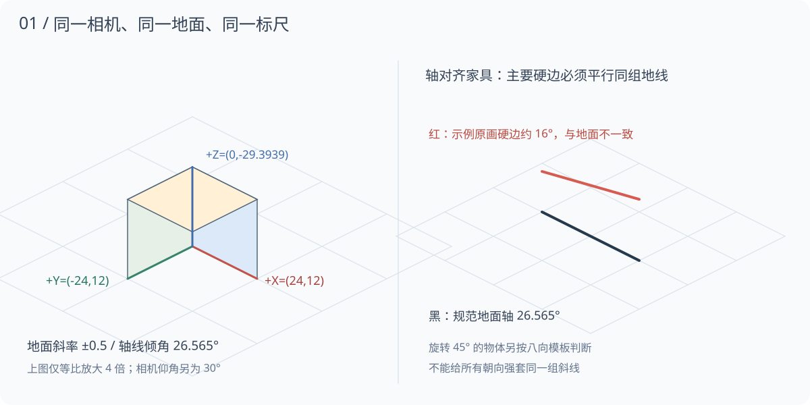
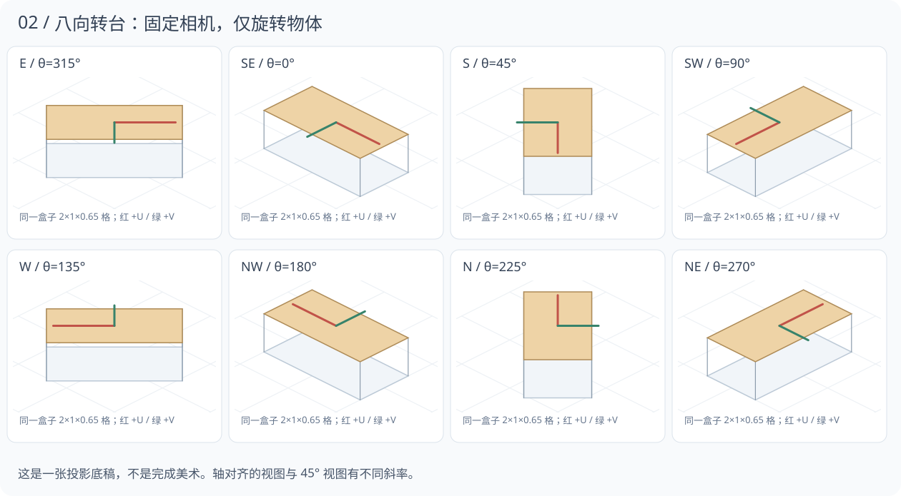
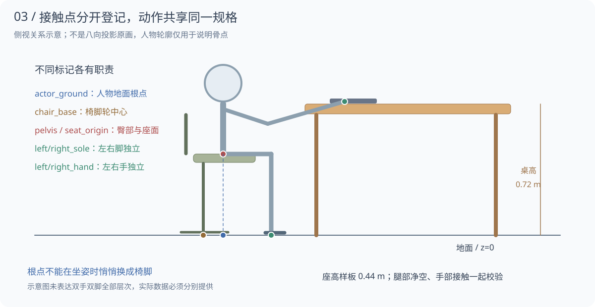

# RoomCrew 统一素材制作规范 v1.0

日期：2026-10-28。适用于人物、家具、建筑、道具及交互动作的后续制作。

**本规范已经制定；现有 scene-v1 原图尚未按此重新制作、校准或通过验收。** 配置模板属于制作端设计，当前导入器不会直接读取。它不代表新增了骨骼、IK 或家具导入功能，也不改变后端 Agent。

## 1. 目标与执行原则

所有素材进入同一间办公室后，应像同一台相机下拍摄的物体。人物大小稳定，脚有支撑，坐姿贴合座面，手能接触操作对象，移动与转向连续。用户更换形象或家具时，通过匹配的尺寸和交互规格判断兼容性。

制作顺序为：**相机与标尺 → 一套桌椅人物样板 → 连续交互 → 全套扩展 → 原生验收**。样板不通过，暂停批量生成；不以“已经生成很多图”替代相机、接触和连续性合格。

项目使用暖色手绘、细轮廓、适度 Q 版的 2.5D 风格。参考图用于风格和构图，几何关系以本规范的校准模板为准。仅在提示词中写“等距”“八方向”“同尺寸”不能证明输出合格。

本规范的尺寸、误差和性能预算是 **RoomCrew 制作基线与验收目标**，不是外部行业标准，也不是现有实现的性能承诺。先经样板实测，后续版本调整时保留版本记录。

## 2. 统一相机：三个角度不要混淆

| 项目 | 制作基线 | 说明 |
| --- | --- | --- |
| 投影 | 固定正交、地面 2:1 二等轴测 | 远近不改变物体尺度，平行边没有消失点 |
| 地面屏幕轴线 | ±26.565051° | 来自斜率 12/24；不是三维相机俯角 |
| 三维相机仰角 | 水平面以上 30° | 与下方映射一起使用；不是严格等轴测的约 35.264° |
| 水平观看方向 | 固定，见 Blender 坐标配方 | 八方向由物体旋转，不转相机、不逐帧改变焦距 |
| 竖直线 | 始终竖直 | 桌腿、柜边、墙角不能逐件倾斜 |
| 灯光 | 同一世界方向的左上方柔光 | 物体转向时按相同灯光计算；不逐帧换光源 |

当前代码中的 `crewProject` 已采用地面 `(24,12)`。保留该地面基准，逐步重制视角不一致的原图；不通过把整幅 PNG 斜切、旋转或拉扁来假装物体换了三维视角。

正交相机及真正渲染相机设置可参考 [Blender 官方正交投影说明](https://docs.blender.org/manual/en/dev/editors/3dview/navigate/projections.html)。以下具体参数与映射是本项目自行推导的制作配方。

### 2.1 坐标、单位与公式

区分四种坐标，字段必须带空间含义：

| 坐标 | 原点与方向 | 单位 |
| --- | --- | --- |
| `world_grid` | 房间格网；+X 向屏幕右下、+Y 向左下、+Z 向上 | 1 格；制作参考为 0.5 米 |
| `view` | 未经过桌面相机缩放的画布；右、下为正 | 逻辑视图单位 |
| `source_px` | 原画画布左上角；右、下为正 | 源像素 |
| `atlas_px` | 打包图集左上角 | 图集像素；需要还原裁切偏移 |

新制作端统一使用三维公式：

```text
view_x = 24 * (world_x - world_y)
view_y = 12 * (world_x + world_y) - 12 * sqrt(6) * world_z

source_px = canvas_origin_px + source_pixels_per_view_unit * view

地面逆变换（z=0）：
world_x = view_x / 48 + view_y / 24
world_y = -view_x / 48 + view_y / 24
```

`12*sqrt(6) ≈ 29.3938769134`。地面一格的菱形包围框为 48×24 视图单位；一根高一格的竖直标尺为约 29.3939 视图单位。不能把屏幕高、图片包围框高、真实高度混成一个 `height`。

这套游戏格网与 Blender 的右手坐标有轴向差别。制作时明确转换为：`Blender(X,Y,Z) = (world_x, -world_y, world_z)`，不能省略 Y 取反后又用同一相机。

### 2.2 可复现的 Blender / 三维制图配方

1. 单位按上述格单位建立，物体放在原点；相机位置设为 `(8,-8,6.5319726474)`，准确看向原点，世界上方为 `+Z`，相机局部 `-Z` 指向目标、局部 `Y` 朝上。
2. 相机设为 **Orthographic**。使用方形输出、像素长宽比 1:1；1024×1024 原画、每视图单位 8 源像素时，`Orthographic Scale=3.7712361663`。2048×2048 使用 `7.5424723327`，维持同一像素密度；不能每个动作自动适配画幅。
3. 平移相机构图只改变 `canvas_origin_px`；记录原点位置。用一格立方体检查：地面边应为 `(192,96)`、`(-192,96)` 源像素，竖直一格约为 `235.1510` 源像素。导出结果达不到该标尺时，先排查相机朝向、轴转换、输出比例和单位。
4. 每个朝向只旋转物体及其完整交互结构，转轴在地面登记点。人物、桌椅、接触点与遮挡层同源导出；相机、灯光和尺度保持一致。

原画使用 8 源像素/视图单位是起始制作密度；正式包建议先试 4 源像素/视图单位并在实际最大缩放检查。改变密度要整包一致地导出，不能给单帧重新量头宽缩放。



## 3. 八个朝向：方向表与旋转约束

方向名沿用项目 `e,se,s,sw,w,nw,n,ne`。家具方向表示其正面或操作侧；人物方向表示实际面朝方向。桌子与人物通常相向，不能把二者配置成同一个面朝向。

| 方向 | 格网正面向量 | 物体绕 world +Z 的角度 θ | 正面投影方向 |
| --- | --- | --- | --- |
| e | (1,-1) | 315° | 屏幕右 |
| se | (1,0) | 0° | 右下 26.565° |
| s | (1,1) | 45° | 屏幕下 |
| sw | (0,1) | 90° | 左下 |
| w | (-1,1) | 135° | 屏幕左 |
| nw | (-1,0) | 180° | 左上 |
| n | (-1,-1) | 225° | 屏幕上 |
| ne | (0,-1) | 270° | 右上 |

**并非八个方向的桌边都应平行地砖。** 与房间轴平行的家具应匹配 ±26.565°；旋转 45° 的家具，其本体两轴可能投影为水平和竖直。方向名称不意味着相邻投影角都相差屏幕 45°。

对物体局部 +U/+V 两个互相垂直的地面轴，设 `c=cosθ`、`s=sinθ`：

```text
axis_u_view = (24*(c-s), 12*(c+s))
axis_v_view = (-24*(s+c), 12*(c-s))
```

每个方向记录 `axis_u_view`、`axis_v_view`、`axis_z_view` 与正面。轴线验收针对该方向的预期向量，不能用一张斜率截图判定所有方向。对应的制作模板见下图。

表中旋转角定义在项目格网中。由于制作到 Blender 的映射包含 Y 取反，Blender 对象的 Z 旋转应为 `-θ`；不能直接复制正角度后却期望同一朝向。



原绘、三维转台渲染、镜像、对称复用和缺失方向必须分别登记。设备带抽屉、键盘、文字、徽标等非对称结构时，不能靠镜像补方向。人物镜像也需审核左右手、道具、服装和灯光；不能把镜像计为新增原绘覆盖。

## 4. 统一比例、尺寸与美术风格

### 4.1 尺寸表：用于第一套样板

以下为项目建模起始值，先做接触样板再冻结。物理尺寸不等于地图保守占地；通道、拉椅和交互区另算。

| 对象 | 制作参考尺寸（米） | 必须一起登记 |
| --- | --- | --- |
| 基准人物 | 站高 1.60，允许独立规格体型 | 骨架、腿长、站姿根点、头宽；起坐腿长保持一致 |
| 办公桌 | 宽 1.40、深 0.70、高 0.72 | 四角、桌底净空、键盘面、屏幕注视点 |
| 办公椅 | 宽约 0.55、深约 0.60，座高 0.44 | 座面平面、脚轮支撑面、扶手和拉出范围 |
| 双人沙发 | 宽约 1.50、深约 0.80，座高 0.42 | 两个独立坐席、靠背、扶手与前景遮挡 |
| 茶几 | 宽 0.85、深 0.50、高 0.40 | 桌面和四脚，不用桌面投影做地面占地 |
| 会议桌 | 宽 1.80、深 0.90、高 0.72 | 每把椅子的独立 seat ID、操作点与走道 |
| 白板 | 板面约 1.40×0.90，整体高约 1.65 | 板面四角、笔接触面、脚架和底轮 |

人物头身比先控制在 2.8—3.2 头的风格范围，但腿长必须能满足样板座高与鞋底支撑；不能为了 Q 版效果把下肢缩短到无法落地。短体型可以定义独立家具/脚踏规格，明确表现出来，不在运行时盲塞支撑。

### 4.2 一致性要求

- 同角色同规格动作共用一套骨架、服饰与尺度，不逐帧自适应裁切框、不逐帧缩放头部。
- 家具厚度、木色、绿布材质、描边与圆角采用同一风格板。阴影是地面接触与统一光源的结果，不能烘焙成每帧移动的大椭圆。
- 高度较大的家具必须增加真实纵向尺寸，不能纵向拉伸源图；固定相机下不因物体放在房间远处而单独缩小。
- RGB 使用 sRGB，PNG 使用 RGBA 8 位、直通 Alpha。保持透明边缘，分别在白、深灰和地板底色检查白边/黑边；PNG 的压缩字节数不代表解码纹理内存。
- 角色表情、手部姿态、道具应与身体分层或至少保留可编辑源，避免每次改手机位置就重生整个人物身份。

透明边缘和预乘 Alpha 的处理存在配套渲染要求，参见 [Godot 官方图像导入说明](https://docs.godotengine.org/en/stable/tutorials/assets_pipeline/importing_images.html)。RoomCrew 当前 SVG 路径继续使用直通 Alpha，规范未要求迁移引擎。

## 5. 根点与接触：坐得住、手够到、脚踩实

### 5.1 各类根点固定语义

| 根点 | 定义 | 禁止行为 |
| --- | --- | --- |
| `actor_ground` | 人物骨盆的地面投影，z=0；站姿近似支撑中心 | 入座时悄悄换成椅脚、换帧追着透明框边缘移动 |
| `furniture_ground` | 家具的作者地面原点 | 改 seat 位置时顺带拖动桌子 |
| `chair_base` | 脚轮支撑面的中心 | 人起身后空椅突然弹回初始点 |
| `seat_origin` | 明确的座面局部原点和法向 | 直接拿图片中心或椅背顶点作为座面 |

新制作片段始终保留人物根点语义。若预合成片段以 `chair_base` 为图片原点，必须逐帧导出 `actor_ground` 相对它的位移，并在交接时显式换算。旧 ADR-0019 的预设仍需兼容适配，不能把它的椅脚原点无说明混入新人物包。

### 5.2 人物必须提供的标记

`actor_ground`、`pelvis`、`left_sole`、`right_sole`、`left_hand`、`right_hand`、`head_center`、`gaze`、`bubble_mount`。

动作帧另提供脚/手接触时段：哪只脚支撑、哪只手接触道具、臀部是否接触座面。两个鞋底不能合成一个模糊的 `soles` 点后就宣称双脚已校验。标记来自骨架或作者逐帧登记；自动推测要标记 `estimated`，未经检查不得升级为 verified。

`bubble_mount` 是稳定头部语义挂点，不用每帧裁切框重新定位。正常呼吸/走路的小幅变化可以跟随骨点；禁止为了每一帧最高像素自动左右选边或跳位。

### 5.3 家具必须提供的标记

- 地面支撑多边形 `support_polygon_world`、实体碰撞 `solid_footprint_world`、互动预留区 `interaction_clearance_world`、遮挡层与选中区域分别保存。
- 椅子/沙发：`seat_origin`、`seat_normal`、`seat_forward`、接近点、坐席 ID、扶手净空和起身范围。
- 电脑桌：键盘左右手接触区、屏幕注视区、腿部净空、椅子摆入/拉出的轨迹范围。
- 白板：可书写平面、笔接触区、人物站位与脚架占地；写字人物不能站进板脚。
- 茶几、柜子、冰箱、咖啡机：操作面、把手/放置区及可用站位；功能尚未实现时只保留素材能力声明。

### 5.4 兼容性规则

以 `interaction_profile_id`、座高、桌高、方向、腿部净空、人物规格和片段覆盖共同判断。能把两个 PNG 显示出来不等于兼容。

标准样板先建立 `humanoid-desk-044-072-v1`，用于记录匹配 0.44 米座高与 0.72 米桌高、经过验证后的组合；目前该样板尚未制作与验证。成员可自由更换外观，但只有匹配该骨架/接触规格才可复用动作。改家具高度超出声明范围时，需要匹配的新动作或明确的受限回退。

脚点、臀部和双手必须同时检查。只把臀部贴到椅子上、却把鞋底悬空或手压进抽屉，判定失败。坐姿鞋底的屏幕纵向位置可以与椅轮不同，这是地面深度；应比较投影后的三维接触位置，不能只比较 y 像素。



## 6. 人物动作覆盖与逐帧要求

### 6.1 完整办公素材的最低覆盖

| 动作 | 方向覆盖 | 起始制作量 | 核心要求 |
| --- | --- | --- | --- |
| 站立待命 | 八向 | 每向 4—8 帧或经验证的骨骼循环 | 身形稳定，轻呼吸，不做整张图缩放 |
| 行走 | 八向 | 每向 12—16 帧、约 12—16 fps | 支撑脚与地面匹配，循环首尾连续 |
| 跑步 | 八向，可后补 | 每向 12—16 帧 | 独立步幅与节奏，不能只加快走路图片 |
| 原地转向 | 已支持的相邻朝向 | 每 45° 段 4—6 帧 | 足点稳定、头身协同，不突然翻面 |
| 坐下 / 起身 | 每个兼容座椅方向 | 各 8—12 帧，约 0.8—1.2 秒 | 臀部、脚、椅子及姿态端点一致 |
| 坐姿待命 | 每个支持座向 | 每向 4—8 帧 | 臀部贴合；正面问答也确实坐在椅上 |
| 电脑工作 / 游戏 | 每个工位方向 | 每向 8—12 帧 | 眼睛朝屏幕，手接键盘，不穿桌 |
| 手机 / 阅读 / 闲聊 | 明确声明的方向 | 每向 8—12 帧 | 道具固定在手中；手机与打电话可区分 |
| 疑问 / 提醒 / 汇报 | 面向用户与工作方向 | 每种至少进入、保持、退出 | 情绪动作不改体型；泡泡跟随同一人物 |
| 浇花等设施动作 | 与设施匹配的方向 | 各一段完整互动 | 移动到真实设施，不对着空气操作 |

“最小可导入草稿”与“完整办公包”继续分开。缺动作可以保留导入与明确降级，不能将单帧复用称为完整动画。六帧旧预设属于过渡基线，不自动满足此处完整包的制作量。

帧数是生产起点，不能代替节奏与视觉验收。普通动作循环不一定匀速播放，允许声明逐帧持续时间。显示刷新率与原画帧率不同：画面可 60 Hz 更新位置，原画可以是 12 fps；重复同一帧或透明叠两张身体不能凭空补足姿态。

### 6.2 连贯衔接的七条规则

1. **固定原画画布与骨点尺度。** 同角色站立/坐姿默认 1024×1024 原画，原点登记为画布上的一个明确位置；大动作可用独立更大画布规格，但保持相同像素密度。源帧不得裁掉头、手、脚、椅轮。
2. **打包裁切只节省空白。** 图集每帧保留 `source_size`、`trim_rect` 和 `offset`，还原后与原画画布一致。不能把裁切后宽高当作人物新尺寸。
3. **每个片段声明入口和出口。** 包括姿态、方向、接触、根点与速度。上一段出口和下一段入口匹配后才能直接切换，否则播放明确的转向/起坐片段。
4. **根运动只有一个控制者。** 推荐场景导航驱动位移、走跑片段原地播放；按实际速度与片段 `stride_world_tiles` 配速。若选原画根运动，导航不再重复叠加同一段位移。兼容模式必须显式标记。
5. **支撑脚在接触区间内固定。** 它的世界位置漂移超阈值判为滑步；抬脚不受固定约束。只有 root 轨迹平滑不能证明脚没有滑动。
6. **转向、接近、拉椅、落座各有职责。** 不把模型事件到来就硬切成坐姿；真实任务继续执行，画面在合法路径和相容动作中追上状态。
7. **动作中断有出口。** 走路从当前脚点重规划；起坐从当前稳定接触或支持的中断片段切换，不重置进度。人工问题可立即显示泡泡，但人物不能停在半空或坐着瞬移。

## 7. 家具交互：以一套桌椅为完整单元制作

建议制作源中保留人物、椅背、椅面、前扶手、桌面、桌腿、道具和阴影层。人物身体按深度放在正确的层之间，不能靠整张椅子压住人物来遮挡穿模。

允许为特定搭配预合成人物+椅子，但必须保留可编辑分层源、参与对象 ID、每帧接触轨迹和 `includes_entities`。预合成显示时，同一椅子只能由一个绘制者负责；离开预合成时恢复到同一世界位置和方向。未经适配不能套到任意用户椅子。

桌椅标准顺序：

```text
工作循环 → 停手 →（需要时）转椅 → 后移椅子
→ 前倾 / 脚支撑 → 起身 → 离椅站立 → 步行
→ 到新椅的接近点 → 转向 → 拉出空椅
→ 臀部落座 → 调整脚位 → 推椅入桌 → 工作循环
```

每个阶段允许物理上的短暂停顿。起身与坐下只有经过接触检查才可互为倒放；靠近桌子、拉出椅子、离开桌子不能不加区分全部倒放。

沙发要逐坐席定义臀部、双脚和靠背关系；会议桌每把椅子独立，不能把一张大桌当整块可通行区域。四沙发围茶几的布景需要保留四向入口，茶几上物件按桌面层显示。

遮挡排序先解决对象相交关系，再按地面深度排序。桌面与人物、椅背与身体存在交叠时，单靠一个 `x+y` 深度数值不够，应拆层/拆对象；新制作规范不把当前单排序实现说成通用 3D 遮挡。

## 8. 轨迹动作与素材语义的边界

后端继续只产出真实 Agent 执行记录。桌面将事件转换为有限语义，再选兼容动作；素材包不包含模型密钥、工具定义、权限策略或后端 SDK 私有类型。

| 桌面语义 | 表现候选 | 前提 |
| --- | --- | --- |
| 普通工具 / Python 执行 | 赴工位、电脑工作 | 有可达兼容工位；没有则保持思考/处理中 |
| MCP | 拿起电话、通话、放下电话 | 有完整手机/听筒片段；不需要真实打电话 |
| Skills 加载 | 取书、翻阅、收书 | 书与手有挂点；不改变技能加载事实 |
| 已配置成员协作 | 赴会议席、面对同事讨论 | 空间内实际成员与可用座位；不复制人物身份 |
| 人工参与 | 安全落稳后转向用户、疑问保持 | 问题泡泡可即时出现，归入口主 Agent |
| 任务完成 | 停止当前动作、汇报、进入待命 | 完成事实取轨迹；泡泡读取消失规则保留 |
| 安全审核 | 预留赴监管台、等候 | 仅表现接口，当前安全 VM 未实现 |
| 无工作 | 手机、游戏、散步、假聊天 | 每人最多四类池，5—10 分钟轮换；工作可中断 |

动作片段中的 `foot_contact`、`seat_contact`、`hands_contact`、`prop_attach` 只是**表现事件**。它们不能批准操作、答复人工、宣告执行成功或恢复后端任务。

## 9. 素材包结构与制作清单

制作源与运行图集分开。当前用户导入仍为旧人物两页合同；以下是未来制作包结构，**不是现有导入格式**。

```text
asset-id/1.0.0/
├── authoring.json              相机、规格、来源、方向覆盖、校验状态
├── source/                     可编辑分层源 / 三维源与灯光相机
├── frames/<action>/<direction>/0000.png
├── contacts/                   逐帧 3D / 原画像素标记，空间显式命名
├── delivery/                   打包后图集、逐帧偏移、片段时长
├── preview/                    轴线叠加、接触叠加、连续动作预览
├── validation/report.json      工具报告与人工检查结论
└── LICENSE                     作者、版权、授权与分发范围
```

制作清单必须含 `format/version`、资产 ID/版本、相机 profile、坐标/单位、源像素密度、画布原点、尺寸、交互 profile、逐向覆盖、片段/时长、根运动模式、接触来源、包含对象与遮挡层、来源/授权、已知缺失、校验结果。

随附 `authoring-profile.json` 是共同基准，`authoring-record.example.json` 是**未通过验收的样板记录示例**。示例中不填假的全部通过结果，不把数值模板当成真实作者测量。

## 10. 清晰度、纹理内存与性能预算

- 原画保留高质量独立帧，发布图集按动作/方向分组，默认单页边长不超过 2048；确需 4096 时记录理由和实测。不能按“全部角色所有帧塞进一页”组织。
- 无压缩 RGBA 纹理内存约为 `width*height*4`；2048² 一页约 16 MiB，4096² 一页约 64 MiB，开启完整 mipmap 链还会增加约三分之一。PNG 文件小不代表显存小。
- 建议以 8 个可见人物为首轮压力样板，活动角色纹理总驻留目标 ≤128 MiB、全场景纹理 ≤256 MiB；这只是待验证预算，超出需降密度、按需加载或分组，不能假报已达标。
- 行走方向与当前/下一动作预加载；逐帧回调不读磁盘、不解码图片、不调用模型。缓存要有上限，未使用资源可释放。
- 验证 100%、150%、200% Windows 缩放及应用最大/最小镜头；目标 60 Hz，报告 p95 帧耗时 ≤16.7 ms 和 p99、峰值内存，窗口、GPU、分辨率与测试时长必须一起写明。
- 报告需统计解码后的纹理、Alpha 混合开销和临时精灵数；不以当前四角色测试推导八角色、全套高分辨率动作已通过。

图集与逐帧动画的基本组织方式可参考 [Godot 官方 2D 精灵动画说明](https://docs.godotengine.org/en/stable/tutorials/2d/2d_sprite_animation.html)；该参考不表示 RoomCrew 已采用 Godot。

## 11. 制作流程与 AI 制图要求

1. **建立标尺文件。** 相机、地面格网、一格立方体、八向空白轮廓、人物骨架与接触点同时固定。把实际模板作为参考，不能只发“2.5D 办公室”文字。
2. **先做灰模 / 轮廓。** 优先在同一个正交场景里建立桌、椅与人物关节；或直接在数学投影模板上手绘。先验证四角、支撑面和人体关节，再上细节。
3. **确认一套风格样板。** 椅子朝向、抽屉侧、屏幕、键盘、服饰与头身锁定。审查人物正面、背面、侧面，不能每个朝向重新设计身份。
4. **先完成连续接触动作。** 做整段坐下/起身/工作，保持同一时间线；不要把毫无关联的几张漂亮坐姿拼成“动画”。
5. **再扩八方向与其他体型。** 先检查 0° / 90° 和 45° 方向各自的预期轴线，再批量导出。缺方向记录缺失，不靠复制文件名补齐。
6. **导出并验证。** 先独立帧检查透明度/边缘，记录原画画布、偏移和接触，再进行图集打包；打包后再做一遍还原叠加检查。
7. **放进实际播放器。** 连续检查工作、转身、离座、步行、换座、人工打断、任务完成、缩放与泡泡；一次完整循环合格才推进下一组素材。

AI 适合辅助风格探索、贴图和细节重绘；几何、骨架和动作一致性由模板与检查负责。生成后即使外观接近参考，也只能是候选素材。

可复用的提示结构：

```text
用途：RoomCrew 暖色手绘 2.5D 素材，参考图 A 锁定风格，参考图 B 锁定人物身份，
模板 C 锁定投影、原点、尺寸与接触。目标资产/动作/方向明确列出。
相机：rc-ortho-2to1-v1；地面 +X=(24,12)、+Y=(-24,12)，竖直朝上。
对象：同一个物体/角色；保持抽屉侧、服装、头身、灯光和真实比例。
帧约束：固定画布、像素密度和根点，按提供关键姿势顺序制作；手脚不能裁切。
交互：明确椅面、臀部、左右鞋底、左右手接触与遮挡；不得任意添加家具。
交付：真实透明 RGBA，无底板、文字和标记；原画与校准叠加图分别交付。
验收：须按方向矩阵和接触标记检查，文字承诺本身不等于合格。
```

每次保留实际完整提示、引用对象及角色、生成工具/版本（可取得时）、输出 ID、人工修改记录、许可和最终选用版本。未能恢复的历史提示标明缺失，不以回忆摘要冒称逐字原词。

## 12. 验收：自动检查和实际画面缺一不可

### 12.1 几何与静态验收

| 项目 | 起始门槛 | 检查方式 |
| --- | --- | --- |
| 方向轴误差 | 主要硬边与该方向预期轴夹角 ≤1° | 记录两个长边与立边，叠加模板；不只测一个边 |
| 投影标尺 | 一格基准投影尺寸误差 ≤1% | 用标尺物/角点，不从阴影或衣服轮廓猜测 |
| 站立/接触位置 | 关键手脚/臀部投影误差 ≤1 视图单位 | 3D 或作者标记与原生画面同时核查 |
| 帧间刚性部件 | 头部/椅子等刚性部件尺寸漂移 ≤2% | 同一视角比较；俯身缩短的包围框不据此判错 |
| 画布还原 | pivot 与 trim 还原无差异 | 原画与图集还原叠加；源文件未被篡改 |
| 方向覆盖 | 声明与实际原图一致 | 原绘/镜像/缺失逐项列出 |
| 透明度 | 存在真正透明像素，边缘无底色污染 | Alpha 通道与三色底目检 |

角度/接触来源为估计值时应保留误差与人工结论；贴一个 `verified=true` 不能替代检查记录。轻微轮廓风格化可以保留，但不得改变桌面主要轴线或家具地面支撑关系。

### 12.2 动画验收

- 相邻片段交接时根点与关键支撑点的**额外跳变** ≤1 视图单位，测量前扣除声明的真实位移。检查速度/朝向连续性；不把正常步长误判为抖动。
- 支撑脚在接触段的世界漂移目标 ≤0.03 格；循环接缝姿态投影误差 ≤1 视图单位。需要骨点数据支撑，只有 actor root 路径时应标“未测脚滑”。
- 逐帧检查所有声明的方向；每个方向至少播放 10 个循环，正常速度和 0.25 倍速都检查。静态图集拼图合格不等于动画合格。
- 观察“坐下—工作—转向问题—起身—走路—另一椅落座—完成汇报”；动作中再次点目标、临时来任务、人工等待等中断必须覆盖。
- 验收人物穿插、椅子重复、椅背压脸、手穿桌、道具脱手、脚悬空、阴影漂移与泡泡跳位。任何一项明显可见均不能发布为完整包。

### 12.3 报告与放行

报告使用 `draft / candidate / verified / rejected` 四种状态，记录相机 profile、素材 hash、方向/动作覆盖、实际数据/估计数据、机器指标、截图/连续预览、已知缺失、检查人和日期。

图像数量、测试数量和“未报错”都不是美术放行条件。代码验收与视觉验收独立写结果。完整包需在实际桌面播放器验收；验证脚本不能通过强制选帧、改人物位置或造轨迹来规避问题。

## 13. 与现有代码和资料的兼容

| 现有内容 | 真实状态 | 后续处理 |
| --- | --- | --- |
| `crewProject` 的 24/12 | 已实现地面投影 | 继续保留；制作端高度投影是新增规范，不冒称运行端已有 3D 骨架 |
| scene-v1/catalog 的 `height` | 整张图的显示高度 | 不当成米或物体真实高；新增制作尺寸需适配层 |
| 旧 `seat_height=22` | 桌面逻辑视图高度 | 不直接改成 0.44；新旧单位转换需明确版本 |
| 人物两页导入、五页内部显示 | 当前限制 | 规范多图集制作结构不自动扩大当前导入能力 |
| 旧臀部/鞋底推测登记 | 候选接触信息 | 重做作者标记、分左右脚；现有素材不自动授予新规范 verified |
| 配套人物+椅子 | 特定搭配的过渡方案 | 分层源与完整根点轨迹补齐后再扩大兼容范围 |
| ADR-0017 中 32/16 公式 | 历史文档错误 | 当前代码为 24/12，本规范明确覆盖该数值 |
| 旧“身高差自动塞脚踏”规则 | 未区分投影深度的旧方案 | 以三维/作者接触核查替代；不重新启用盲目脚踏 |

本次仅制定规范、提供校准图及制作模板。没有重绘现有 PNG、调整运行相机、改数据或重新发布 exe，也没有实现制作导入器、自动判定器或骨骼 IK。

## 14. 下一步实施顺序

1. **一套样板。** 选择助手 + 一张桌子 + 一把椅子；用本目录标尺重制，先核对三维尺寸、两个地面轴和立边。
2. **接触样板。** 登记根点、臀部、左右脚、左右手、椅脚、座面和键盘；完成静态工作与正面问答，检查两个方向后补八向。
3. **连续样板。** 制作 8—12 帧起坐及行走/转身，覆盖中断与换座；提供真正连续的播放对比，不能只交单帧。
4. **接入与自动验证。** 为制作合同开发显式适配和检查器；先保持旧用户素材可用，再逐步采用新资产。不修改后端 Agent。
5. **其余素材。** 样板通过后扩员工、监管员、会议桌、沙发、白板和柜子，逐项记录兼容组合与未完成方向。
6. **性能和发行。** 按八人物压力样板与目标机器实测，达到清晰度/内存/帧耗时预算后打包，再复验发行文件和真实窗口。

## 15. 相关文件与依据

- [机器可读的制作基准](authoring-profile.json)
- [未通过验收的制作记录示例](authoring-record.example.json)
- [当前运行素材与方向合同](../../architecture/0017-configurable-scene-assets.md)
- [当前配套椅实现与局限](../../architecture/0019-paired-chair-interactions.md)
- [Blender 官方：正交投影与相机设置](https://docs.blender.org/manual/en/dev/editors/3dview/navigate/projections.html)
- [Godot 官方：2D 精灵动画](https://docs.godotengine.org/en/stable/tutorials/2d/2d_sprite_animation.html)
- [Godot 官方：纹理导入与 Alpha](https://docs.godotengine.org/en/stable/tutorials/assets_pipeline/importing_images.html)

外部文档提供正交、纹理与动画组织参考；本规范的公式、数值、兼容规格和验收门槛是 RoomCrew 的项目决定。
